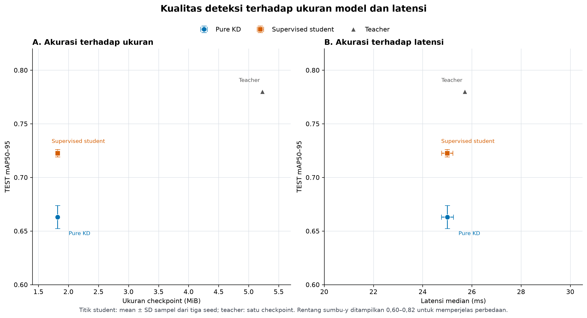

# Draf Bab IV–V: Hasil dan Pembahasan

> Draf diperbarui 30 Oktober 2026. Bagian 4.2–4.6 mempertahankan hasil tahap awal Pure KD/supervised tanggal 10 Oktober; bagian 4.8–4.10 menambahkan Hybrid, konfirmasi S2, dan status OP3/T42. Angka dapat ditelusuri ke [`thesis_analysis_final_corrected/`](artifacts/thesis_analysis_final_corrected/), manifest TEST, dan benchmark yang ditautkan di bawah. Sesuaikan penomoran tabel, gaya sitasi, dan istilah dengan pedoman program studi serta arahan pembimbing.

## BAB IV — HASIL DAN PEMBAHASAN

### 4.1 Audit dataset dan protokol evaluasi

Dataset Advance Vision yang digunakan adalah export Roboflow v1 dengan split resmi level-gambar. Split TRAIN berisi 4.600 gambar dan 6.143 anotasi, VAL 1.213 gambar dan 1.525 anotasi, sedangkan TEST 592 gambar dan 734 anotasi. Distribusi objek TEST adalah 83 `ball`, 532 `gawang`, dan 119 `robot`; terdapat satu gambar TEST tanpa anotasi. Audit menemukan pasangan label untuk seluruh gambar, tidak menemukan label orphan atau baris anotasi invalid, dan fingerprint SHA-256 mengunci file gambar serta label yang dipakai.

Nama sumber yang sama dan kemiripan adegan ditemukan lintas split setelah suffix export Roboflow dihilangkan. Oleh sebab itu, hasil di bab ini hanya ditafsirkan sebagai kinerja pada split resmi level-gambar. Hasil tidak membuktikan generalisasi ke sesi, video, atau adegan yang sama sekali baru. Rincian distribusi dan batas audit tercantum dalam [`AUDIT_DATASET_SKRIPSI.md`](AUDIT_DATASET_SKRIPSI.md).

Metrik utama adalah mAP50–95. AP dihitung dengan confidence floor 0,001; precision, recall, dan F1 memakai confidence tetap `>0,25` serta IoU pencocokan 0,50. NMS memakai IoU 0,7. Parameter ini ditetapkan sebelum evaluasi TEST. Evaluasi menggunakan FP32, resolusi 640, batch 16, tanpa augmentasi pada NVIDIA L40. Interval bootstrap 95% memakai 1.000 replikasi gambar dengan pengembalian dan seed 20261009. Interval tersebut bersyarat pada checkpoint yang diuji dan tidak menangkap variasi akibat training ulang.

### 4.2 Pelaksanaan training dan pemilihan checkpoint

Pada tahap awal, enam student diselesaikan dengan seed berpasangan 42, 1337, dan 2025. Ketiga seed pure KD menggunakan objective teacher-only: fitur P3/P4/P5, logit regresi box teacher, dan target lunak kelas teacher dengan bobot 1:1:1 serta temperatur 2. Label TRAIN tidak digunakan dalam loss KD. Baseline supervised memakai arsitektur student yang sama dalam run terpisah dan menggunakan label TRAIN. Seluruh run menyatakan `test_split_used=false`; checkpoint `best.pt` masing-masing dipilih berdasarkan VAL.

Resep bersama memakai AdamW, maksimum 100 epoch, batch 16, ukuran gambar 640, learning rate awal 0,001, warm-up 3 epoch, weight decay 0,0005, `close_mosaic=10`, FP32, dan patience 30. Manifest lima dari enam run merekam NVIDIA L40 dan runtime secara terstruktur. Manifest supervised seed 42 merupakan pengecualian legacy: run telah dimulai sebelum pencatatan metadata runtime dan hash awal konfigurasi diperluas; keterbatasan ini tidak ditutup dengan hash retrospektif.

Supervised seed 1337 sempat terhenti saat validasi, lalu dilanjutkan dari `last.pt` dengan optimizer dan EMA yang tersimpan. Manifest mencatat hash checkpoint resume dan durasi kedua segmen. Karena itu, `args.yaml` akhirnya menunjuk ke `last.pt` sebagai input resume, sedangkan `best.pt` yang dievaluasi tetap dipilih melalui VAL. Selain field `model` yang menunjuk ke checkpoint resume, 28 pengaturan training bersama yang diperiksa cocok dengan KD seed 1337; run ini tetap dilaporkan dalam analisis berpasangan.

| Metode | Seed | VAL mAP50–95 | TEST mAP50–95 | Status penggunaan label TRAIN dalam loss |
| --- | ---: | ---: | ---: | --- |
| Pure KD | 42 | 0,6825 | 0,6744 | Tidak |
| Pure KD | 1337 | 0,6757 | 0,6531 | Tidak |
| Pure KD | 2025 | 0,6789 | 0,6616 | Tidak |
| Supervised student | 42 | 0,7189 | 0,7203 | Ya, pada run kontrol terpisah |
| Supervised student | 1337 | 0,7181 | 0,7265 | Ya, pada run kontrol terpisah |
| Supervised student | 2025 | 0,7252 | 0,7208 | Ya, pada run kontrol terpisah |

### 4.3 Hasil TEST tiap model

Tabel berikut menampilkan metrik keseluruhan dan interval bootstrap 95% untuk mAP50–95. Nilai precision, recall, dan F1 merupakan macro-average tiga kelas pada operating point yang dikunci.

| Model | P | R | F1 | mAP50 | mAP50–95 (IK bootstrap 95%) |
| --- | ---: | ---: | ---: | ---: | ---: |
| Pure KD, seed 42 | 0,7451 | 0,9613 | 0,8395 | 0,9481 | 0,6744 (0,6553–0,7005) |
| Pure KD, seed 1337 | 0,7404 | 0,9632 | 0,8372 | 0,9403 | 0,6531 (0,6343–0,6834) |
| Pure KD, seed 2025 | 0,7787 | 0,9648 | 0,8618 | 0,9455 | 0,6616 (0,6362–0,6916) |
| Supervised student, seed 42 | 0,8573 | 0,9685 | 0,9095 | 0,9585 | 0,7203 (0,7044–0,7429) |
| Supervised student, seed 1337 | 0,8632 | 0,9673 | 0,9123 | 0,9578 | 0,7265 (0,7081–0,7493) |
| Supervised student, seed 2025 | 0,8622 | 0,9738 | 0,9146 | 0,9639 | 0,7208 (0,7026–0,7433) |
| Teacher FP32 | 0,8915 | 0,9697 | 0,9290 | 0,9642 | 0,7800 (0,7623–0,7974) |

Rincian per kelas dan interval metrik lainnya tersedia di [`per_model.csv`](artifacts/thesis_analysis_final_corrected/per_model.csv); manifest sumber adalah [`manifest.json`](runs/final_test/pure_kd_official_split_locked_retry1/manifest.json). Teacher telah memiliki evaluasi TEST historis setelah pemilihan checkpoint pada studi sumber. Bukti itu dicantumkan sebagai provenance, bukan dipakai memilih checkpoint student.

### 4.4 Perbandingan antar-seed dan hipotesis

| Metode | mAP50–95 | mAP50 | Precision | Recall | F1 |
| --- | ---: | ---: | ---: | ---: | ---: |
| Pure KD, mean ± SD sampel (n=3) | 0,6630 ± 0,0108 | 0,9446 ± 0,0040 | 0,7547 ± 0,0209 | 0,9631 ± 0,0017 | 0,8462 ± 0,0136 |
| Supervised student, mean ± SD sampel (n=3) | 0,7225 ± 0,0035 | 0,9601 ± 0,0034 | 0,8609 ± 0,0032 | 0,9699 ± 0,0035 | 0,9121 ± 0,0026 |
| Teacher FP32 (n=1) | 0,7800 | 0,9642 | 0,8915 | 0,9697 | 0,9290 |

Selisih berpasangan pure KD dikurangi supervised pada mAP50–95 adalah −0,0595 ± 0,0138. Selisih untuk mAP50 adalah −0,0154 ± 0,0044, precision −0,1062 ± 0,0203, recall −0,0068 ± 0,0025, dan F1 −0,0660 ± 0,0116. Nilai tersebut adalah mean dan SD sampel dari tiga pasangan seed; tidak dilakukan uji signifikansi formal. Dengan hasil ini, hipotesis kerja bahwa pure KD akan mengungguli supervised student pada mAP50–95 **tidak didukung** oleh eksperimen.

Recall KD relatif dekat dengan supervised, tetapi precision dan mAP KD lebih rendah. Karena ambang confidence ditetapkan sama sebelum TEST, perbedaan ini tidak dikoreksi melalui threshold tuning. Hasil menunjukkan bahwa pada resep dan dataset ini, kesamaan ukuran model tidak membuat objective teacher-only menyamai baseline supervised.

### 4.5 Trade-off kompresi dan inferensi

Jumlah parameter berikut adalah hitungan checkpoint sebelum predictor melakukan fusi Conv-BN. Jumlah student dicocokkan dengan manifest training. Validator TEST juga mencatat jumlah pascafusi, tetapi angka itu disimpan terpisah dan tidak dipakai dalam rasio kompresi.

| Metode | Parameter | Ukuran checkpoint (MiB) | GFLOPs | Latensi median (ms) | Latensi p95 (ms) | Throughput (gambar/s) |
| --- | ---: | ---: | ---: | ---: | ---: | ---: |
| Pure KD, mean ± SD (n=3) | 810.649 ± 0 | 1,8191 ± 0,00004 | 2,4291 ± 0 | 25,0065 ± 0,2463 | 27,2915 ± 1,9972 | 40,8113 ± 1,3282 |
| Supervised student, mean ± SD (n=3) | 810.649 ± 0 | 1,8210 ± 0,00004 | 2,4291 ± 0 | 24,9993 ± 0,2286 | 27,7765 ± 2,2900 | 40,8819 ± 0,3317 |
| Teacher FP32 | 2.590.425 | 5,2279 | 6,5017 | 25,7160 | 28,6861 | 39,6020 |

Dibandingkan teacher, student KD mempunyai 68,71% lebih sedikit parameter, checkpoint 65,20% lebih kecil, dan FLOPs 62,64% lebih rendah. Rata-rata mAP50–95 KD adalah 85,01% dari teacher. Mean latensi median student KD adalah 25,01 ms, dibanding 25,72 ms untuk teacher pada benchmark ini. Pengukuran dilakukan pada satu frame VAL yang dimuat ke memori, batch 1, FP32, 30 warm-up, dan 200 iterasi; latensi mencakup preprocessing, inferensi, dan NMS. Perbedaan latensi yang kecil tidak membuktikan peningkatan nyata pada platform lain. Lihat [`pure_kd_final_inference.json`](runs/benchmarks/pure_kd_final_inference.json) untuk seluruh sampel dan metadata.

Pengurangan parameter dan FLOPs tersebut berasal dari pemakaian arsitektur student yang lebih kecil. Student supervised memakai arsitektur yang sama dan memiliki jumlah parameter serta GFLOPs yang identik; ukuran checkpoint dan latensinya juga sangat dekat dengan student KD. Karena itu, hasil ini menunjukkan kompresi arsitektur student relatif terhadap teacher, bukan keuntungan kompresi khusus yang dihasilkan objective KD.

**Gambar 4.1.** Trade-off kualitas deteksi terhadap ukuran checkpoint dan latensi. Error bar menunjukkan simpangan baku sampel student pada tiga seed; teacher tidak memiliki estimasi variasi antar-seed. Rentang sumbu-y sengaja dibatasi pada 0,60–0,82. Versi [PDF](artifacts/thesis_analysis_final_corrected/figures/figure_4_1_model_tradeoff.pdf) dan skrip pembuat gambar tersedia untuk reproduksi.

### 4.6 Hasil per kelas

Angka pada kolom student adalah mean ± SD sampel dari tiga seed; teacher hanya memiliki satu checkpoint.

| Kelas | KD mAP50 | Supervised mAP50 | Teacher mAP50 |
| --- | ---: | ---: | ---: |
| `ball` | 0,9560 ± 0,0084 | 0,9760 ± 0,0046 | 0,9848 |
| `gawang` | 0,9139 ± 0,0034 | 0,9266 ± 0,0086 | 0,9234 |
| `robot` | 0,9640 ± 0,0060 | 0,9776 ± 0,0047 | 0,9846 |

| Kelas | KD mAP50–95 | Supervised mAP50–95 | Teacher mAP50–95 |
| --- | ---: | ---: | ---: |
| `ball` | 0,7302 ± 0,0190 | 0,8241 ± 0,0040 | 0,9131 |
| `gawang` | 0,5382 ± 0,0041 | 0,5486 ± 0,0004 | 0,5684 |
| `robot` | 0,7207 ± 0,0151 | 0,7949 ± 0,0062 | 0,8585 |

| Kelas | KD recall | Supervised recall | Teacher recall |
| --- | ---: | ---: | ---: |
| `ball` | 0,9639 ± 0,0000 | 0,9679 ± 0,0070 | 0,9880 |
| `gawang` | 0,9311 ± 0,0029 | 0,9417 ± 0,0038 | 0,9380 |
| `robot` | 0,9944 ± 0,0049 | 1,0000 ± 0,0000 | 0,9832 |

Selisih berikut dihitung per seed sebagai KD dikurangi supervised, lalu diringkas sebagai mean ± SD sampel dari tiga pasangan.

| Kelas | Δ mAP50 | Δ mAP50–95 | Δ recall |
| --- | ---: | ---: | ---: |
| `ball` | −0,0200 ± 0,0053 | −0,0939 ± 0,0218 | −0,0040 ± 0,0070 |
| `gawang` | −0,0128 ± 0,0120 | −0,0104 ± 0,0042 | −0,0107 ± 0,0060 |
| `robot` | −0,0136 ± 0,0022 | −0,0742 ± 0,0214 | −0,0056 ± 0,0049 |

Gap mAP50–95 pure KD terhadap teacher paling besar untuk `ball` (−0,1828) dan `robot` (−0,1378), sedangkan `gawang` memiliki gap lebih kecil (−0,0302) tetapi nilai absolut mAP50–95 terendah. Dibanding supervised student, selisih mAP50–95 KD paling besar untuk `ball`, lalu `robot`; recall kedua student relatif berdekatan, khususnya pada `ball` dan `robot`. Hasil perlu dibaca bersama distribusi TEST yang tidak seimbang (83 objek `ball`, 532 `gawang`, dan 119 `robot`) serta jumlah gambar yang terbatas. Interval bootstrap per kelas dan seluruh metrik lain tersedia di [`per_model.csv`](artifacts/thesis_analysis_final_corrected/per_model.csv), sedangkan paired deltas tersedia di [`paired_summary.csv`](artifacts/thesis_analysis_final_corrected/paired_summary.csv).

### 4.7 Batas interpretasi dan catatan reproduksibilitas

Split Roboflow yang dipilih tidak membuktikan pemisahan sumber video atau adegan. Versi TRAIN/VAL yang dipakai saat teacher lama dilatih tidak tercatat lengkap, sehingga kesamaan byte data teacher dengan export studi ini tidak dapat diverifikasi. Hasil antar-seed hanya memakai tiga pasangan; interval bootstrap gambar tidak menggantikan variasi training. Benchmark latency juga hanya mengukur NVIDIA L40 dan satu frame VAL.

Keterlacakan training memiliki dua pengecualian. Pada supervised seed 42, hash YAML dan metadata runtime tidak direkam saat run dimulai; fingerprint data prarun serta `args.yaml` diperiksa dan data di-hash ulang ketika provenance ditautkan, tetapi identitas byte YAML pada awal training tidak dapat dibuktikan. Pada KD seed 42, snapshot `distill_model.py` dibuat pascarun; hash-nya sama dengan snapshot yang direkam saat run untuk seed 1337 dan 2025, tetapi bytes yang dimuat pada seed 42 tidak memiliki hash run-time. Karena itu, kesetaraan implementasi untuk seed 42 didukung oleh snapshot dan timestamp sumber, namun tidak diverifikasi setingkat run-time. Rincian hash dan batas provenance tercatat dalam manifest serta [`PROTOKOL_EKSPERIMEN_SKRIPSI.md`](PROTOKOL_EKSPERIMEN_SKRIPSI.md).

Evaluasi TEST sempat memiliki satu percobaan harness yang gagal pada batch pertama karena validator mencoba menghitung loss dan mengharapkan atribut hyperparameter training pada objek model. Percobaan itu memindai label TEST tetapi tidak menghasilkan metrik model; manifest kegagalannya disimpan di [`runs/final_test/pure_kd_official_split_locked/manifest.json`](runs/final_test/pure_kd_official_split_locked/manifest.json). Evaluator kemudian diperbaiki agar berjalan dalam mode inferensi saja, dan run final memakai direktori baru serta mencatat hash manifest percobaan terdahulu dalam `retry_context`. Tidak ada checkpoint, objective, threshold, atau hyperparameter yang dipilih ulang berdasarkan percobaan gagal tersebut.

Tabel analisis final yang sudah mengoreksi sumber hitungan parameter tersedia di [`artifacts/thesis_analysis_final_corrected/`](artifacts/thesis_analysis_final_corrected/). Seluruh file di folder itu terdaftar dengan SHA-256 pada `analysis_manifest.json`. Folder [`artifacts/thesis_analysis_final/`](artifacts/thesis_analysis_final/) adalah keluaran analisis pertama sebelum audit hitungan parameter dan sebaiknya tidak dipakai untuk tabel final.

### 4.8 Hasil utama Hybrid full dan konfirmasi S2

Hybrid full menggabungkan loss deteksi berlabel dengan distilasi fitur, box, dan kelas. Tiga seed memakai arsitektur student yang sama dengan kontrol supervised. Pada VAL, mAP50–95 Hybrid full adalah 0,7505 ± 0,0018, dibanding supervised 0,7208 ± 0,0041 ([T28](analisis_performa/tabel/T28_selisih_kd_hybrid_val.md)).

Pada TEST resmi, Hybrid full memperoleh mAP50–95 0,7469 ± 0,0022 dibanding supervised 0,7225 ± 0,0035; selisih berpasangan +0,0244 ± 0,0040. F1@0,25 Hybrid 0,9071 ± 0,0017 sedikit lebih rendah daripada supervised 0,9121 ± 0,0026 ([T30](analisis_performa/tabel/T30_kd_hybrid_test_berpasangan.md)). Kenaikan mAP tidak berarti semua metrik membaik. TEST sudah digunakan pada tahap sebelumnya; hasil ini bukan evaluasi pada holdout baru dan tiga seed tidak mendukung klaim signifikansi kuat.

Penyaringan S1–S8 selesai (T40). Konfirmasi S2 tiga seed menghasilkan VAL mAP50–95 0,7475 ± 0,0013 dan F1@0,25 0,9251 ± 0,0024. Penurunan mAP sekitar 0,0030 dan kenaikan F1 sekitar 0,0046 gagal batas penggantian yang ditetapkan sebelum training ([T41](analisis_performa/tabel/T41_konfirmasi_hybrid_v2_val.md)). Hybrid full tetap model utama; seed 1337 dipilih dari VAL untuk OP3 sesuai D16.

### 4.9 Bukti OP3 dan pekerjaan yang masih diperlukan

Uji live Hybrid sudah tercatat pada percobaan 27. Evaluasi offline eksploratif [T34](analisis_performa/tabel/T34_akurasi_op3_hybrid_supervised_seed1337.md) membandingkan Hybrid dan supervised seed 1337 pada 260 frame identik: mAP50–95 0,4885 versus 0,4414, F1 makro 0,5121 versus 0,6054, dan frame negatif dengan false positive 21/60 versus 0/60. Label berawal dari draf Pure KD sebelum tinjauan manusia; pengambilan berasal dari satu rangkaian sesi. Temuan ini terbatas pada set tersebut dan tidak digunakan memilih ulang model atau ambang.

T36/T37 belum tersedia. Uji live setara empat model, dua kondisi, tiga ulangan akan menjawab latensi/FPS serta CPU/RAM pada OP3. Set akurasi baru memerlukan sampling dan aturan anotasi yang dibekukan, tinjauan setiap frame, serta hash frame/label sebelum evaluasi. Angka L40 tidak menggantikan pengukuran OP3.

### 4.10 Status ablasi kapasitas teacher T42

Teacher YOLO11n T42 selesai 100 epoch dengan durasi manifest 8.145,535 detik; VAL mAP50–95 0,7760286 dan F1@0,25 0,9355309. Manifest privat dan hasil VAL telah diperiksa. Kelanjutan teacher YOLO11s dan enam student dimulai sebagai antrean pada 30 Oktober 2026. Tabel akhir belum tersedia, sehingga belum ada kesimpulan pengaruh ukuran teacher. Protokol ini memakai TRAIN/VAL saja dan tidak mengganti model OP3.

## BAB V — KESIMPULAN DAN SARAN

### 5.1 Kesimpulan

Hybrid full merupakan model KD utama: mAP50–95 TEST meningkat terhadap supervised pada tiga seed, sedangkan F1@0,25 sedikit menurun. S2 tetap ablasi. Implementasi Hybrid pada OP3 telah memiliki bukti historis, tetapi kesimpulan runtime utama menunggu T36/T37 dan generalisasi kamera memerlukan set baru. Rincian berikut mempertahankan temuan tahap awal Pure KD.

1. Pada split resmi level-gambar Advance Vision, pure teacher-only KD menghasilkan mean TEST mAP50–95 0,6630 ± 0,0108, lebih rendah daripada teacher FP32 (0,7800) dan supervised student berarsitektur sama (0,7225 ± 0,0035). Selisih berpasangan KD–supervised adalah −0,0595 ± 0,0138. Hipotesis awal khusus Pure KD tidak didukung; hasil Hybrid berbeda seperti dijelaskan pada bagian 4.8.
2. Student yang dilatih dengan pure KD memiliki 68,71% lebih sedikit parameter, ukuran checkpoint 65,20% lebih kecil, dan FLOPs 62,64% lebih rendah daripada teacher. Pengurangan ini mencerminkan arsitektur student yang lebih kecil: baseline supervised dengan arsitektur sama memiliki parameter dan GFLOPs identik, serta ukuran checkpoint yang hampir sama. Pada benchmark NVIDIA L40, mean latensi median student KD adalah 25,01 ms, student supervised 25,00 ms, dan teacher 25,72 ms. Perbedaan tersebut terbatas pada konfigurasi host dan tidak cukup untuk menyimpulkan manfaat real-time di robot.
3. Gap mAP50–95 KD terhadap teacher paling besar pada kelas `ball` (−0,1828) dan `robot` (−0,1378). Kelas `gawang` memiliki gap −0,0302, tetapi mAP50–95 absolutnya paling rendah. Temuan ini bersifat deskriptif dan terkait distribusi serta karakteristik split yang diuji.
4. Kesimpulan dibatasi pada checkpoint, konfigurasi, dan split level-gambar yang dilaporkan. Eksperimen ini tidak membuktikan generalisasi pada adegan baru atau keunggulan inferensi pada perangkat robot.

### 5.2 Saran

1. Jika sasaran penelitian berikutnya adalah generalisasi ke adegan baru, bentuk split group-held-out berdasarkan sesi/sumber video yang dapat diverifikasi, kemudian latih ulang teacher dan seluruh student agar group TEST tidak pernah masuk ke training teacher.
2. Evaluasi metode KD lanjutan hanya dengan checkpoint dan hyperparameter yang dipilih pada VAL; gunakan TEST baru atau split baru untuk penilaian akhir setelah perubahan metode.
3. Tambah jumlah seed dan laporkan variasi antar-run dengan rancangan statistik yang ditetapkan sebelum eksperimen.
4. Ukur latency, throughput, memori, dan konsumsi daya langsung pada perangkat robot sebelum membuat klaim deployment.
