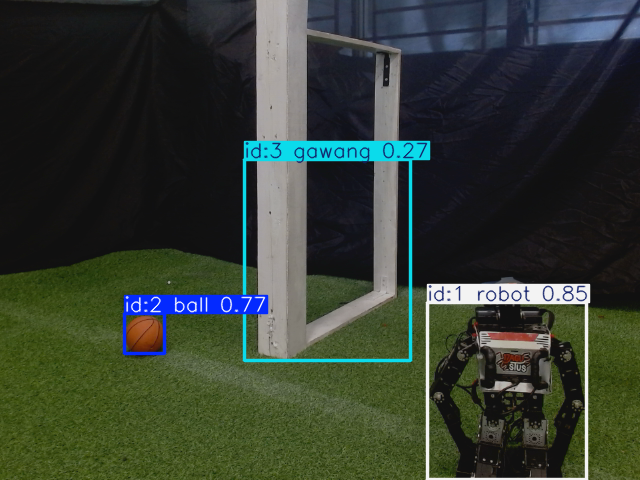

# Deteksi Objek ROBOTIS OP3 dengan YOLO11 dan Knowledge Distillation

Repositori penelitian ini membandingkan model deteksi objek untuk kamera robot humanoid **ROBOTIS OP3**. Sistem berbasis **ROS 2** mendeteksi tiga kelas: **bola (`ball`)**, **gawang**, dan **robot**. Penelitian membandingkan teacher YOLO11n dengan student YOLO11 skala **t kustom** yang dilatih secara Supervised, KD Murni, dan KD Hybrid.

Objek target pada lingkup skripsi ditempatkan statis; pengujian runtime dilakukan saat robot **diam** dan **berjalan**. Percobaan tracking yang pernah dilakukan adalah tambahan, bukan tujuan wajib penelitian.

## Progres dan langkah berikutnya

Per 12 November 2026, grafik garis runtime dari 24 run, evaluasi set frame baru [T43](dokumentasi/2026-11-12/percobaan-39-evaluasi-t43/README_ID.md), dan [draf tujuh bab](laporan/draf-7-bab/README.md) sudah selesai. Audit menemukan 18 hash PNG akurasi historis tidak cocok dengan manifest awal; [grafik reproduksi](dokumentasi/2026-11-12/grafik-akurasi-terverifikasi/README.md) memiliki manifest terpisah. Lihat [log progres](dokumentasi/2026-11-12/LOG_PROGRES_SKRIPSI.md) dan [catatan keputusan](docs/DECISIONS.md) (D18 sampai D21).

| No | Tempat | Pekerjaan | Prompt atau rujukan |
|---|---|---|---|
| 1 | Robot OP3 | Uji sensitivitas T43 secara offline: sapuan confidence pada 260 frame (bagian A), lalu peninjau kedua dan konvensi kotak alternatif pada 52 frame sampel (bagian B, butuh satu orang tambahan). Tanpa kamera, servo, atau gait. Jalankan setelah `git pull --ff-only origin main`. | [`PROMPT_T43_UJI_SENSITIVITAS_2026-11-12.md`](prompt/PROMPT_T43_UJI_SENSITIVITAS_2026-11-12.md) · D21 |
| 2 | Laptop | Menyusun slide presentasi progres untuk pembimbing. | [Log 12 November](dokumentasi/2026-11-12/LOG_PROGRES_SKRIPSI.md) |
| 3 | Laptop | Mengembangkan naskah tujuh bab (D17): sitasi, pembahasan pustaka, format kampus, nomor tabel dan gambar, tabel uji kotak hitam, dan pembahasan T43. | [Draf tujuh bab](laporan/draf-7-bab/README.md) |
| 4 | Laptop | Menyimpan cadangan bobot teacher utama dan teacher T42 di luar robot dan server, dengan verifikasi hash. | [`model_registry.yaml`](configs/model_registry.yaml) · [T42](analisis_performa/tabel/T42_ablasi_teacher_yolo11s_val.md) |

T43 dipisahkan dari T38 karena konvensi kotak berbeda, dan pra-labelnya memakai gabungan keempat model yang dievaluasi. Frame, label, dan log robot tetap lokal kecuali ada instruksi publikasi. Bobot teacher tidak masuk repo.

## Mulai dari sini

| Ingin melihat | Buka |
|---|---|
| Hasil, grafik dan dokumentasi setiap model | [Indeks empat model](dokumentasi/model/README.md) |
| Confusion matrix empat model dalam satu gambar | [Jumlah kotak](dokumentasi/model/gabungan/confusion_matrix_empat_model_jumlah_id.png) · [Persentase](dokumentasi/model/gabungan/confusion_matrix_empat_model_persen_id.png) · [Cara membaca](dokumentasi/model/gabungan/README.md) |
| Grafik akurasi, runtime dan training | [Indeks 30 grafik HD: Indonesia dan Inggris](dokumentasi/2026-11-09/visualisasi-tambahan-empat-model/README.md) |
| Contoh gambar dan video deteksi | [Empat screenshot dan video Supervised 10 detik](dokumentasi/2026-11-09/visualisasi-tambahan-empat-model/README.md#contoh-hasil-deteksi) · [Ringkasan di halaman ini](#contoh-hasil-kamera-dan-rekaman) |
| Grafik garis akurasi per epoch dan sapuan confidence | [Per model dan gabungan](dokumentasi/model/README.md) · [Kurva mAP50–95 VAL tiga metode](dokumentasi/model/gabungan/kurva_map50_95_val_per_epoch_id.png) |
| Keputusan dan progres terbaru | [Log 11 November 2026](dokumentasi/2026-11-11/LOG_PROGRES_SKRIPSI.md) · [Catatan keputusan D1–D19](docs/DECISIONS.md) |
| Draf skripsi tujuh bab | [Buka indeks Bab 1–7](laporan/draf-7-bab/README.md) |
| Evaluasi tambahan kamera T43 | [Tabel dan batas interpretasi](analisis_performa/tabel/T43_akurasi_op3_empat_model_260.md) · [Grafik dan confusion matrix](dokumentasi/2026-11-12/percobaan-39-evaluasi-t43/README_ID.md) |
| Grafik akurasi hasil reproduksi | [Grafik ID/EN dan manifest baru](dokumentasi/2026-11-12/grafik-akurasi-terverifikasi/README.md) · [Audit gambar historis](dokumentasi/2026-11-12/AUDIT_GRAFIK_AKURASI.md) |
| Grafik runtime per waktu | [Per model dan gabungan](dokumentasi/model/README.md) |
| Draf laporan Bab IV–V | [Folder draf dan arsip](laporan/draf-bab-iv-v/README.md) · [Draf terpadu terkini](laporan/draf-bab-iv-v/DRAF_TERPADU_T38_T42.md) |
| Tabel lengkap untuk penelitian | [Indeks tabel](analisis_performa/INDEKS.md) · [Indeks dokumentasi](dokumentasi/INDEKS.md) |
| Prompt untuk robot | [Grafik garis runtime](prompt/PROMPT_GRAFIK_RUNTIME_OP3_GARIS_KONTINU_2026-11-11.md) · [Evaluasi set frame baru](prompt/PROMPT_EVALUASI_SET_FRAME_BARU_OP3_2026-11-11.md) |
| Prompt audit dan penyusunan skripsi | [Audit celah](prompt/PROMPT_AUDIT_CELAH_SKRIPSI_KD_OP3_2026-11-09.md) · [Perbaikan Bab I–III dan draf lengkap](prompt/PROMPT_PERBAIKAN_BAB_1-3_DAN_LANJUTAN_SKRIPSI_KD_OP3_2026-11-09.md) · [Semua prompt](prompt/inventaris_tabel_dan_prompt.md) |

## Model yang dibandingkan

| Model | Peran | Checkpoint OP3 / sumber |
|---|---|---|
| **Teacher YOLO11n** | Model acuan dan sumber pengetahuan untuk distilasi | [Dokumentasi teacher](dokumentasi/model/teacher_yolo11n/README.md) |
| **KD Hybrid full** | Student dengan loss deteksi berlabel dan distilasi fitur, kotak, serta kelas | [Seed 1337](dokumentasi/model/kd_hybrid/README.md) |
| **Supervised** | Student berarsitektur sama yang dilatih menggunakan label tanpa distilasi | [Seed 1337](dokumentasi/model/supervised/README.md) |
| **KD Murni** | Student dengan objective *teacher-only* | [Seed 42](dokumentasi/model/kd_murni/README.md) |

Student YOLO11 skala t yang dipakai adalah **arsitektur kustom berisi 810.649 parameter**, bukan YOLO11n standar. Alias `op3_default` dalam [registry model](configs/model_registry.yaml) masih menunjuk KD Murni seed 42; kandidat Hybrid untuk OP3 ditentukan secara terpisah. Jangan mengubah alias tanpa keputusan baru.

## Alur sistem

```text
Kamera OP3 → topik gambar ROS 2 → model deteksi → kotak dan kelas objek
                                            ├── preview kamera
                                            └── catatan hasil dan runtime
```

Model berjalan pada komputer onboard robot. Deteksi menghasilkan keluaran visual dan data performa; gerakan robot diatur melalui prosedur robot yang terpisah. Petunjuk runtime dan konfigurasi tersedia di [OP3 PyTorch Runtime](OP3_PYTORCH_RUNTIME.md).

## Ringkasan hasil

### 1. Akurasi pada dataset TEST

Dataset TEST berisi **592 gambar**. Angka student merupakan rata-rata tiga seed; teacher menggunakan satu checkpoint. Hasil ini berasal dari dataset TEST, **bukan** dari kamera OP3.

| Model | mAP50 | mAP50–95 | Precision | Recall | F1 |
|---|---:|---:|---:|---:|---:|
| Teacher YOLO11n | 0,9642 | 0,7800 | 0,8915 | 0,9697 | 0,9290 |
| KD Hybrid full | 0,9583 | 0,7469 | 0,8519 | 0,9698 | 0,9071 |
| Supervised | 0,9601 | 0,7225 | 0,8609 | 0,9699 | 0,9121 |
| KD Murni | 0,9446 | 0,6630 | 0,7547 | 0,9631 | 0,8462 |

F1 pada tabel TEST dihitung dari precision dan recall makro. Sumber, standar deviasi, ambang dan hasil per seed tersedia pada [T05](analisis_performa/tabel/T05_akurasi_test_keseluruhan.md) dan [T30](analisis_performa/tabel/T30_kd_hybrid_test_berpasangan.md). TEST pernah digunakan pada tahap eksperimen sebelumnya.

### 2. Evaluasi frame kamera OP3 dan confusion matrix

[T38](analisis_performa/tabel/T38_akurasi_op3_empat_model_260.md) mengevaluasi empat checkpoint pada **260 frame yang sama**: 200 frame berobjek dan 60 frame tanpa target. Sebanyak 50 frame gawang parsial dianalisis terpisah. F1 T38 adalah **rata-rata F1 per kelas**, sehingga definisinya berbeda dari tabel TEST.

| Model OP3 | mAP50–95 | F1 makro per kelas | Frame tanpa target dengan deteksi salah |
|---|---:|---:|---:|
| Teacher | 0,5004 | 0,6829 | 2/60 |
| KD Hybrid seed 1337 | 0,4885 | 0,5121 | 21/60 |
| Supervised seed 1337 | 0,4414 | 0,6054 | 0/60 |
| KD Murni seed 42 | 0,4218 | 0,5008 | 0/60 |

[Confusion matrix per model dan gabungan](dokumentasi/model/README.md) memakai 400 kotak acuan, confidence > 0,25, NMS IoU 0,7 dan IoU pencocokan ≥ 0,5. Baris adalah label acuan dan kolom adalah prediksi; perhitungan mengutamakan pasangan sekelas sesuai T38, lalu mencatat pasangan salah kelas yang tersisa. Hasil dapat berbeda dari confusion matrix bawaan Ultralytics yang memakai aturan asosiasi lain.

Frame T38 berasal dari satu rangkaian pengambilan; label awal dibantu KD Murni sebelum ditinjau manusia. Evaluasi ini bersifat retrospektif dan mencakup frame dari sesi sebelumnya, termasuk sesi objek bergerak; jangan menganggap seluruh set T38 sebagai data khusus objek statis atau sebagai bukti generalisasi lintas adegan.

### 3. Runtime robot diam dan berjalan

Terdapat **24 run aktif**: empat model × dua kondisi × tiga ulangan. Angka berikut adalah rata-rata tiga run. Lihat [T36 per run](analisis_performa/tabel/T36_runtime_live_setara_per_run.md), [T37 ringkasan](analisis_performa/tabel/T37_runtime_live_setara_ringkasan.md), dan [audit runtime](dokumentasi/2026-11-03/percobaan-36-audit-runtime-24-run/README_ID.md).

| Model | Latensi diam (ms) | FPS diam | Latensi berjalan (ms) | FPS berjalan |
|---|---:|---:|---:|---:|
| Teacher | 96,24 | 9,88 | 95,85 | 9,87 |
| KD Hybrid | 64,70 | 13,60 | 71,47 | 12,54 |
| Supervised | 73,12 | 12,14 | 70,80 | 12,64 |
| KD Murni | 74,09 | 12,07 | 72,65 | 12,21 |

CPU dan RAM yang disajikan pada T36/T37 adalah penggunaan **proses detektor**; RSS bukan total RAM robot. Proses detektor memakai sekitar 1300% satu CPU logis pada keempat model, sehingga persentase CPU tidak membedakan efisiensi antarmodel. Tiga student berarsitektur identik; hari dan urutan run (blok 2–3 November) dapat memengaruhi selisih latensi, sehingga penyebabnya tidak dapat dipastikan. Grafik garis runtime per waktu sudah tersedia. FPS efektif tidak dihitung dengan membalik nilai latensi. Pengukuran digunakan sebagai analisis deskriptif dengan batas yang dijelaskan dalam audit.

### 4. Ablasi tambahan dan waktu training

[T42](analisis_performa/tabel/T42_ablasi_teacher_yolo11s_val.md) membandingkan dua teacher yang dilatih ulang dan enam student pada **VAL**. Teacher YOLO11n dan YOLO11s mencapai mAP50–95 0,7760 dan 0,7843, sedangkan student masing-masing 0,7482 ± 0,0003 dan 0,7473 ± 0,0003; teacher yang lebih besar tidak menaikkan student. Hasilnya tidak mengganti teacher utama atau checkpoint OP3. [Audit teacher di server](audit_teacher_t42_LTOW7Xw5.json) mencatat pemeriksaan yang dilakukan.

[T35](analisis_performa/tabel/T35_waktu_training_dan_pengujian.md) memisahkan durasi training, durasi satu sesi TEST multi-model, dan benchmark inferensi. Durasi sesi TEST bukan waktu per checkpoint; benchmark server L40 bukan FPS robot OP3.

## Contoh hasil kamera dan rekaman



*Contoh keluaran KD Hybrid pada frame setelah jendela pengukuran berjalan. Angka pada kotak adalah confidence model, bukan akurasi keseluruhan.*

| Media | Lokasi | Keterangan |
|---|---|---|
| Screenshot Teacher | [Buka](dokumentasi/2026-11-09/visualisasi-tambahan-empat-model/media/teacher_berjalan_u1_sesudah.png) | Frame setelah jendela run berjalan. |
| Screenshot KD Hybrid | [Buka](dokumentasi/2026-11-09/visualisasi-tambahan-empat-model/media/hybrid_berjalan_u3_sesudah.png) | Frame setelah jendela run berjalan. |
| Screenshot Supervised | [Buka](dokumentasi/2026-11-09/visualisasi-tambahan-empat-model/media/supervised_berjalan_u1_sesudah.png) | Frame setelah jendela run berjalan. |
| Screenshot KD Murni | [Buka](dokumentasi/2026-11-09/visualisasi-tambahan-empat-model/media/kd_murni_berjalan_u3_sesudah.png) | Frame setelah jendela run berjalan. |
| **Video deteksi Supervised, 10 detik** | [Putar atau unduh](dokumentasi/2026-11-09/visualisasi-tambahan-empat-model/media/supervised_deteksi_tracking_10detik.mp4) | Cuplikan keluaran gambar beranotasi dari sesi 22 Oktober; kondisi fisik robot `unknown`. |

Video tersebut sudah ditautkan dari [halaman model Supervised](dokumentasi/model/supervised/README.md). File video berada di folder `dokumentasi/2026-11-09/visualisasi-tambahan-empat-model/media/`, bukan disalin ke masing-masing folder model. Rekaman adalah keluaran topik gambar beranotasi, bukan rekaman layar desktop; objek dalam cuplikan relatif statis. Screenshot bukan bukti gerakan kontinu atau akurasi seluruh sesi. Sumber dan hash media ada di [manifest media](dokumentasi/2026-11-09/visualisasi-tambahan-empat-model/media/manifest_media.json).

## Arti istilah

- **mAP50 / mAP50–95:** ukuran kualitas deteksi yang mempertimbangkan ketepatan kelas dan lokasi kotak; lebih tinggi lebih baik.
- **Precision:** proporsi deteksi yang cocok dengan acuan. **Recall:** proporsi objek acuan yang berhasil ditemukan. **F1:** ringkasan precision dan recall; periksa cara agregasinya pada tiap tabel.
- **Latensi:** waktu pemrosesan dalam milidetik. **FPS:** jumlah frame per detik. CPU dan RSS pada laporan ini merujuk proses detektor.
- **Confusion matrix:** tabel label acuan dibanding prediksi. Diagonal adalah pasangan benar; baris latar memuat prediksi tanpa pasangan dan kolom terlewat memuat objek tanpa pasangan. Kesalahan kelas dihitung sebagai FP dan FN; sel latar–latar bukan *true negative*.

## Struktur folder dan file

```text
skripsi-knowlage-destilation/
├── README.md                  Gambaran, hasil, media dan peta repositori
├── dokumentasi/
│   ├── model/
│   │   ├── teacher_yolo11n/   Hasil dan confusion matrix teacher
│   │   ├── kd_hybrid/         Hasil dan confusion matrix KD Hybrid
│   │   ├── supervised/        Hasil dan confusion matrix Supervised
│   │   ├── kd_murni/          Hasil dan confusion matrix KD Murni
│   │   └── gabungan/          Matriks empat model dan CSV gabungan
│   ├── 2026-10-19 ... 11-12/  Dokumentasi percobaan berdasarkan tanggal
│   └── INDEKS.md              Daftar percobaan dan laporan
├── analisis_performa/
│   ├── tabel/                 Tabel hasil bernomor dan CSV sumber
│   ├── grafik/                Grafik analisis tambahan
│   └── lab_server/            Analisis eksperimen pada server
├── ros2_packages/             Package robot dan alat analisis yang terpisah
├── scripts/                   Script training, evaluasi, audit dan visualisasi
├── configs/                   Konfigurasi dataset, model dan eksperimen
├── models/                    Arsitektur student dan bobot yang disediakan
├── artifacts/                 Fingerprint, manifest dan ringkasan hasil
├── data/                      Dataset dan sesi lokal, sebagian tidak masuk Git
├── runs/                      Output eksperimen, sebagian hanya lokal
├── laporan/draf-7-bab/        Draf terkini Bab 1–7
├── laporan/draf-bab-iv-v/     Draf terdahulu dan arsip hasil/pembahasan
├── prompt/                    Prompt audit, proposal, laporan dan robot
├── memory/                    Catatan progres dan keputusan bertanggal
├── docs/                      Protokol, keputusan, tutorial dan audit
├── datasheet/                 Metadata dataset dan model
├── requirements/              Spesifikasi dependency
├── tests/                     Tes otomatis script umum
└── environment/, log/         Informasi environment dan log lokal/generated
```

Folder percobaan lama tetap pada lokasi semula supaya sumber dan tautannya tidak rusak. GitHub berisi tabel dan media yang dikurasi; **sebagian** data mentah kamera, label, telemetry, log, checkpoint privat dan environment hanya tersedia pada mesin tempat eksperimen dilakukan. Periksa ketersediaannya sebelum mereproduksi hasil.

## Menjalankan analisis ulang

Confusion matrix dapat dibuat ulang secara offline **jika** manifest, gambar, label tinjauan, prediksi T38, dan environment OP3 tersedia pada mesin yang digunakan. Package baru menggunakan fungsi evaluasi bersama tanpa mengubah package lama dan tidak mengaktifkan kamera atau aktuator:

```bash
PYTHONPATH=ros2_packages/op3_camera_eval:ros2_packages/op3_multi_session_eval:ros2_packages/op3_confusion_matrix \
  .venv-op3-pytorch/bin/python -m op3_confusion_matrix --output /tmp/confusion_matrix_op3_baru
```

Folder tujuan harus belum ada. Penjelasan input dan metode ada di [README package confusion matrix](ros2_packages/op3_confusion_matrix/README.md). Pengaturan runtime robot dan environment training yang sebenarnya dapat berbeda antar-mesin; lihat [runtime OP3](OP3_PYTORCH_RUNTIME.md) dan [provenance environment](environment/README.md).

## Batas interpretasi

- Hasil TEST, frame kamera OP3, runtime robot, dan ablasi T42 berasal dari konteks berbeda dan tidak boleh diperlakukan sebagai satu pengujian yang sama.
- Hasil OP3 bersifat deskriptif; beberapa kondisi fisik dan artefak sesi tidak terekam lengkap. T38 berasal dari satu rangkaian frame dan bukan pengujian independen lintas adegan.
- Asal checkpoint teacher utama terikat hash, tetapi kesamaan byte seluruh dataset training lama belum dapat dipastikan. Teacher baru pada T42 bukan teacher utama tersebut.
- Preview dan confidence memperlihatkan keluaran model; keduanya tidak menggantikan metrik dengan ground truth.

<details>
<summary>Arsip teknis Pure KD: catatan dan perintah historis</summary>

> Bagian ini dipertahankan untuk riwayat. Keterangan dan perintah di dalamnya menggambarkan tahap awal dan dapat berbeda dari status terbaru di atas. Periksa protokol terkini sebelum menjalankan perintah eksperimen.

## Catatan historis tahap Pure KD

Bagian berikut mempertahankan rincian eksperimen awal Pure KD, deployment alias lama, dan contoh perintah training. Status model utama serta instruksi sesi robot terbaru mengikuti bagian di atas. Contoh training adalah rujukan reproduksibilitas, bukan antrean yang perlu dijalankan ulang.

## Pure Teacher-Only Knowledge Distillation

This workspace evaluates a narrower YOLO11 student trained from the frozen
FP32 teacher using the Advance Vision research data and teacher checkpoint. The KD objective
uses teacher-only feature and detection-output distillation: there is no NNCF,
fake quantization, or supervised detection loss in the student update. TEST was
excluded from all student training and checkpoint selection; it was opened only
after the six student checkpoints had been locked by VAL. Training uses FP32.

## Observasi OP3 pada tahap awal Pure KD

The completed experiments below use Advance Vision data and establish the
current pure-KD checkpoints. The selected student `.pt` has been run on
ROBOTIS OP3 using PyTorch/Ultralytics on CPU. OpenVINO and QAT/INT8 are not
part of the current deployment plan. In the operator-verified servo-idle
session with a C920 camera and a reliable ROS 2 subscriber, the trial package
processed 1,501 frames and logged 4,454 detections across the three classes.
This is one runtime observation, not camera accuracy or evidence of walking
performance. Motion state is not inferred by the detector. The proposal and
planning drafts in this repo describe the completed Advance Vision study and
need revision before serving as the final OP3 thesis proposal.

The native PyTorch/Ultralytics ROS 2 camera node for the KD student is
[`scripts/op3_pytorch_detector.py`](scripts/op3_pytorch_detector.py). It reads
an operator-selected image topic and publishes detections without controlling
the robot. Runtime setup, parameters, and logging are documented in
[`OP3_PYTORCH_RUNTIME.md`](OP3_PYTORCH_RUNTIME.md). A CPU camera-inference
session and its performance charts are documented in
[`dokumentasi/README.md`](dokumentasi/README.md), including one annotated
camera frame and its detection metadata.
The node supports BoT-SORT IDs within a run and per-detection CSV logging.
Three earlier camera logs predate this tracking change and contain no track IDs.
A later trial through `ros2_packages/op3_idle_trial/` recorded all three classes
and stable IDs for relatively stationary objects in one servo-idle session.
Tracking moving objects and walking performance remain unmeasured, and the
existing frame counts are not camera accuracy evidence.
An offline smoke run on one VAL image for each class detected `ball`,
`gawang`, and `robot`; repeated frames kept a BoT-SORT ID after confirmation.
This checks the model/tracker software path only. It does not verify camera
capture or tracking while the OP3 is moving. The runtime pins `lap==0.5.12`
and exits at startup if that tracker dependency is missing.
Recorded offline smoke details are in
[`artifacts/op3_tracking_offline_smoke_20261019.json`](artifacts/op3_tracking_offline_smoke_20261019.json).
Per-run reports grouped by date and trial are indexed in
[`dokumentasi/INDEKS.md`](dokumentasi/INDEKS.md).

## Hasil tahap awal Pure KD

The six paired student runs, locked TEST evaluation, NVIDIA L40 inference
benchmark, and analysis are complete. The working hypothesis that pure KD
would beat the supervised student on TEST mAP50–95 was not supported: the means
are 0.6630 ± 0.0108 for pure KD and 0.7225 ± 0.0035 for supervised, across
three seeds. Pure KD reduced checkpoint parameters by 68.71%, checkpoint size
by 65.20%, and GFLOPs by 62.64% versus the teacher. Mean median latency was
25.01 ms for KD versus 25.72 ms for the teacher on the historical NVIDIA L40 benchmark.

Use [`DRAF_BAB_IV-V_HASIL_DAN_PEMBAHASAN.md`](DRAF_BAB_IV-V_HASIL_DAN_PEMBAHASAN.md)
for the current Indonesian results/discussion draft and
[`artifacts/thesis_analysis_final_corrected/`](artifacts/thesis_analysis_final_corrected/)
for the hash-registered tables. The corrected tables use checkpoint parameter
counts before Conv-BN fusion. The earlier analysis directory is retained as an
audit trail and should not be used for final parameter counts.
For thesis tables, start at the
[`analisis_performa` index](analisis_performa/INDEKS.md). The
[`lab/server T01–T14 index`](analisis_performa/lab_server/README.md) records
the current table status, source files, and remaining measurements; the
[`prompt inventory`](prompt/inventaris_tabel_dan_prompt.md) links the lab and
robot workflows. The [20 October repository audit](docs/AUDIT_REPO_DAN_LANGKAH_LAB_SERVER_2026-10-20.md)
summarizes current evidence and the next lab/server steps.
The [seven-checkpoint VAL diagnosis](analisis_performa/lab_server/DIAGNOSIS_VAL_2026-10-20.md)
records error categories, confidence sweeps, and the current KD improvement recommendation.
[The 20 October model and server-table status](docs/STATUS_MODEL_DAN_TABEL_SERVER_2026-10-20.md)
records the pre-pilot checkpoint count and open table work. The completed
[`pure_weighted` pilot](docs/PILOT_PURE_WEIGHTED_2026-10-20.md) and
[`T04` ablation](analisis_performa/tabel/T04_ablasi_kd_val.md) contain the newer
VAL result and decision.

## Teacher, student, and data

- Teacher: `rafli/advance_vision/artifacts/checkpoints/fp32/best.pt`.
- Student: `models/yolo11_tiny_kd.yaml`, with the YOLO11n layer topology and
  half the nano model's channel width. It starts from random initialization.
- Distillation: score-weighted feature L2 over P3/P4/P5 plus Smooth L1 box-logit
  and soft-target class-logit losses from the teacher. The teacher is frozen;
  the trainer's ground-truth detection loss is omitted, so labels do not update
  the student. This also trains the student's Detect head.
- Dataset: the existing `advance_vision_human` TRAIN and VAL image folders.
  The KD data YAML deliberately has no TEST entry.

The final student has 810,649 parameters versus 2,590,425 for the teacher.
Checkpoint size, GFLOPs, and host latency are recorded in the corrected analysis
tables and benchmark manifest. The student starts from random initialization;
the final TEST result is lower than the separate supervised control. Any future
changes must be selected on VAL and evaluated on a new locked test protocol.

## Checkpoint deployment historis dan alias default

`models/weights/kd_student_best.pt` is the selected seed-42 pure-KD checkpoint,
copied from `runs/kd/yolo11_tiny_pure_kd_v4_locked_seed42/weights/best.pt`.
Seed 42 had the highest VAL mAP50–95 among the three final KD seeds. This
checkpoint has run through a C920 ROS image topic on the OP3 host. An
[exploratory OP3 camera evaluation](analisis_performa/tabel/T27_akurasi_frame_kamera_op3.md)
now reports detection metrics on 260 human-reviewed frames, with 50 partial-goal
frames kept separate. The frames come from one day and environment, so the
final camera evaluation is still open. Live logs show observed track IDs but
do not measure tracking accuracy against temporal ground truth. For another
camera session, use the [OP3 frame and labeling prompt](prompt/PROMPT_KUMPUL_FRAME_DAN_LABEL_OP3.md).
The [OP3 camera dataset folder](data/op3_camera_eval/README.md) documents raw frames, automatic draft labels, and human-reviewed labels.
To monitor detections while capturing frames, follow the [combined OP3 camera prompt](prompt/PROMPT_MONITOR_DAN_REKAM_KAMERA_OP3_BERSAMAAN.md).

## Run

Use the Python 3.11 environment already installed in `rafli/advance_vision`:

```bash
env -u PYTHONPATH /mnt/nas-hpg9/rafli5131/rafli/advance_vision/.venv/bin/python scripts/train_kd.py
```

Edit `configs/kd.yaml` to change epochs, batch size, GPU device, or the
distillation weight. Training refuses to overwrite an existing run directory.
The initial checkpoint at `runs/kd/yolo11_tiny_pure_kd_v4/` is an exploratory
pilot: it finished before the current dataset fingerprint was captured, so the
locked TEST evaluator will reject it. The final seed-42 run uses a fresh output
directory and binds the fingerprint from the start:

```bash
env -u PYTHONPATH /mnt/nas-hpg9/rafli5131/rafli/advance_vision/.venv/bin/python scripts/train_kd.py \
  --seed 42 --run-name yolo11_tiny_pure_kd_v4_locked_seed42
```

Checkpoints, `results.csv`, and the provenance manifest are written under
`runs/kd/yolo11_tiny_pure_kd_v4_locked_seed42/` for that final seed.

## Thesis control model

For a separate supervised control using the same student architecture and
training schedule, use `configs/supervised_baseline.yaml` with
`scripts/train_supervised_baseline.py`. This run trains from the labels in
TRAIN; its loss is not combined with the pure-KD objective. VAL selects its
checkpoint, and the TEST split is not included in the training YAML. Pass
`--seed 1337` or another seed to create a distinct run directory for repeated
experiments.

## Reproduce the paired final experiment

The final run is complete. For a fresh reproduction, train supervised seed 42 first with the run name
expected by the queue. Then launch the serial queue once; it runs KD seed 42,
the remaining supervised/KD pairs for seeds 1337 and 2025, and validates each
manifest without opening TEST. Launch the final pipeline once after the queue;
it waits for queue completion, checks all six student checkpoints, evaluates
the locked TEST set once, benchmarks inference, and builds the analysis tables.
Do not launch individual jobs alongside the queue. The queue/pipeline `--resume`
flags are only for states explicitly marked failed or interrupted, after
inspecting existing artifacts.

```bash
env -u PYTHONPATH /mnt/nas-hpg9/rafli5131/rafli/advance_vision/.venv/bin/python scripts/train_supervised_baseline.py \
  --seed 42 --run-name yolo11_tiny_supervised_seed42_retry1
env -u PYTHONPATH /mnt/nas-hpg9/rafli5131/rafli/advance_vision/.venv/bin/python scripts/run_student_training_queue.py
env -u PYTHONPATH /mnt/nas-hpg9/rafli5131/rafli/advance_vision/.venv/bin/python scripts/run_locked_final_pipeline.py
```

The source split inventory, label counts, provenance gaps, and possible
cross-split scene overlap are summarized in
[`AUDIT_DATASET_SKRIPSI.md`](AUDIT_DATASET_SKRIPSI.md). Exact image/label SHA-256
records are in
[`artifacts/advance_vision_dataset_fingerprint.json`](artifacts/advance_vision_dataset_fingerprint.json).
The thesis scope and work stages are in
[`PLANNING_SKRIPSI.md`](PLANNING_SKRIPSI.md); the frozen seed, loss, metric,
checkpoint-selection, and TEST gates are in
[`PROTOKOL_EKSPERIMEN_SKRIPSI.md`](PROTOKOL_EKSPERIMEN_SKRIPSI.md).
The Indonesian and English abstract drafts using the locked final results are
in [`DRAF_ABSTRAK_SKRIPSI.md`](DRAF_ABSTRAK_SKRIPSI.md).
The initial proposal draft for Chapters I–III is in
[`DRAF_PROPOSAL_BAB_I-III.md`](DRAF_PROPOSAL_BAB_I-III.md), and the chapter map
is in [`KERANGKA_BAB_SKRIPSI.md`](KERANGKA_BAB_SKRIPSI.md).
Dataset metadata copies and their source hashes are in [`datasheet/`](datasheet/README.md), and the initial academic bibliography is in [`REFERENSI_SKRIPSI.bib`](REFERENSI_SKRIPSI.bib).
The bounded literature audit distinguishing direct teacher-only objectives from
hybrid and pseudo-label objectives is in
[`TINJAUAN_PUSTAKA_KD_DETEKSI.md`](TINJAUAN_PUSTAKA_KD_DETEKSI.md); it is not a
systematic review and does not support a “first pure KD” novelty claim.
To compare checkpoint inference speed using the same in-memory VAL image, use
`scripts/benchmark_inference.py`; its report labels the result as a server
diagnostic, not as a robot deployment benchmark.

For a fresh experiment, after every student checkpoint is complete and selected using VAL, run
`scripts/evaluate_locked_test.py` with all six best student checkpoints. It
also evaluates the teacher after verifying its source training artifact,
validation-best checkpoint hash, and historical final-TEST evidence. This
records that the teacher was evaluated on TEST previously; the student
checkpoints remain selected using VAL only. The evaluator verifies the TEST
file hashes against the dataset fingerprint, writes its label cache inside a
new output directory, and refuses to reuse an existing evaluation directory.
Do not use its TEST metrics to make further model or hyperparameter changes.
After the locked TEST manifest and speed benchmark exist, create per-model and
mean/standard-deviation tables, per-class deltas against the teacher, and
paired KD-versus-supervised differences with `scripts/build_thesis_analysis.py`;
it checks their fingerprints, records SHA-256 for every generated table/report,
and requires the teacher plus every paired seed.

The supervised seed-42 baseline is complete and its dataset provenance was
linked after training by re-hashing the full snapshot and checking the training
YAML and pre-run timestamp. Its manifest still lacks run-time hashes for the
YAML/config and structured runtime metadata; this legacy limitation is recorded
in the run manifest and results draft.

Environment provenance (the source lock snapshot and clean runtime package
freeze) is documented in [`environment/README.md`](environment/README.md).

</details>
