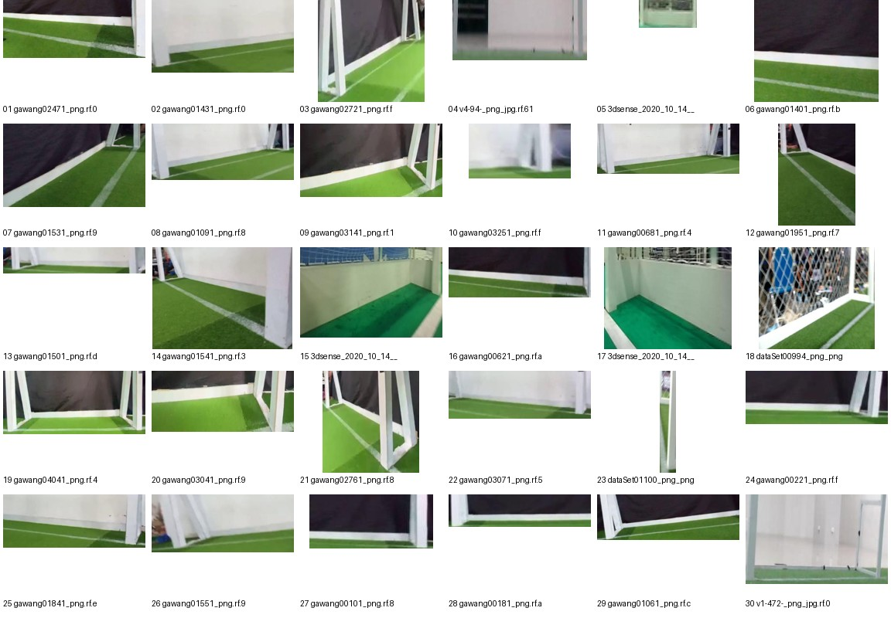

# Audit definisi kotak gawang, 2026-10-21

Sumber: `/mnt/nas-hpg9/rafli5131/bre/configs/data_train_val.yaml`; hanya split TRAIN dan VAL. Kelas: `{0: 'ball', 1: 'gawang', 2: 'robot'}`. Ukuran piksel adalah koordinat label yang dinormalkan ke kanvas 640 × 640, bukan ukuran piksel asli gambar. Jumlah kotak per gambar mencakup gambar tanpa kelas tersebut. Persentil memakai interpolasi linear pada posisi (n-1)q.

[Statistik lengkap](AUDIT_DEFINISI_GAWANG_2026-10-21.csv) memuat jumlah kotak, rerata, dan persentil 5, 25, 50, 75, 95 tiap kelas dan split.

| Split | Gambar | Kotak `gawang` | Lebar p5/p50/p95 (px pada 640) | Tinggi p5/p50/p95 (px pada 640) | Rasio tinggi/lebar p5/p50/p95 |
| --- | ---: | ---: | ---: | ---: | ---: |
| TRAIN | 4.600 | 3.662 | 84,0 / 278,0 / 601,0 | 60,5 / 153,0 / 412,0 | 0,265 / 0,555 / 1,952 |
| VAL | 1.213 | 1.048 | 100,0 / 295,0 / 624,3 | 63,5 / 147,3 / 386,0 | 0,246 / 0,505 / 1,624 |

Angka berasal dari CSV audit yang dibangun langsung dari label YOLO pada path di `configs/data_train_val.yaml`. Pada 30 potongan acak TRAIN di bawah, isi kotak terlihat beragam: ada potongan bilah bawah, tiang, dan bagian rangka yang lebih luas. Potongan saja tidak cukup untuk menetapkan satu definisi kotak yang berlaku bagi seluruh dataset; perlu melihat gambar penuh beserta panduan anotasi.

## Data OP3

[BELUM DIUKUR]. Gambar dan `labels_reviewed/` OP3 tidak ada di server. `per_frame_*.jsonl` menyimpan jumlah GT dan kotak prediksi, sedangkan `results.json` menyimpan ringkasan; keduanya tidak menyimpan koordinat GT. Setelah data disalin ke `data/op3_camera_eval/sessions/`, jalankan kembali `env -u PYTHONPATH /mnt/nas-hpg9/rafli5131/rafli/advance_vision/.venv/bin/python scripts/audit_gawang_box_geometry.py`; skrip akan memverifikasi hash manifest terlebih dahulu.

## Batas interpretasi

Lembar potongan memperlihatkan isi kotak, tetapi keputusan apakah anotasi memakai satu tiang atau seluruh rangka perlu inspeksi gambar utuh dan pedoman label. Audit ini tidak membuktikan penyebab kegagalan deteksi.
