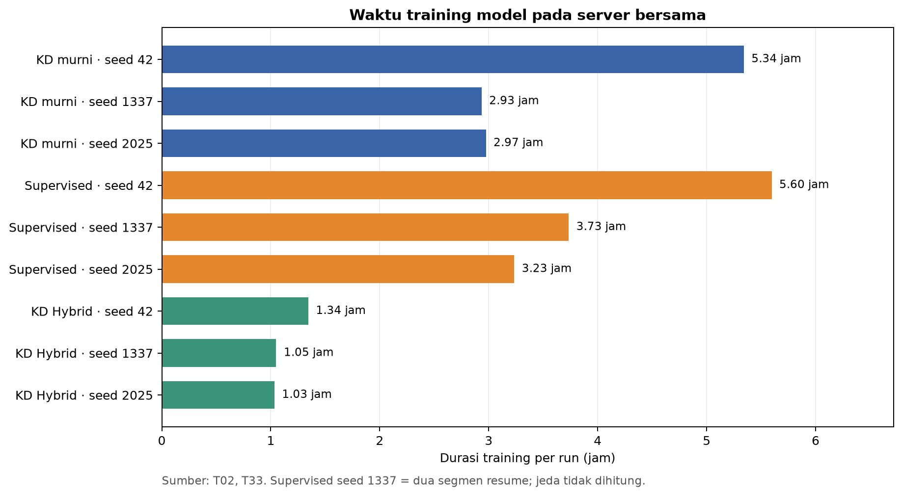
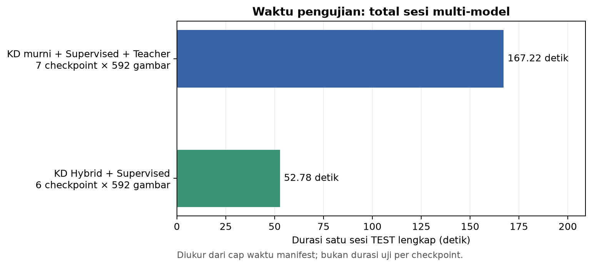

# T35. Waktu training dan pengujian model

Tabel ini memisahkan **durasi training tiap run**, **durasi satu sesi TEST multi-model**, dan **latensi inferensi per gambar**. Ketiganya memakai satuan dan cakupan yang berbeda. Sumber angka mentah dan basis pengukuran ada di [CSV T35](T35_waktu_training_dan_pengujian.csv).

## Waktu training

| Metode | Seed 42 | Seed 1337 | Seed 2025 | Sumber |
|---|---:|---:|---:|---|
| KD murni | 5,341 jam (19.228,30 s) | 2,934 jam (10.564,10 s) | 2,974 jam (10.707,10 s) | [T02](T02_resep_pelatihan.md) |
| Supervised | 5,597 jam (20.147,50 s) | 3,734 jam (13.443,34 s) | 3,234 jam (11.643,00 s) | [T02](T02_resep_pelatihan.md) |
| KD Hybrid full | 1,344 jam (4.840,09 s) | 1,050 jam (3.779,57 s) | 1,033 jam (3.719,85 s) | [T33](T33_pelatihan_kd_hybrid_full.md) |

Durasi diambil dari `time` pada epoch terakhir di `results.csv`, kecuali Supervised seed 1337 yang merupakan jumlah dua segmen training dari manifest resume; jeda interupsi tidak dihitung. Semua run menggunakan server bersama. Perbedaan waktu antar-metode **tidak otomatis** membuktikan biaya komputasi kausal karena beban server dan periode eksperimen dapat berbeda. Waktu training teacher tidak tersedia dengan provenance yang setara dan tidak diisi.

## Waktu pengujian TEST

| Sesi TEST | Jumlah checkpoint | Gambar TEST per checkpoint | Durasi sesi keseluruhan | Sumber |
|---|---:|---:|---:|---|
| Evaluasi KD murni + Supervised + Teacher, retry berhasil | 7 | 592 | 167,217 detik | [Manifest TEST KD murni](../../runs/final_test/pure_kd_official_split_locked_retry1/manifest.json) |
| Evaluasi KD Hybrid full + Supervised | 6 | 592 | 52,784 detik | [Manifest TEST Hybrid](../../runs/final_test/hybrid_full_official_split_20261022/manifest.json) |

Durasi dihitung sebagai `finished_at_utc − started_at_utc` dari manifest berstatus `complete`. Ini adalah waktu **keseluruhan pipeline evaluasi satu sesi**, termasuk beberapa checkpoint dan overhead penyiapan/pelaporan; manifest tidak mencatat durasi TEST terpisah untuk tiap model. Karena protokol, jumlah model, dan waktu pengambilan berbeda, kedua durasi sesi tidak boleh dipakai untuk menyimpulkan Hybrid menguji lebih cepat daripada KD murni.

Untuk biaya inferensi yang lebih mendekati **per gambar**, lihat [T32 benchmark frame tetap NVIDIA L40](T32_kd_hybrid_benchmark_server.md): median Hybrid seed 1337 **8,483 ms/gambar** dan Supervised seed 1337 **13,132 ms/gambar** pada **sesi benchmark yang sama**. Nilai T32 bukan durasi keseluruhan TEST, bukan FPS OP3, dan bukan latensi live kamera. Laporkan perangkat, ukuran gambar, warmup, dan jumlah iterasi sesuai sumber T32 ketika mengutipnya.

**Audit kesetaraan waktu:** benchmark KD murni terdahulu dan benchmark Hybrid kemudian mencatat pengaturan, hash frame VAL, perangkat NVIDIA L40, dan versi pustaka yang sama, tetapi **hash skrip benchmark berbeda**. Checkpoint Supervised seed 1337 yang identik menghasilkan median **25,262 ms** pada [benchmark lama](../../runs/benchmarks/pure_kd_final_inference.json) dan **13,132 ms** pada [benchmark baru](../../runs/benchmarks/hybrid_full_paired_20261022.json); seed 42 dan 2025 juga berubah dari sekitar 24,9 ms menjadi 11,7–12,3 ms. Penyebab selisih tidak dapat dipastikan dari artefak ini. Karena itu, **jangan membandingkan latensi KD murni dari benchmark lama dengan latensi Hybrid dari benchmark baru** sebagai efek metode. Perbandingan latensi intra-sesi dalam masing-masing benchmark hanya bersifat deskriptif. Untuk klaim waktu uji per model yang kuat, ulang ketiga checkpoint dalam satu sesi dengan skrip, urutan, frame, dan kondisi host yang sama.
