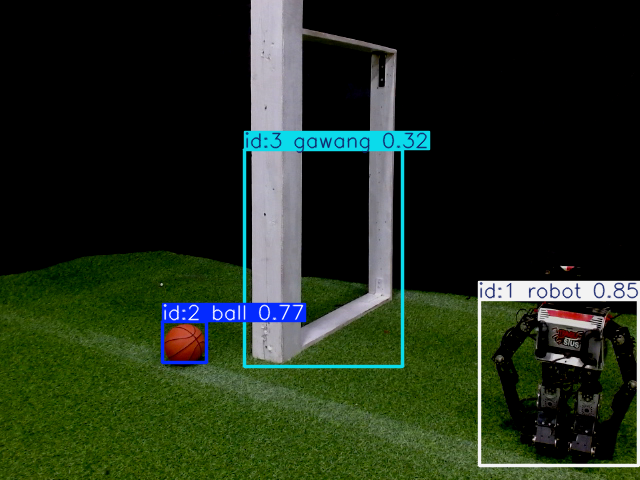

# KF-02 Mendeteksi bola, gawang, dan robot

**Kebutuhan:** keluaran sistem memuat kelas `ball`, `gawang`, dan `robot` beserta kotak
pembatasnya.

**Implementasi:** hasil deteksi diterbitkan sebagai `vision_msgs/Detection2DArray` pada
`/vision/detections` dan dicatat per kotak pada log deteksi.

**Prosedur:** ketiga objek ditata di depan robot. Untuk setiap run dihitung jumlah frame yang
memuat tiap kelas pada confidence > 0,25 dan NMS IoU 0,45 (sumber: `tabel_deteksi.csv`
setiap run).

**Kriteria lulus:** ketiga kelas muncul sebagai kotak berlabel pada setiap run.

**Hasil:** 24/24 run lulus. Cakupan frame terendah: bola
100,0%, gawang 92,5%, robot
100,0%. Rincian:
[`bukti_cakupan_kelas_24_run.csv`](bukti_cakupan_kelas_24_run.csv).

**Batas:** kemunculan kotak tidak sama dengan deteksi yang benar. Ketepatan terhadap label acuan
dinilai pada TEST (T05/T30), T38, T43, dan T44. Adegan ini sama untuk semua run, sehingga cakupan
tinggi di sini tidak menggambarkan kinerja pada adegan lain.
