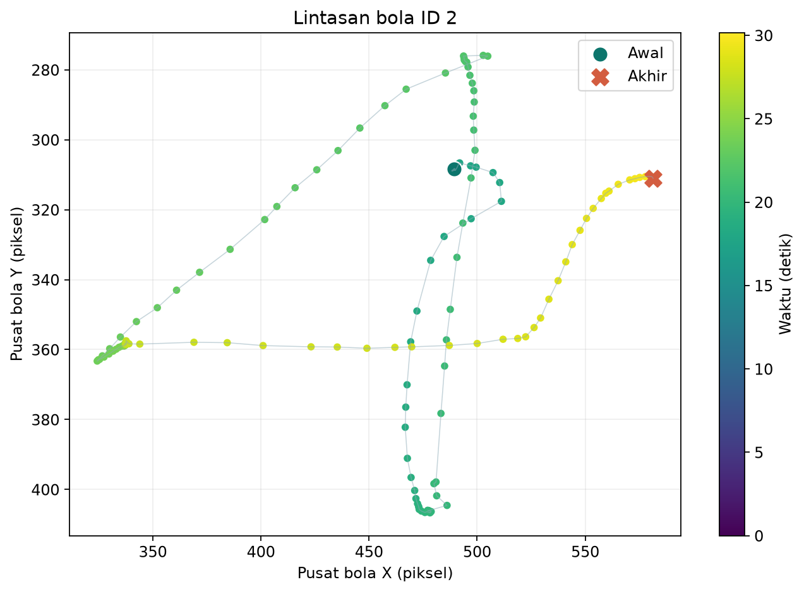
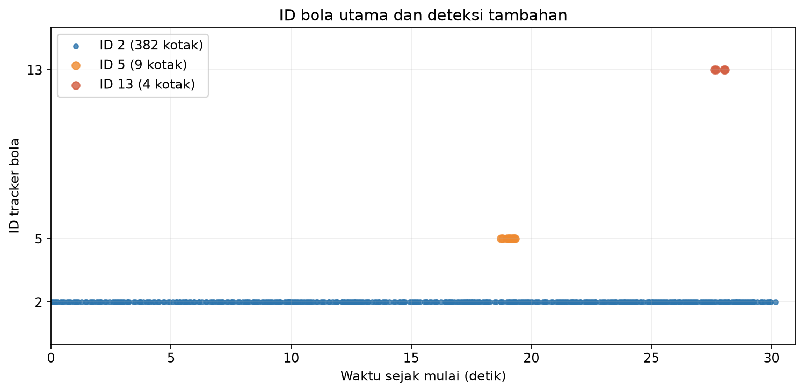

# KF-03 Menyediakan ID pelacakan pada mode tambahan

**Kebutuhan:** pada mode pelacakan, setiap objek memperoleh ID dan ID tersebut dipertahankan
ketika objek bergerak. Kebutuhan ini merupakan kemampuan tambahan, bukan tujuan wajib penelitian.

**Implementasi:** bila `enable_tracking` aktif, node memanggil `model.track` dengan konfigurasi
BoT-SORT (`botsort.yaml`, `persist=True`). ID dicatat pada kolom `track_id` log deteksi.

**Prosedur:** sesi `20261023_kd_hybrid_tracking_moving_ball_01` (percobaan 27) dengan KD Hybrid seed 1337
(SHA-256 `cd6bcb8bd931...`). Bola dipindahkan di depan kamera selama jendela
382 frame (12,63 FPS), sedangkan gawang dan robot diam. Kondisi
fisik robot tercatat `unknown`. Sumber:
[dokumentasi percobaan 27](../../dokumentasi/2026-10-23/percobaan-27-uji-ulang-kd-hybrid/03-tracking/README_ID.md).

**Kriteria lulus:** bola utama memiliki ID, dan ID yang sama muncul pada setiap frame jendela
selama bola bergerak.

**Hasil:** ID 2 muncul pada 382/382 frame. Pusat kotak
ID tersebut bergeser 257,2 px pada sumbu X dan 130,8 px pada
sumbu Y, sehingga bola memang berpindah dan ID tidak berganti. Robot memakai ID 1 pada
seluruh frame. Error frame: 0. Rincian per frame:
[`bukti_id_bola_per_frame.csv`](bukti_id_bola_per_frame.csv).

**Catatan:** pada 13 frame muncul kotak bola kedua dengan ID lain
(ID 2: 382 kotak, ID 5: 9 kotak, ID 13: 4 kotak). Kotak tambahan ini tidak menggantikan ID utama, tetapi menunjukkan adanya kotak
ganda atau deteksi palsu sesaat. Gawang memakai dua ID selama sesi (lihat dokumentasi sumber).

**Batas:** satu sesi sekitar 30 detik dengan satu model dan satu objek bergerak. Tidak ada label
acuan identitas, sehingga hasil ini tidak mengukur metrik pelacakan seperti MOTA atau IDF1.

**Log pendukung** di [`../log/`](../log/README.md): `pelacakan_percobaan_27/jendela_deteksi.csv` (ID setiap kotak per frame) dan `jendela_runtime.csv`.
