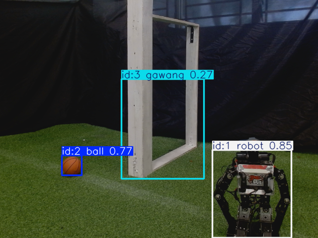

# KF-05 Menampilkan preview deteksi

**Kebutuhan:** sistem menampilkan citra beranotasi berisi kotak dan kelas hasil deteksi.

**Implementasi:** bila `publish_debug_image` aktif, node menggambar hasil dengan
`result.plot()` dan menerbitkannya pada `/vision/debug_image`. Preview ditampilkan melalui SSH-X.

**Prosedur:** tangkapan preview diambil sebelum run dan sesudah jendela ukur pada beberapa run
dari keempat model. Pemeriksaan dilakukan secara visual.

**Kriteria lulus:** kotak, nama kelas, confidence, dan ID tampak pada preview.

**Hasil:** keenam tangkapan menampilkan kotak, nama kelas, confidence, dan ID untuk bola,
gawang, dan robot.

| Berkas | Model dan kondisi |
|---|---|
| `preview_hybrid_diam_u1_sebelum_run.png` | KD Hybrid seed 1337, diam, sebelum run |
| `preview_teacher_berjalan.png` | Teacher, berjalan, sesudah jendela |
| `preview_hybrid_berjalan.png` | KD Hybrid seed 1337, berjalan, sesudah jendela |
| `preview_supervised_berjalan.png` | Supervised seed 1337, berjalan, sesudah jendela |
| `preview_kd_murni_berjalan.png` | KD murni seed 42, berjalan, sesudah jendela |
| `../KF-02_deteksi_tiga_kelas/contoh_keluaran_hybrid_diam_u1.png` | KD Hybrid seed 1337, diam, sesudah jendela |

Cuplikan video 10 detik (supervised, percobaan 22) tersedia di
[`dokumentasi/2026-11-09/visualisasi-tambahan-empat-model/media/`](../../dokumentasi/2026-11-09/visualisasi-tambahan-empat-model/media/manifest_media.json).

**Batas:** tangkapan tunggal tidak membuktikan preview bebas macet sepanjang setiap run.
Tangkapan sesudah jendela pada kondisi berjalan juga tidak membuktikan robot sedang melangkah
pada gambar tersebut.
