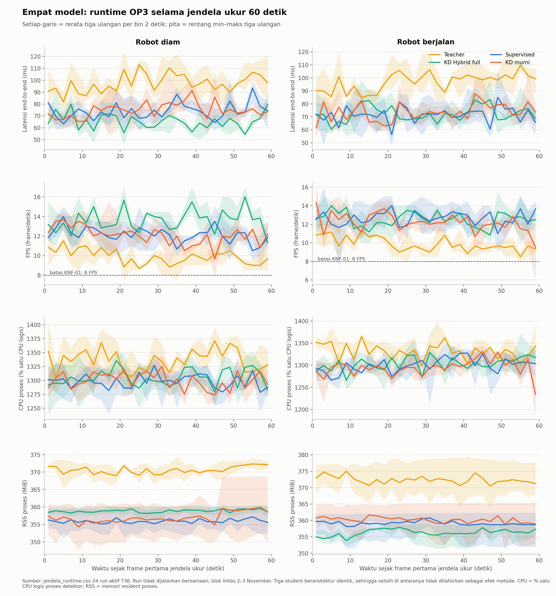

# KNF-01 Laju pemrosesan

**Kebutuhan:** FPS efektif rata-rata setiap run minimal 8 FPS pada kondisi
diam dan berjalan. KNF-01 adalah kebutuhan kinerja (Glinz, 2007).

**Prosedur:** FPS efektif dihitung sebagai (jumlah frame - 1) dibagi selang timestamp kamera
antara frame pertama dan terakhir pada jendela 60 detik. Nilai per run diambil dari
[T36](../../analisis_performa/tabel/T36_runtime_live_setara_per_run.md).

**Kriteria lulus:** FPS efektif setiap run >= 8.

**Hasil:** 24/24 run lulus. Nilai terendah 9,69 FPS pada
Teacher YOLO11n, kondisi diam, ulangan 3
(`20261102_eq_teacher_idle_u3`). Rincian: [`bukti_fps_24_run.csv`](bukti_fps_24_run.csv).

| Model | FPS run terendah | FPS run tertinggi |
|---|---:|---:|
| Teacher YOLO11n | 9,69 | 10,24 |
| KD Hybrid seed 1337 | 12,12 | 13,85 |
| Supervised seed 1337 | 11,94 | 13,23 |
| KD murni seed 42 | 12,04 | 12,38 |

**Batas:** kriteria berlaku untuk rerata per run. Pada grafik dengan bin 2 detik, FPS sesaat
dapat turun di bawah 8 tanpa membatalkan kriteria. Rerata per model pada
T37 (terendah teacher 9,87 FPS saat berjalan) adalah besaran lain dan tidak dipakai sebagai
penilaian KNF-01. Run dikumpulkan lintas hari, sehingga selisih antarmodel tidak ditafsirkan
sebagai efek metode.

**Log pendukung** di [`../log/`](../log/README.md): `run_live_24/<run_id>/jendela_runtime.csv` (`capture_stamp_ns` untuk menghitung FPS) dan `summary_metrics.json`.
