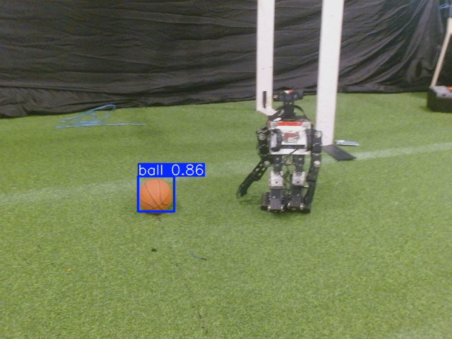
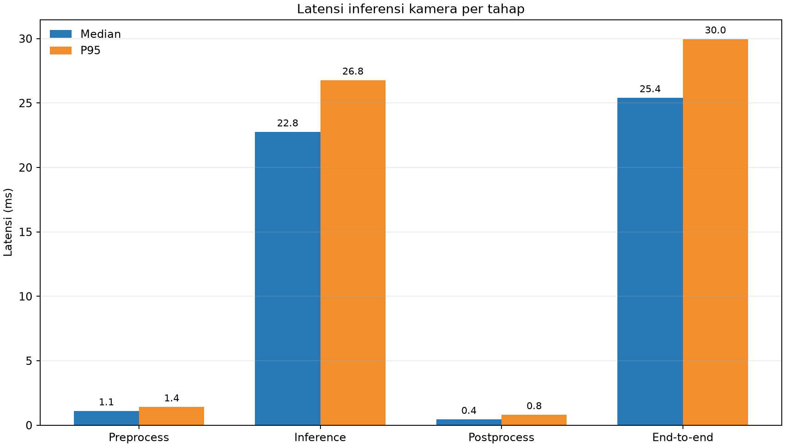
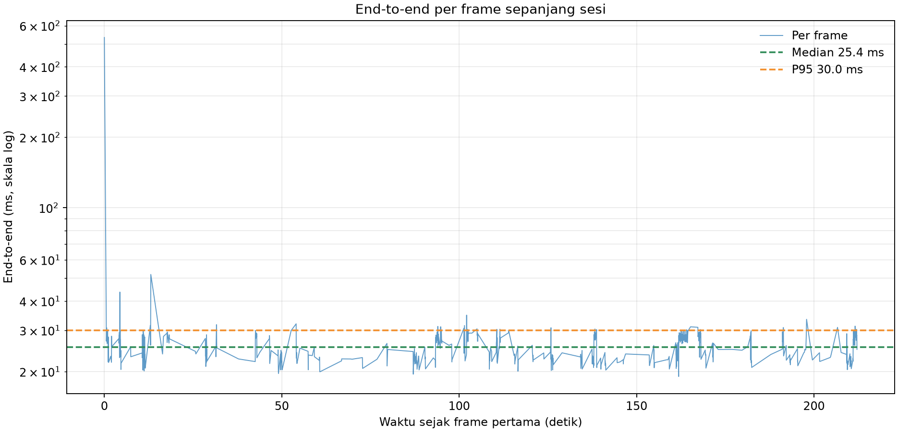
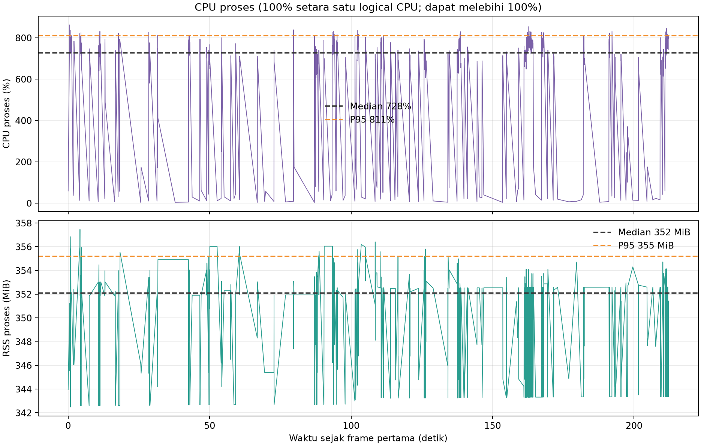
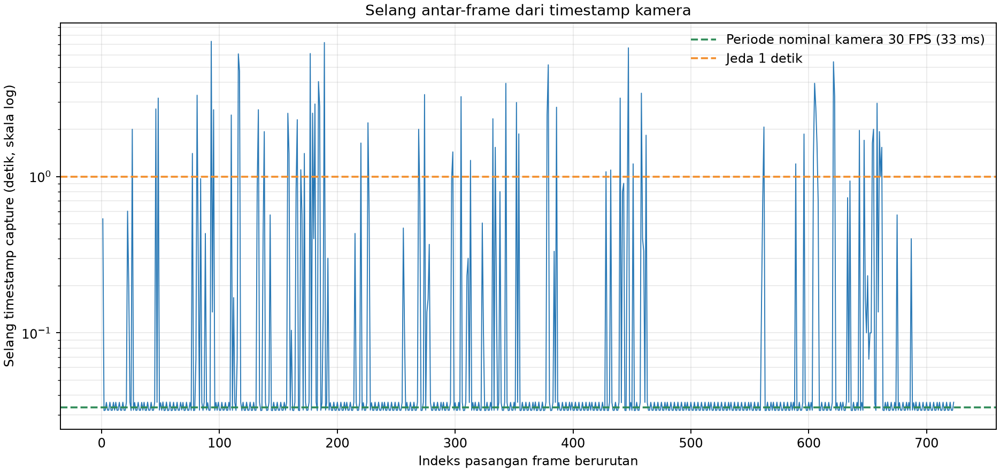

# Hasil inferensi kamera OP3

Dokumentasi ini merangkum satu sesi inferensi kamera yang benar-benar dijalankan. Grafik menunjukkan performa dan aliran frame. Satu frame beranotasi disertakan sebagai contoh visual; video dan frame mentah tidak disimpan.

## Ringkasan sesi

| Item | Nilai |
| --- | --- |
| Run ID | `20261019T080757Z` |
| Kondisi tercatat | `servo_idle` (label operator; tidak diukur otomatis) |
| Sumber label kondisi | Input operator; bukan telemetry gerak |
| Waktu mulai (UTC) | `2026-10-19T08:07:58.163176+00:00` |
| Waktu berhenti (UTC) | `2026-10-19T08:11:32.290371+00:00` |
| Durasi | 214.1 detik |
| Kamera/sumber | Logitech HD Pro Webcam C920, `/dev/video0`, ROS topic `/thesis/image_raw` |
| Mode capture | 640×480, YUYV dikonversi `yuyv2rgb`, 30 FPS diminta |
| Frame diproses | 724 |
| FPS rata-rata sesi | 3.38 |
| Error pemrosesan frame | 0 |
| Checkpoint | `kd_student_best.pt` (SHA-256 `2da0c0e58a5c1884358fe814f8992cda19bb7b58f292edc15f53b9081b6129c3`) |
| Runtime | Python 3.12.3, PyTorch 2.4.1+cpu, Ultralytics 8.4.130, CPU FP32 |
| Input model | 640×640, batch 1 |
| Threshold runtime | confidence 0.25, IoU NMS 0.45 |
| Preview | Mati; tidak menyimpan gambar/video |
| Topic output | `/vision/detections` (`vision_msgs/Detection2DArray`) |
| Mapping kelas | 0: ball, 1: gawang, 2: robot |

Log frame menunjukkan total **412 instance deteksi** yang dikeluarkan selama 724 frame. CSV hanya merekam jumlah deteksi per frame. Gambar beranotasi di bawah adalah contoh kamera terpisah dari sesi sebelumnya; timestamp, kelas, confidence, dan koordinatnya tercatat di JSON pendamping. Contoh tunggal ini dan jumlah deteksi bukan ukuran akurasi, precision, atau recall karena tidak ada frame berlabel dan ground truth.

Detail bbox dan confidence untuk contoh frame: [`contoh_deteksi_kamera.json`](../../contoh_deteksi_kamera.json).

## Performa

Latensi dihitung per frame dari CSV. P95 memakai persentil linear NumPy. End-to-end mencakup callback deteksi dan publish ROS; preview mati.

| Tahap | Median (ms) | P95 (ms) | Rata-rata (ms) | Unit |
| --- | ---: | ---: | ---: | --- |
| Preprocess | 1.11 | 1.41 | 1.11 | ms |
| Inference | 22.75 | 26.77 | 22.79 | ms |
| Postprocess/NMS | 0.44 | 0.81 | 0.52 | ms |
| End-to-end | 25.41 | 29.97 | 26.17 | ms |

CPU proses: median 728.2% dan p95 811.3%. psutil menghitung 100% sebagai satu logical CPU, sehingga nilai dapat melampaui 100% ketika beberapa thread bekerja bersamaan. RSS proses: median 352.1 MiB dan p95 355.2 MiB.

## Aliran frame dan batas hasil

Di antara timestamp capture berurutan, terdapat 62 jeda lebih dari 1 detik dan 7 jeda lebih dari 5 detik; jeda maksimum 7.32 detik. Pengamatan ini sejalan dengan peringatan kamera terputus sementara pada log node. FPS sesi karenanya menggambarkan stream yang benar-benar diterima selama sesi ini, bukan kemampuan maksimum model atau kamera dalam kondisi lain.

Node ini mendeteksi objek (`ball`, `gawang`, `robot`), bukan aksi/gerakan; ia tidak menentukan apakah robot sedang berjalan. Kondisi `servo_idle` pada run ini adalah label operator, bukan hasil telemetry otomatis. Label `servo_idle` pada run pertama tidak cocok dengan kondisi yang kemudian dilaporkan, sehingga kondisi fisik run pertama tidak dapat dipastikan. Run ini tidak mengirim perintah servo/gait. Sesi walking terkontrol belum dilakukan.

Contoh PNG di atas dibuat untuk dokumentasi atas permintaan. Grafik performa dibuat dari CSV sesi benchmark yang preview-nya mati. CSV benchmark tidak menyimpan bounding box per kelas atau frame; detail bbox di JSON hanya berlaku untuk contoh tunggal. Evaluasi akurasi memerlukan frame berlabel dan ground truth.

## Artefak sumber

- Data mentah per frame: [`20261019T080757Z.csv`](../../../runs/op3_pytorch/20261019T080757Z.csv)
- Metadata konfigurasi dan status: [`20261019T080757Z.json`](../../../runs/op3_pytorch/20261019T080757Z.json)
- Script pembuat laporan dan grafik: [`build_op3_session_documentation.py`](../../../scripts/build_op3_session_documentation.py)
