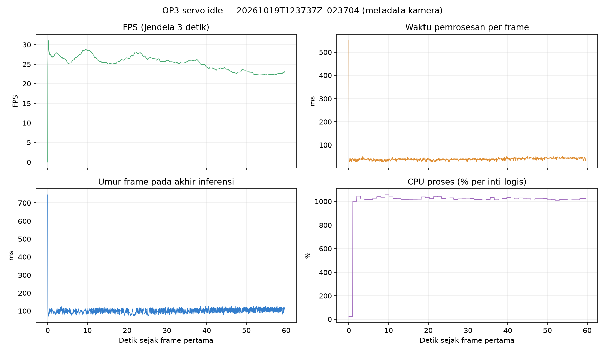

# Percobaan 04 — tracking kamera, servo idle

**Hasil:** sesi metadata 60 detik selesai (`completed`), 0 error. Kondisi `servo_idle` dikonfirmasi operator melalui percakapan; kode tidak membaca telemetri servo dan tidak memberi perintah gerak. Kamera Logitech C920 pada `/dev/video0` diterbitkan oleh `usb_cam` ke `/thesis/image_raw` (640×480, YUYV, target 30 FPS). Node uji memakai subscriber ROS `reliable`, checkpoint `kd_student_best.pt` SHA-256 `2da0c0e58a5c1884358fe814f8992cda19bb7b58f292edc15f53b9081b6129c3`, PyTorch CPU FP32, `imgsz=640`, confidence `0,25`, IoU `0,45`, dan BoT-SORT. Preview tampil lewat SSH X11. Tidak ada gambar atau video yang direkam oleh node uji.

Run valid: [`20261019T123737Z_023704`](../../../runs/op3_idle_trial/20261019T123737Z_023704/summary.json). Sumber angka: [`frames.csv`](../../../runs/op3_idle_trial/20261019T123737Z_023704/frames.csv) dan [`detections.csv`](../../../runs/op3_idle_trial/20261019T123737Z_023704/detections.csv). Jendela frame yang terukur 59,61 detik, dari frame pertama sampai terakhir. `summary.json` mencatat 1.806 frame diterima, 1.501 diproses, 304 tertimpa oleh frame yang lebih baru di antrean aplikasi (16,8% dari yang diterima), 4.454 baris deteksi, dan 0 error. Indeks 1–1.501 berurutan; jumlah deteksi per frame cocok dengan baris CSV. Publisher ROS dan node uji dihentikan sesudah percobaan.

| Metrik | Rata-rata | Median | P95 | Maksimum |
| --- | ---: | ---: | ---: | ---: |
| FPS hasil proses | 25,16 | — | — | — |
| Preprocess (ms) | 1,34 | 1,32 | 1,85 | 3,69 |
| Inferensi (ms) | 29,67 | 29,57 | 34,91 | 40,60 |
| Postprocess (ms) | 0,79 | 0,82 | 0,95 | 4,14 |
| Pemrosesan sejak worker mulai (ms) | 39,78 | 39,38 | 45,95 | 550,57 |
| Umur frame saat akhir inferensi (ms) | 100,22 | 99,70 | 117,70 | 744,80 |
| CPU proses (% dari satu inti logis) | 1.005,66 | 1.022,20 | 1.043,20 | 1.056,10 |
| RAM proses (MiB) | 380,05 | 381,70 | 386,10 | 387,90 |

`Pemrosesan` tidak mencakup waktu antrean sebelum worker maupun pengiriman gambar X11. `Umur frame` adalah beda waktu host saat hasil jadi terhadap timestamp header ROS; angka ini juga bukan latensi kamera-ke-layar. FPS dihitung dari 1.500 interval antar-frame terproses pada jendela 59,61 detik. CPU proses dapat melampaui 100% karena memakai banyak inti. P95 dihitung dari persentil empiris tiap kolom CSV. Maksimum 550,57 ms merupakan lonjakan sesaat; median/P95 lebih mewakili sebagian besar frame. Grafik menampilkan nilai per frame, termasuk lonjakan ini.



| Kelas | Frame terdeteksi | Jumlah deteksi | ID teramati | Frame tanpa deteksi | Confidence rata-rata |
| --- | ---: | ---: | --- | ---: | ---: |
| `ball` | 1.501/1.501 | 1.501 | `1` pada 1.501 deteksi | 0 | 0,979 |
| `gawang` | 1.452/1.501 | 1.452 | `3` pada 1.452 deteksi | 49 | 0,290 |
| `robot` | 1.501/1.501 | 1.501 | `2` pada 1.501 deteksi | 0 | 0,771 |

Semua baris deteksi memiliki `track_id`; untuk `gawang`, jeda terpanjang tanpa deteksi adalah 3 frame, dan ID `3` muncul kembali. Ini menunjukkan konsistensi ID **pada objek yang relatif tetap dalam adegan sesi ini**. CSV saja tidak membuktikan bahwa ID mengikuti objek bergerak atau bahwa setiap kotak tepat secara visual. Confidence `gawang` dekat ambang 0,25 dan tidak boleh disebut akurasi. Akurasi/mAP live tetap **[BELUM DIUKUR]** karena tidak ada ground truth berlabel. Kualitas visual tiap kelas pada run kedua tetap **[BELUM DIVERIFIKASI SECARA INDEPENDEN]** tanpa rekaman, meskipun preview X11 tersedia. Kondisi berjalan **[BELUM DIUKUR]**.

Setelah run valid selesai, logika status untuk penghentian dini pada paket uji dan efisiensi pembacaan CSV pada skrip analisis diperbaiki. Inferensi, threshold, tracker, dan log mentah run valid tidak diubah.

Run sebelumnya [`20261019T123540Z_fe38a8`](../../../runs/op3_idle_trial/20261019T123540Z_fe38a8/summary.json) dipertahankan sebagai **`incomplete`**: worker sempat menulis setelah CSV ditutup (`I/O operation on closed file`). Urutan shutdown pada paket uji baru diperbaiki sebelum run valid; log run pertama tidak diedit atau dicampur.

Reproduksi statistik dan grafik dari log mentah:

```bash
cd /home/humanoid/bre_skripsi
source /opt/ros/jazzy/setup.bash
source .venv-op3-pytorch/bin/activate
PYTHONPATH="$PWD/ros2_packages/op3_idle_trial:$PYTHONPATH" python -m op3_idle_trial.analyze \
  runs/op3_idle_trial/20261019T123737Z_023704 \
  /tmp/op3_trial_reanalysis
```

Kode analisis: [`ros2_packages/op3_idle_trial/op3_idle_trial/analyze.py`](../../../ros2_packages/op3_idle_trial/op3_idle_trial/analyze.py). Hasil terstruktur sesi ini: [`summary_metrics.json`](summary_metrics.json). Langkah berikutnya adalah sesi terpisah dengan objek bergerak aman di depan kamera saat robot tetap diam, untuk memeriksa apakah ID mengikuti objek sepanjang waktu; lakukan beberapa ulangan bila ingin melaporkan variasi performa. Jangan gabungkan angka ini dengan uji `walking` atau hasil TEST offline.
