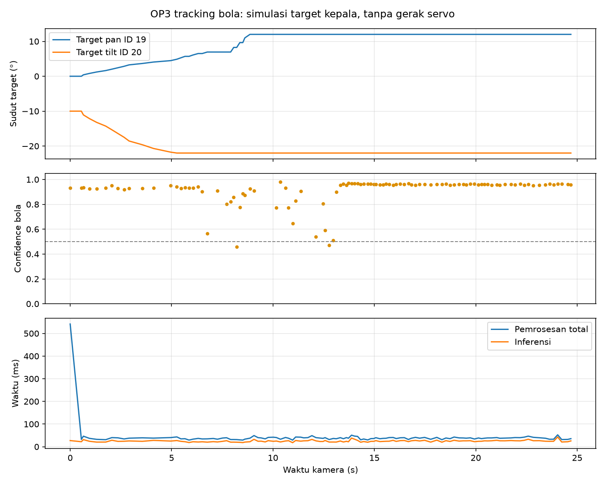
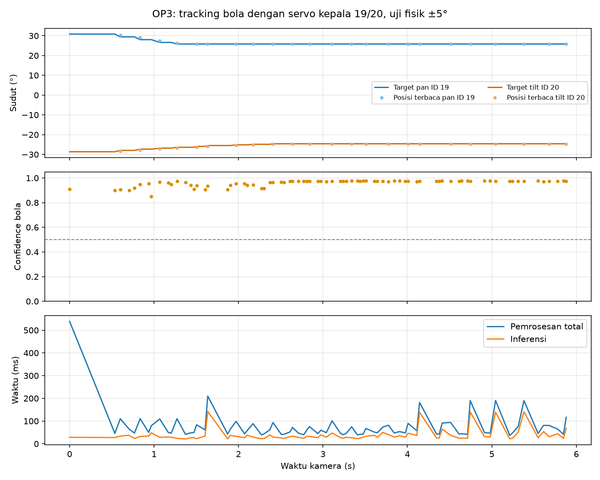

# Percobaan 05 — tracking bola dengan target servo kepala 19/20

Tanggal: 19 Oktober 2026 (UTC). Paket baru: `ros2_packages/op3_head_ball_tracking`; paket lama tidak diubah. Kamera ROS `/thesis/image_raw` aktif, model KD `op3_default` dipakai pada CPU FP32, deteksi/track bola ditampilkan melalui X11. Percobaan berlangsung bertahap: simulasi, pemeriksaan daya bus, lalu gerak fisik servo kepala.

| Metrik | Hasil |
|---|---:|
| Durasi loop | 25,08 s |
| Frame diproses | 114 (4,55 frame/s selama sesi) |
| Frame dengan bola | 103/114 (90,4%) |
| Confidence bola rata-rata saat terdeteksi | 0,910 |
| Perintah target kepala yang dihitung | 21 |
| Penulisan perangkat keras | 0 |
| Inferensi rata-rata | 24,73 ms/frame |
| Pemrosesan rata-rata | 42,15 ms/frame |
| Umur frame kamera rata-rata | 117,25 ms |
| Rentang target pan simulasi | 0° sampai +12° |
| Rentang target tilt simulasi | −22° sampai −10° |

Sumber angka: [`tracking.csv`](../../../runs/op3_head_ball_tracking/20261019T125606Z_51db57/tracking.csv) dan [`summary.json`](../../../runs/op3_head_ball_tracking/20261019T125606Z_51db57/summary.json). Angka target simulasi menggunakan posisi awal asumsi pan 0° dan tilt −10°; posisi servo nyata belum dapat dibaca. Confidence model adalah skor deteksi per frame, **bukan** akurasi ground truth atau mAP live. Grafik tidak memuat gambar kamera.

Preflight awal U2D2 berhasil membaca OpenCR ID 200, tegangan masuk 12,7 V, tetapi `dynamixel_power=0`. Ping ID 19 dan 20 (juga ID 1/18) tidak menerima status packet. Uji jalur `--enable-motion` berhenti sebelum kamera dan menghasilkan `OpenCR dynamixel_power=0; bus servo is off. No writes sent.` dengan `hardware_writes=0` pada [`summary.json` uji penolakan](../../../runs/op3_head_ball_tracking/20261019T125741Z_c2bc0b/summary.json). Setelah operator memberi izin eksplisit, daya bus OpenCR diaktifkan. Register berubah menjadi 1 dan kedua servo kepala merespons ping. Pengaktifan daya bus mencakup semua servo OP3; paket tracking tetap hanya menulis ID 19/20.

## Gerak fisik servo kepala

| Metrik | Uji 15 s, batas ±8° | Uji diagnostik 6 s, batas ±5° |
|---|---:|---:|
| Frame diproses | 49 | 79 |
| Frame dengan bola | 26 | 79 |
| Confidence bola rata-rata | 0,811 | 0,960 |
| Pembaruan target kepala | 10 | 23 |
| Penulisan perangkat keras total (termasuk persiapan/pemulihan) | 34 | 26 |
| Pemrosesan rata-rata | 62,09 ms/frame | 75,44 ms/frame |
| Umur frame rata-rata | 125,00 ms | 132,07 ms |
| CPU proses rata-rata | 329,1% | 1063,0% |
| RAM proses rata-rata | 374,3 MiB | 347,4 MiB |

Pada uji 15 s, pan terukur −1,05° sampai +6,50° dan tilt −19,78° sampai −14,33°. Ini membuktikan ID 19/20 menerima perintah dan bergerak selama pelacakan, **belum** membuktikan bola berhasil dipusatkan. Hanya 26/49 frame berisi bola; track ID berganti dari 1 ke 5 lalu 11. Pemeriksaan setelah uji menunjukkan torque kedua servo sudah mati, tetapi posisi pan telah bergeser dari posisi awal. Karena itu uji diagnostik kedua menambahkan pembacaan sebelum dan sesudah torque dimatikan. Pada uji kedua, sebelum torque mati, goal/present pan 2399/2398 count dan tilt 1722/1721 count, yaitu selisih 1 count dari posisi awal masing-masing. Setelah torque mati, posisi tetap 2398/1721 count saat pemeriksaan. Posisi kepala dapat berubah ketika torque mati, sehingga tidak dijamin tetap di posisi awal setelah uji.

Pada uji diagnostik, error horizontal bola turun dari +0,8125 ke sekitar +0,6281 ketika pan bergerak ke batas percobaan ±5°. Setelah itu error tetap sekitar +0,6281 (pusat bola 81,4% lebar gambar), sehingga kepala **belum dapat mengikuti bola sampai tengah frame**. `computed_commands=23` mencakup target berulang setelah saturasi; hanya sebagian menghasilkan penulisan baru. Baris `reason=dry_run_command` pada akhir run hardware adalah label log yang keliru saat target tidak berubah pada resolusi servo, bukan pergantian mode ke simulasi. Batas ±5° sengaja dipakai sebagai tahap awal yang hati-hati; perbaikan berikutnya memerlukan pengendali package baru yang melaporkan saturasi dengan benar dan uji target stasioner setelah robot tersedia.

Data uji fisik: [`summary.json` 15 s](../../../runs/op3_head_ball_tracking/20261019T130201Z_7ba2ef/summary.json), [`tracking.csv` 15 s](../../../runs/op3_head_ball_tracking/20261019T130201Z_7ba2ef/tracking.csv), [`summary.json` diagnostik](../../../runs/op3_head_ball_tracking/20261019T130400Z_74c464/summary.json), dan [`tracking.csv` diagnostik](../../../runs/op3_head_ball_tracking/20261019T130400Z_74c464/tracking.csv). Setelah kedua uji, torque ID 19/20 sempat dipastikan mati tanpa hardware error. Perintah mengembalikan daya bus dari 1 ke 0 berhasil dibaca balik 0, tetapi pemeriksaan berikutnya menemukan daya bus kembali 1 dan torque kepala 1. Penyebabnya tidak dapat ditentukan dari data ini; robot sedang dipakai orang lain sehingga tidak dilakukan intervensi lagi. Publisher kamera percobaan telah dihentikan. Skor confidence adalah keyakinan model per frame, bukan ukuran akurasi ground truth atau mAP live. Tidak ada gambar atau video kamera yang disimpan.
