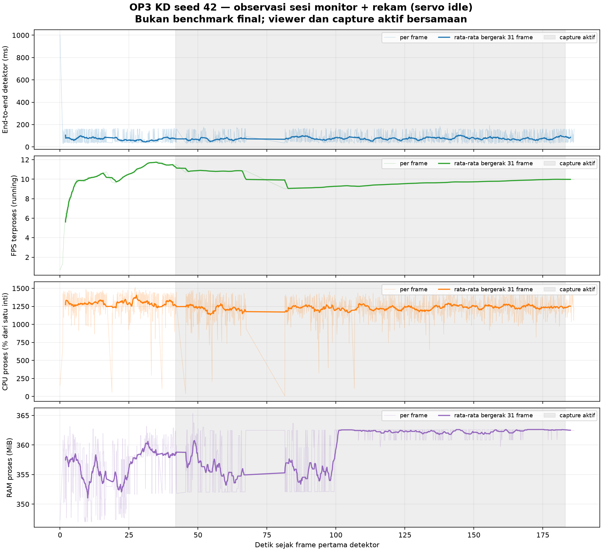
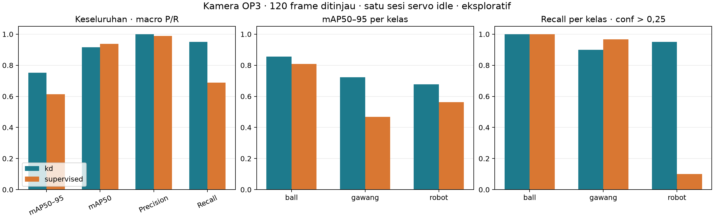
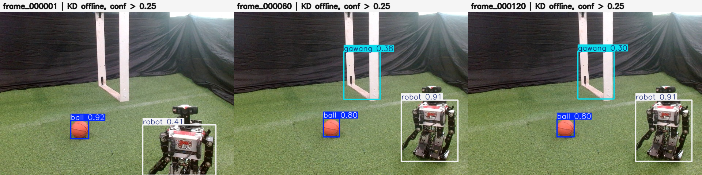

# Percobaan 01 — monitor deteksi dan rekam kamera, servo idle

**Tanggal:** 21 Oktober 2026, 12:42–12:45 WIB. **Commit runtime:** `0c14591`. Kondisi `servo_idle` dikonfirmasi operator untuk sesi ini; tidak ada telemetri servo yang dipakai untuk menyimpulkannya. Agen tidak mengirim perintah servo, gait, atau motor.

Sesi mengikuti [`PROMPT_MONITOR_DAN_REKAM_KAMERA_OP3_BERSAMAAN.md`](../../../prompt/PROMPT_MONITOR_DAN_REKAM_KAMERA_OP3_BERSAMAAN.md). Satu publisher `usb_cam` membaca Logitech C920 `/dev/video0` (640×480, target 30 FPS) dan menerbitkan `/thesis/image_raw`. Detektor KD seed 42 PyTorch FP32 dan perekam frame mentah berlangganan topic itu. Viewer SSH X11 menampilkan `/vision/debug_image` dari detektor, tanpa inferensi kedua. Jendela viewer terkonfirmasi terbuka, tetapi tidak ada rekaman layar yang disimpan. Semua proses live dihentikan setelah sesi.

Checkpoint `models/weights/kd_student_best.pt` memiliki SHA-256 `2da0c0e58a5c1884358fe814f8992cda19bb7b58f292edc15f53b9081b6129c3`, sesuai alias `op3_default`. Parameter detektor: `imgsz=640`, confidence `0,25`, IoU `0,45`, BoT-SORT, log per deteksi aktif. `run_id=20261021_idle_01_live`; `session_id=20261021_idle_01`.

| Hasil sesi | Nilai | Sumber |
| --- | ---: | --- |
| Frame diproses detektor | 1.866; 0 error frame | [Metadata detektor](../../../runs/op3_pytorch/20261021_idle_01_live.json) |
| Frame mentah tersimpan | 120/120; status `max_frames_reached` | [Manifest capture](../../../data/op3_camera_eval/sessions/20261021_idle_01/capture_manifest.json) |
| Label otomatis draf | 120 file YOLO; 0 frame tanpa prediksi | [Manifest pra-label](../../../data/op3_camera_eval/sessions/20261021_idle_01/labels_auto/prelabel_manifest.json) |
| FPS proses rata-rata selama sesi gabungan | 9,98 | Metadata detektor; **bukan benchmark final** |
| End-to-end detektor median / P95 | 48,05 / 160,95 ms | [CSV frame](../../../runs/op3_pytorch/20261021_idle_01_live.csv) |
| CPU proses median / RAM proses median | 1.250,8% dari satu inti / 361,61 MiB | CSV frame; CPU dapat melebihi 100% karena banyak inti |

Grafik menggambarkan nilai per frame dan rata-rata bergerak 31 frame. Area abu-abu adalah interval capture aktif. Proses kamera, viewer, dan perekam menambah beban; angka di atas hanya untuk pemeriksaan fungsi dan tidak sebanding langsung dengan benchmark OP3 tanpa perekaman. `end_to_end_ms` adalah metrik node detektor, bukan kamera-ke-layar. FPS `mean_fps` berasal dari metadata node, bukan laju publisher kamera yang terukur secara independen.

| Kelas | Frame detektor dengan kelas | Baris deteksi live | Prediksi draf pada 120 JPEG |
| --- | ---: | ---: | ---: |
| `ball` | 1.866 | 1.891 | 120 |
| `gawang` | 1.338 | 1.338 | 108 |
| `robot` | 1.722 | 1.722 | 114 |

[CSV per deteksi](../../../runs/op3_pytorch/20261021_idle_01_live_detections.csv) berisi kotak, confidence, dan ID BoT-SORT. ID `1` muncul pada seluruh 1.866 frame untuk satu rangkaian deteksi `ball`; `gawang` memakai ID `9` dalam 1.338 frame, sedangkan deteksi `robot` terutama memakai ID `2` dan `13`. Ini hanya menunjukkan keluaran tracker dalam sesi tersebut. Sampel [frame awal](../../../data/op3_camera_eval/sessions/20261021_idle_01/images/frame_000001.jpg), [tengah](../../../data/op3_camera_eval/sessions/20261021_idle_01/images/frame_000060.jpg), dan [akhir](../../../data/op3_camera_eval/sessions/20261021_idle_01/images/frame_000120.jpg) memperlihatkan ketiga objek dalam adegan yang relatif tetap; log dan tiga sampel ini belum membuktikan ketepatan ID pada objek bergerak atau kualitas seluruh kotak.

Ada jeda sekitar **14,0 detik** tanpa frame yang diproses detektor pada 05:43:09,915–05:43:23,914 UTC; perekam juga mengalami jeda maksimum sekitar 15,0 detik antara JPEG ke-21 dan ke-22. Detektor mencetak peringatan tidak menerima gambar selama lebih dari 5 detik. Penyebab jeda belum diverifikasi. Walau sesi selesai tanpa error frame, kontinuitas stream tidak boleh diklaim sempurna.

Pra-label dibuat **setelah** live berhenti dan berada di [`labels_auto/`](../../../data/op3_camera_eval/sessions/20261021_idle_01/labels_auto/). Semua label otomatis adalah draf. Peninjau `bhre` mengonfirmasi telah memeriksa dan menyimpan **120/120 frame** melalui [peninjau label lokal SSH-X](../../../ros2_packages/op3_label_reviewer/README.md). Hasil ada di [`labels_reviewed/`](../../../data/op3_camera_eval/sessions/20261021_idle_01/labels_reviewed/): 120 file, masing-masing memuat satu `ball`, satu `gawang`, dan satu `robot`. Log mencatat 121 penyimpanan karena satu frame disimpan ulang; seluruh 120 nama gambar tercakup. Kolom peninjau awalnya berisi `1` karena disangka nomor frame, lalu dikoreksi menjadi `bhre` sesuai konfirmasi peninjau. [Catatan koreksi metadata](../../../data/op3_camera_eval/sessions/20261021_idle_01/labels_reviewed/reviewer_metadata_correction.json) menyimpan hash log sebelum/sesudah; isi kotak label tidak diubah saat koreksi.

## Evaluasi akurasi eksploratif pada frame yang ditinjau

[Package evaluator baru](../../../ros2_packages/op3_camera_eval/README.md) membandingkan checkpoint KD seed 42 dan supervised seed 42 pada **gambar dan label yang sama**. Evaluasi offline memakai PyTorch FP32 CPU, input 640, NMS IoU 0,7. mAP dihitung dari confidence floor 0,001; precision, recall, dan F1 memakai confidence **>0,25** serta pencocokan IoU 0,5. Precision/recall keseluruhan dirata-ratakan secara makro atas tiga kelas; F1 berasal dari kedua rata-rata itu. Keluaran lengkap: [CSV per kelas](../../../runs/op3_camera_eval/20261021_idle_01_exploratory_retry1/summary.csv), [JSON metrik](../../../runs/op3_camera_eval/20261021_idle_01_exploratory_retry1/metrics.json), dan [manifest hash input/checkpoint](../../../runs/op3_camera_eval/20261021_idle_01_exploratory_retry1/input_manifest.json).

| Model | mAP50–95 | mAP50 | Precision makro | Recall makro | F1 dari P/R makro |
| --- | ---: | ---: | ---: | ---: | ---: |
| KD seed 42 | 0,752 | 0,915 | 1,000 | 0,950 | 0,974 |
| Supervised seed 42 | 0,613 | 0,938 | 0,989 | 0,689 | 0,812 |

Gambar contoh ini adalah **inferensi offline** pada tiga JPEG tersimpan, bukan tangkapan layar live. Kotak menunjukkan keluaran model KD pada confidence 0,25 dan NMS IoU 0,7; gambar tersebut tidak menggantikan label tinjauan manusia. Pada contoh frame pertama, gawang tampak tetapi kotak `gawang` tidak keluar pada ambang ini.

Pada confidence tetap >0,25, recall `robot` adalah **114/120 (0,950)** untuk KD dan **12/120 (0,100)** untuk supervised. Recall `gawang` adalah 108/120 versus 116/120; recall `ball` sama-sama 120/120. Jadi selisih F1 terutama berasal dari kelas `robot`, sedangkan supervised sedikit lebih tinggi pada mAP50 keseluruhan. Ini bukan hasil tracking ID ataupun ukuran kemampuan kepala servo mengikuti bola.

**Batas interpretasi:** seluruh 120 frame berasal dari satu sesi servo idle, dengan ketiga objek hadir pada setiap frame, adegan relatif tetap, dan tanpa frame negatif. Label final ditinjau manusia tetapi dimulai dari draf prediksi KD; hal ini dapat menguntungkan KD dan belum diuji lewat anotasi buta/independen. Frame berdekatan juga tidak setara dengan 120 adegan independen. Karena keputusan D8 untuk set kamera OP3 belum dikunci, hasil ini **hanya eksploratif** dan tidak dimasukkan ke tabel T27 final. Teacher tidak dievaluasi di komputer ini karena checkpoint-nya tidak tersedia. Sesi walking dan benchmark runtime dengan protokol beban terkunci masih **[BELUM DIUKUR]**. Gambar, label, dan log robot tetap lokal; tidak ada commit atau push hasil robot.
