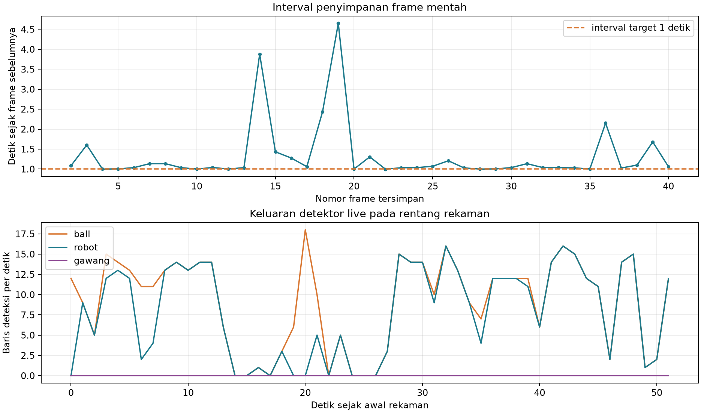

# Percobaan 03 — 40 frame robot dan bola

**Tanggal:** 21 Oktober 2026, 14:24:49–14:25:41 WIB. **Commit runtime:** `0c14591`. Ini kelompok pertama dari rancangan 6 kelompok × 40 frame. Kondisi servo sesi ini tidak diverifikasi dan dicatat `unknown`; agen tidak mengirim perintah servo, gait, atau motor.

Satu publisher Logitech C920 `/dev/video0` menerbitkan gambar 640×480 ke `/thesis/image_raw`. Detektor KD PyTorch FP32 CPU (`models/weights/kd_student_best.pt`, SHA-256 `2da0c0e58a5c1884358fe814f8992cda19bb7b58f292edc15f53b9081b6129c3`) membaca topic itu, menerbitkan `/vision/debug_image`, dan penampil SSH-X membuka jendela `OP3 live detection`. Perekam berlangganan topic kamera mentah yang sama. Log live memakai `run_id=20261021_robot_ball_01_live`, sedangkan gambar memakai `session_id=20261021_robot_ball_01`.

[Manifest capture](../../../data/op3_camera_eval/sessions/20261021_robot_ball_01/capture_manifest.json) menyatakan **40/40 JPEG** tersimpan dengan status `max_frames_reached`. Target penyampelan adalah minimal satu detik antar-frame. Interval teramati: minimum **0,998**, median **1,038**, maksimum **4,652 detik**; ada enam interval >1,5 detik. Selang frame pertama–terakhir **51,835 detik**. Angka ini menunjukkan kamera/pipeline tidak selalu menyediakan sampel tepat setiap satu detik.

[Lembar kontak 1–20](../../../data/op3_camera_eval/sessions/20261021_robot_ball_01/contact_sheet_1.jpg) dan [21–40](../../../data/op3_camera_eval/sessions/20261021_robot_ball_01/contact_sheet_2.jpg) memudahkan pemeriksaan awal tanpa membuka tiap JPEG. Robot dan bola tampak pada lembar kontak; posisi bola berubah selama sesi. Tangan operator ikut terlihat pada beberapa frame, terutama 13 dan 36. Benda putih di tepi kiri frame 19–21 dinyatakan operator **bukan gawang**; klasifikasi itu tetap perlu diperiksa pada anotasi final. Semua gambar sumber tetap utuh.

Pada rentang timestamp kamera selama 40 JPEG direkam, [CSV deteksi live](../../../runs/op3_pytorch/20261021_robot_ball_01_live_detections.csv) memuat **476 baris `ball`**, **409 baris `robot`**, dan **0 `gawang`**. Angka ini berasal dari frame detektor live yang jumlahnya lebih banyak daripada 40 JPEG tersimpan; angka tersebut bukan recall maupun jumlah label ground truth. Perekaman dan viewer sama-sama aktif, sehingga FPS/latensi live juga bukan benchmark final yang bebas beban capture.

Sesudah perekaman, detektor pertama berhenti karena konteks publisher ROS menjadi tidak valid; [metadata run pertama](../../../runs/op3_pytorch/20261021_robot_ball_01_live.json) mencatat satu error setelah capture. Publisher kamera dan viewer tetap aktif. Detektor dinyalakan kembali dengan [run_id lanjutan](../../../runs/op3_pytorch/20261021_robot_ball_01_live_continuation.json); `/vision/debug_image` kembali memiliki satu publisher dan satu subscriber. Data 40 JPEG yang telah selesai direkam tidak diubah.

**Status label: belum ditinjau per-frame.** Tidak ada `labels_reviewed/` untuk sesi ini. Peninjau manusia perlu memeriksa seluruh 40 JPEG pada resolusi penuh, memperbaiki kotak dan kelas, dan mencatat siapa/kapan sebelum sesi dipakai untuk evaluasi mAP. Sisa lima kelompok × 40 frame belum direkam pada saat dokumen ini dibuat. Gambar dan log robot tetap lokal; jangan unggah ke GitHub secara otomatis.

**Pembaruan setelah sesi:** `bhre` telah meninjau dan menyimpan 40/40 label. Lihat [audit peninjauan 120 frame](../percobaan-06-peninjauan-manual-120-frame/README.md) untuk status evaluasi terkini.
