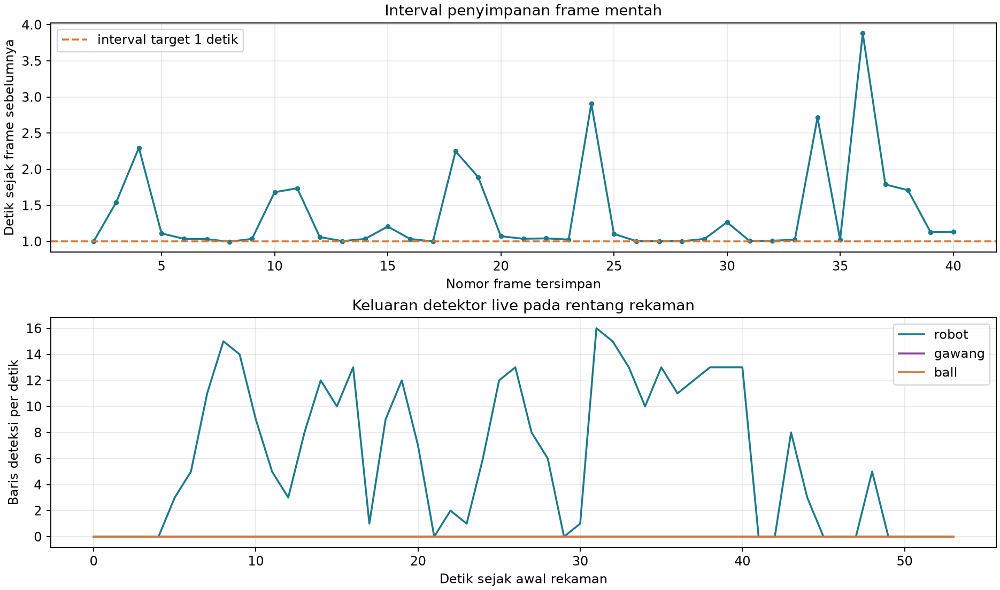

# Percobaan 04 — 40 frame robot dan gawang

**Tanggal:** 21 Oktober 2026, 14:33:59–14:34:53 WIB. **Commit runtime:** `0c14591`. Ini kelompok kedua dari rancangan 6 kelompok × 40 frame. Kondisi servo belum diverifikasi untuk sesi ini dan dicatat `unknown`; agen tidak mengirim perintah servo, gait, atau motor.

Satu publisher Logitech C920 `/dev/video0` menerbitkan gambar mentah 640×480 ke `/thesis/image_raw`. Detektor KD PyTorch FP32 CPU (`models/weights/kd_student_best.pt`, SHA-256 `2da0c0e58a5c1884358fe814f8992cda19bb7b58f292edc15f53b9081b6129c3`) menerbitkan `/vision/debug_image`; jendela `OP3 live detection` berjalan lewat SSH-X. Perekam berlangganan topic gambar mentah yang sama. `session_id=20261021_robot_gawang_01`; `run_id=20261021_robot_gawang_01_live`.

[Manifest capture](../../../data/op3_camera_eval/sessions/20261021_robot_gawang_01/capture_manifest.json) mencatat **40/40 JPEG** tersimpan, status `max_frames_reached`. Target penyampelan minimal satu detik antar-frame; interval aktual minimum **0,997**, median **1,042**, maksimum **3,882 detik**. Ada 11 interval >1,5 detik; durasi dari frame pertama sampai terakhir **53,870 detik**. Ke-40 JPEG berukuran 640×480, berbeda hash, dan cocok dengan 40 entri jurnal.

[Lembar kontak frame 1–20](../../../data/op3_camera_eval/sessions/20261021_robot_gawang_01/contact_sheet_1.jpg) dan [21–40](../../../data/op3_camera_eval/sessions/20261021_robot_gawang_01/contact_sheet_2.jpg) menunjukkan robot dan gawang terlihat sepanjang sesi; bola tidak tampak pada pemeriksaan lembar kontak. Beberapa gambar, khususnya sekitar frame 15, 19, dan 36, tampak kabur akibat pergerakan kamera/adegan. Semua JPEG asli dipertahankan untuk peninjauan per frame nanti.

Pada rentang timestamp kamera selama 40 JPEG direkam, [CSV deteksi live](../../../runs/op3_pytorch/20261021_robot_gawang_01_live_detections.csv) memuat **331 baris `robot`** dan **0 baris `gawang` maupun `ball`**. Jadi detektor live tidak mengeluarkan kotak gawang pada ambang confidence 0,25 untuk rentang ini meski gawang tampak; penyebabnya belum diuji. Baris detektor berasal dari lebih banyak frame daripada 40 JPEG dan **bukan** recall, mAP, atau label ground truth. Log beban bersama kamera/viewer/perekam bukan benchmark runtime final.

**Peninjauan manusia ditunda sampai seluruh 240 frame terkumpul, sesuai instruksi pengguna.** Tidak ada `labels_reviewed/` untuk sesi ini, dan belum ada perhitungan akurasi. Dua kelompok pertama berjumlah 80 frame mentah; empat kelompok berikutnya (160 frame) masih menunggu perekaman. Gambar serta log robot tetap lokal; jangan unggah ke GitHub secara otomatis.

**Pembaruan setelah sesi:** pengguna meminta peninjauan dimulai setelah 120 frame terkumpul. `bhre` telah meninjau dan menyimpan 40/40 label sesi ini. Lihat [audit peninjauan 120 frame](../percobaan-06-peninjauan-manual-120-frame/README.md).
