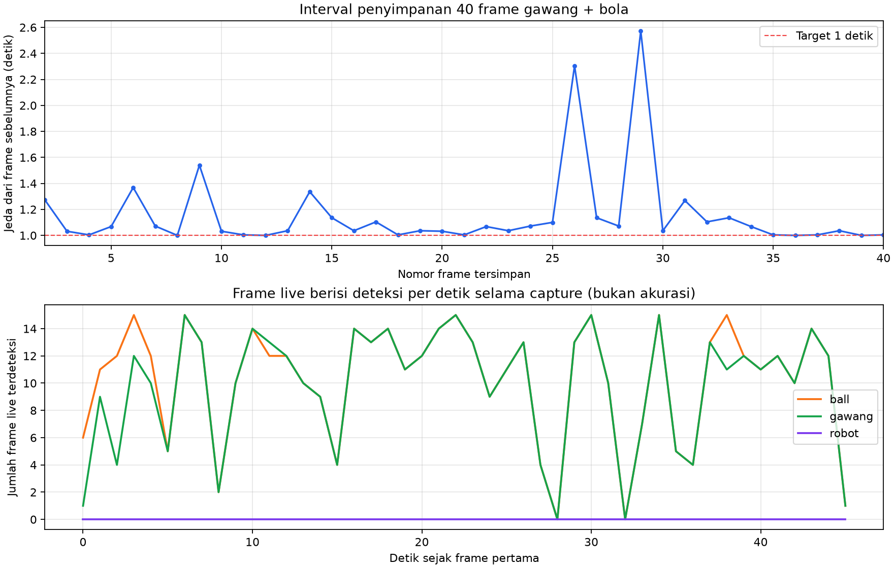

# Percobaan 05 — 40 frame gawang dan bola

**Tanggal:** 21 Oktober 2026, 14:38:49–14:39:36 WIB. **Commit runtime:** `0c14591`. Ini kelompok ketiga dari rancangan 6 kelompok × 40 frame. Kondisi servo sesi ini belum diverifikasi dan dicatat `unknown`; tidak ada perintah servo, gait, atau motor yang dikirim.

Satu publisher Logitech C920 `/dev/video0` mengirim gambar mentah 640×480 ke `/thesis/image_raw`. Detektor KD PyTorch FP32 CPU (`models/weights/kd_student_best.pt`, SHA-256 `2da0c0e58a5c1884358fe814f8992cda19bb7b58f292edc15f53b9081b6129c3`) menerbitkan `/vision/debug_image` untuk jendela `OP3 live detection` lewat SSH-X. Perekam berlangganan gambar mentah yang sama. `session_id=20261021_gawang_ball_01`; `run_id=20261021_gawang_ball_01_live`.

[Manifest capture](../../../data/op3_camera_eval/sessions/20261021_gawang_ball_01/capture_manifest.json) mencatat **40/40 JPEG** dan status `max_frames_reached`. Target penyampelan satu frame setiap satu detik; jeda aktual minimum **1,000**, median **1,036**, maksimum **2,572 detik**. Tiga dari 39 jeda melebihi 1,5 detik; rentang dari timestamp kamera frame pertama sampai terakhir **45,137 detik**. Ke-40 JPEG berukuran 640×480, memiliki hash berbeda, dan cocok dengan 40 baris jurnal.

[Lembar kontak frame 1–20](../../../data/op3_camera_eval/sessions/20261021_gawang_ball_01/contact_sheet_1.jpg) dan [21–40](../../../data/op3_camera_eval/sessions/20261021_gawang_ball_01/contact_sheet_2.jpg) menunjukkan gawang dan bola, tanpa robot yang tampak. Pada frame 30–32 bola terpotong tepi bawah tetapi masih terlihat; frame 33 menunjukkan tangan yang sedang memindahkan bola. Ini temuan inspeksi lembar kontak, belum merupakan peninjauan label per frame. Semua JPEG asli dipertahankan agar peninjau dapat memutuskan pemakaian frame tersebut.

Selama rentang timestamp kamera 40 JPEG tersebut, [CSV deteksi live](../../../runs/op3_pytorch/20261021_gawang_ball_01_live_detections.csv) mencatat **474 baris `ball`**, **451 baris `gawang`**, dan **0 baris `robot`**. Detektor memproses lebih banyak frame live daripada 40 JPEG yang disimpan. Hitungan ini hanya keluaran model pada ambang confidence 0,25, **bukan** recall, mAP, atau akurasi terhadap ground truth. Kinerja runtime saat kamera, viewer, dan perekam berjalan bersama juga bukan benchmark terpisah.

**Peninjauan manusia ditunda sampai seluruh 240 frame terkumpul, sesuai instruksi pengguna.** Belum ada `labels_reviewed/` atau perhitungan akurasi untuk sesi ini. Tiga kelompok pertama berjumlah **120 frame mentah**; tiga kelompok berikutnya (120 frame) masih menunggu perekaman. Gambar serta log robot tetap lokal; jangan unggah ke GitHub secara otomatis.

**Pembaruan setelah sesi:** pengguna meminta peninjauan dimulai setelah 120 frame terkumpul. `bhre` telah menyimpan 40/40 label sesi ini, tetapi audit visual menunjukkan kotak `gawang` perlu diseragamkan dengan sesi robot + gawang sebelum evaluasi akurasi. Lihat [audit peninjauan 120 frame](../percobaan-06-peninjauan-manual-120-frame/README.md).
