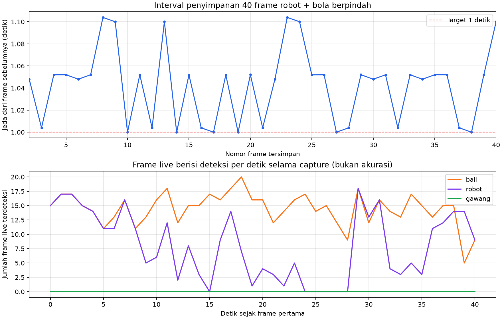

# Percobaan 07 — 40 frame robot dan bola berpindah

**Tanggal:** 21 Oktober 2026, 17:31:04–17:31:45 WIB. **Commit runtime:** `0c14591`. Ini kelompok keempat dari rancangan 6 kelompok × 40 frame. Kondisi servo sesi ini tidak diverifikasi dan dicatat `unknown`; agen tidak mengirim perintah servo, gait, atau motor. Operator menyatakan adegan siap dan memindahkan objek secara manual. Frame pratinjau menunjukkan robot dan bola, tanpa gawang.

Publisher Logitech C920 `/dev/video0` mengirim gambar mentah 640×480 ke `/thesis/image_raw`. Detektor KD PyTorch FP32 CPU (`models/weights/kd_student_best.pt`, SHA-256 `2da0c0e58a5c1884358fe814f8992cda19bb7b58f292edc15f53b9081b6129c3`) menerbitkan `/vision/debug_image` untuk jendela deteksi live SSH-X. `session_id=20261021_robot_ball_moving_01`; `run_id=20261021_robot_ball_moving_01_live`.

[Manifest capture](../../../data/op3_camera_eval/sessions/20261021_robot_ball_moving_01/capture_manifest.json) mencatat **40/40 JPEG** dan status `max_frames_reached`. Target interval minimal satu detik; interval aktual minimum **1,000**, median **1,052**, maksimum **1,104 detik**. Tidak ada jeda >1,5 detik. Rentang timestamp kamera dari frame pertama sampai terakhir **40,655 detik**. Ke-40 JPEG berukuran 640×480, mempunyai hash berbeda, dan cocok dengan 40 baris jurnal.

[Lembar kontak frame 1–20](../../../data/op3_camera_eval/sessions/20261021_robot_ball_moving_01/contact_sheet_1.jpg) dan [21–40](../../../data/op3_camera_eval/sessions/20261021_robot_ball_moving_01/contact_sheet_2.jpg) menunjukkan robot dan bola tetap terlihat, tanpa gawang. Pose/posisi robot berubah sekitar frame 9 dan bola berpindah dari sisi kanan ke bagian depan gambar sekitar frame 30–31. Banyak frame di antara perpindahan itu masih mirip; kelompok ini memberikan beberapa perubahan posisi, bukan 40 adegan gerak yang berbeda. Tangan operator tampak sekitar frame 6–8, 17, 30, dan 38–39. Semua JPEG asli dipertahankan agar peninjau manusia dapat menentukan frame yang dipakai.

Selama rentang timestamp kamera 40 JPEG tersebut, [CSV deteksi live](../../../runs/op3_pytorch/20261021_robot_ball_moving_01_live_detections.csv) mencatat **592 baris `ball`**, **329 baris `robot`**, dan **0 baris `gawang`**. Detektor memproses lebih banyak frame live daripada 40 JPEG tersimpan. Hitungan ini bukan recall, mAP, atau akurasi; pengukuran runtime dengan kamera, viewer, dan perekam aktif bersama bukan benchmark terpisah.

**Status label: belum ditinjau manusia.** Belum ada `labels_reviewed/` untuk sesi ini. Empat kelompok pertama berjumlah **160/240 frame mentah**; dua kelompok berikutnya, bola bergerak dan ketiga objek berpindah-pindah, masih menunggu perekaman. Gambar, label, dan log robot tetap lokal; jangan unggah ke GitHub secara otomatis.
