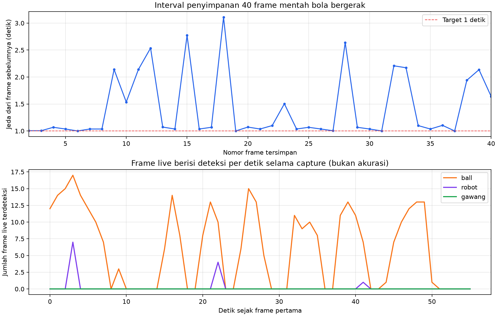

# Percobaan 08 — 40 frame bola bergerak

**Tanggal:** 21 Oktober 2026, 17:36:51–17:37:48 WIB untuk perekaman utama. **Commit runtime:** `0c14591`. Ini kelompok kelima dari rancangan 6 kelompok × 40 frame. Kondisi servo sesi ini tidak diverifikasi dan dicatat `unknown`; agen tidak mengirim perintah servo, gait, atau motor. Operator menggerakkan bola secara manual. Frame pratinjau menunjukkan bola saja, tanpa robot atau gawang.

Publisher Logitech C920 `/dev/video0` mengirim gambar mentah 640×480 ke `/thesis/image_raw`. Detektor KD PyTorch FP32 CPU (`models/weights/kd_student_best.pt`, SHA-256 `2da0c0e58a5c1884358fe814f8992cda19bb7b58f292edc15f53b9081b6129c3`) menerbitkan `/vision/debug_image` untuk jendela deteksi live SSH-X. `session_id=20261021_ball_moving_01`; `run_id=20261021_ball_moving_01_live`.

[Manifest perekaman utama](../../../data/op3_camera_eval/sessions/20261021_ball_moving_01/capture_manifest.json) mencatat **40/40 JPEG**, status `max_frames_reached`. Target interval minimal satu detik; interval aktual minimum **1,000**, median **1,068**, maksimum **3,109 detik**. Ada 13 dari 39 jeda >1,5 detik; rentang timestamp kamera dari frame pertama sampai terakhir **55,572 detik**. Semua 40 JPEG berukuran 640×480, mempunyai hash berbeda, dan cocok dengan 40 baris jurnal.

[Lembar kontak asli frame 1–20](../../../data/op3_camera_eval/sessions/20261021_ball_moving_01/contact_sheet_1.jpg) dan [21–40](../../../data/op3_camera_eval/sessions/20261021_ball_moving_01/contact_sheet_2.jpg) menunjukkan bola berpindah posisi. Bola benar-benar keluar dari gambar pada **frame 10–11, 21–23, dan 38–40**; frame 18 masih menampilkan bola di tepi kanan. Beberapa frame lain menampilkan bola yang terpotong di tepi gambar. Alat pendorong dan sesekali tangan operator tampak dalam beberapa frame. Gambar asli tidak diubah dan tetap berguna untuk menilai hilangnya target dan pemulihan tracking pada urutan waktu aslinya.

Setelah operator menyiapkan bola kembali, [sesi pengganti](../../../data/op3_camera_eval/sessions/20261021_ball_moving_replacement_01/contact_sheet.jpg) merekam 12 frame tambahan. Delapan frame yang menampilkan bola tanpa tangan dipilih untuk mengganti delapan frame kosong. [Manifest kurasi](../../../data/op3_camera_eval/sessions/20261021_ball_moving_candidate_01/curation_manifest.json) memetakan setiap file kandidat ke gambar dan SHA-256 sumber. [Kandidat 40 frame, bagian 1](../../../data/op3_camera_eval/sessions/20261021_ball_moving_candidate_01/contact_sheet_1.jpg) dan [bagian 2](../../../data/op3_camera_eval/sessions/20261021_ball_moving_candidate_01/contact_sheet_2.jpg) terdiri dari **32 frame asli + 8 frame pengganti**. Semua 40 gambar kandidat menampilkan bola pada inspeksi lembar kontak, tetapi belum ditinjau pada resolusi penuh oleh manusia. Set kandidat ini **bukan urutan waktu kontinu** dan hanya disiapkan untuk evaluasi deteksi per frame; gunakan 40 frame asli untuk analisis tracking temporal.

Selama rentang timestamp perekaman utama, [CSV deteksi live](../../../runs/op3_pytorch/20261021_ball_moving_01_live_detections.csv) mencatat **341 baris `ball`**, **12 baris `robot`**, dan **0 baris `gawang`**. Robot tidak tampak pada pemeriksaan lembar kontak; 12 prediksi `robot` perlu diaudit sebagai kemungkinan positif palsu. Detektor memproses lebih banyak frame live daripada 40 JPEG tersimpan. Hitungan ini bukan recall, mAP, atau akurasi, dan pengukuran runtime saat kamera, viewer, dan perekam aktif bersama bukan benchmark terpisah.

**Status label: belum ditinjau manusia.** Belum ada `labels_reviewed/` untuk kandidat ini. Lima kelompok kini menyediakan **200/240 frame kandidat**, dengan 40 frame kelompok ketiga objek berpindah-pindah masih menunggu perekaman. Gambar, label, dan log robot tetap lokal; jangan unggah ke GitHub secara otomatis.
