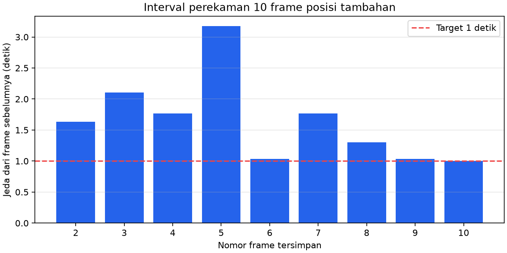

# Percobaan 10 — 10 frame posisi tambahan

**Tanggal:** 21 Oktober 2026, 17:53:52–17:54:07 WIB. **Commit runtime:** `0c14591`. Sesi ini menambah **10 frame di luar target awal 240** dari [empat posisi sebelumnya](../percobaan-09-tiga-objek-empat-posisi/README.md). Kondisi servo tidak diverifikasi untuk sesi ini dan dicatat `unknown`; agen tidak mengirim perintah servo, gait, atau motor.

Frame pengecekan menunjukkan robot di kiri, bola di depan tengah, dan **hanya satu tiang gawang** di tengah. Operator menyetujui susunan ini sebagai data tambahan. Karena rangka gawang tidak terlihat utuh, kelayakan label `gawang` perlu diputuskan saat peninjauan manusia; jangan menganggap 10 frame ini setara dengan contoh tiga objek yang terlihat lengkap.

[Manifest capture](../../../data/op3_camera_eval/sessions/20261021_all_three_position_05/capture_manifest.json) mencatat **10/10 JPEG** dari `/thesis/image_raw` 640×480, status `max_frames_reached`. Semua 10 JPEG mempunyai hash berbeda dan cocok dengan 10 baris jurnal. Target jeda minimal satu detik; jeda aktual minimum **1,004**, median **1,636**, maksimum **3,176 detik**. Lima dari sembilan jeda melebihi 1,5 detik; rentang timestamp kamera dari frame pertama sampai terakhir **14,837 detik**.

[Lembar kontak 10 frame](../../../data/op3_camera_eval/sessions/20261021_all_three_position_05/contact_sheet.jpg) menunjukkan robot dan bola tetap terlihat; tiang gawang berada di tengah. Posisi relatif objek hampir tetap sepanjang sepuluh frame. Gambar asli disimpan tanpa perubahan dan belum ditinjau labelnya per frame.

**Deteksi live tidak tersedia selama perekaman tambahan ini.** [Log detektor sebelumnya](../../../runs/op3_pytorch/20261021_all_three_positions_live.csv) berhenti sekitar 17:53:27 WIB, sebelum capture dimulai, dengan error `Failed to publish: publisher's context is invalid`. Perekam kamera tetap menghasilkan 10 gambar lengkap. Detektor kemudian dinyalakan kembali dengan [run lanjutan](../../../runs/op3_pytorch/20261021_all_three_position_05_live_continuation.csv), tetapi log lanjutan ini dimulai **setelah** sepuluh frame tersimpan dan tidak boleh dipakai sebagai hasil deteksi live pada sesi capture. Tidak ada klaim akurasi atau performa model untuk sesi tambahan ini.

Total tersedia **240 frame rancangan awal + 10 frame tambahan**. Sepuluh frame tambahan tetap dipisahkan dan tidak otomatis dimasukkan ke set evaluasi. Gambar dan log robot tetap lokal sesuai prompt eksperimen.
