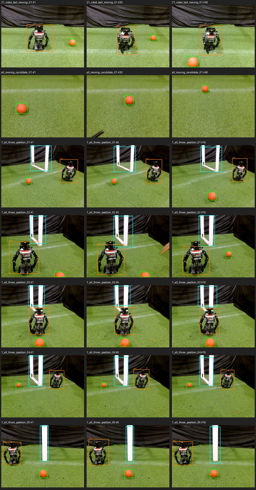

# Peninjauan manual 120 + 10 frame

Atas permintaan pengguna, jendela lokal SSH-X untuk **130 frame** dibuka dengan peninjau `bhre`, memakai package [op3_multi_session_reviewer](../../../ros2_packages/op3_multi_session_reviewer/README.md) yang menggunakan peninjau lama sebagai shared code. Gambar sumber, label draf, dan label hasil tinjauan tetap dipisahkan per sesi. Peninjau berjalan pada urutan berikut:

| Nomor global | Isi | Sesi | Jumlah |
|---|---|---|---:|
| 1–40 | Robot + bola berpindah | `20261021_robot_ball_moving_01` | 40 |
| 41–80 | Bola bergerak, kandidat kurasi | `20261021_ball_moving_candidate_01` | 40 |
| 81–90 | Tiga objek, posisi 1 | `20261021_all_three_position_01` | 10 |
| 91–100 | Tiga objek, posisi 2 | `20261021_all_three_position_02` | 10 |
| 101–110 | Tiga objek, posisi 3 | `20261021_all_three_position_03` | 10 |
| 111–120 | Tiga objek, posisi 4 | `20261021_all_three_position_04` | 10 |
| 121–130 | Posisi 5 tambahan | `20261021_all_three_position_05` | 10 |

Kandidat bola bergerak terdiri dari **32 gambar asli + 8 pengganti** dengan pemetaan sumber pada [manifest kurasi](../../../data/op3_camera_eval/sessions/20261021_ball_moving_candidate_01/curation_manifest.json). File `capture_manifest.json` pada kandidat adalah metadata kompatibilitas untuk pembuat label draf lama; statusnya `curated_candidate_not_continuous_capture`, **bukan** klaim bahwa 40 gambar berasal dari satu perekaman kontinu. Tujuh sesi mempunyai total 130 JPEG dan 130 file `labels_auto/frame_*.txt` yang dihasilkan oleh checkpoint KD `models/weights/kd_student_best.pt` pada `imgsz=640`, `conf=0.25`, `iou=0.45`. Label otomatis adalah **draf**, bukan ground truth.

Hal yang perlu diperhatikan saat meninjau:

- Frame 1–40: draf memuat 39 `ball` dan 28 `robot`; tambahkan objek yang terlewat. Tangan operator tampak pada beberapa gambar.
- Frame 41–80: draf memuat 40 `ball` dan **2 `robot`**. Kandidat dirancang berisi bola saja; periksa dua prediksi `robot` tersebut dan bola yang terpotong tepi gambar.
- Frame 81–90: draf memuat 10 `ball`, 2 `gawang`, dan **0 `robot`** walaupun ketiga objek tampak pada lembar kontak. Tambahkan kelas yang terlewat.
- Frame 91–100: draf memuat 10 `ball`, 20 kotak `robot`, dan **0 `gawang`**. Periksa kotak robot tambahan dan tambahkan gawang yang tampak.
- Frame 101–110: draf memuat 10 `ball`, 11 kotak `robot`, dan **0 `gawang`**. Bola terpotong tepi bawah dan robot menutupi sebagian besar gawang; putuskan kelayakan dan batas kotak secara konsisten.
- Frame 111–120: draf memuat 10 kotak untuk tiap kelas, tetapi bagian atas gawang keluar dari gambar. Periksa ulang semua batas kotak.
- Frame 121–130: draf memuat 10 `ball`, 10 `robot`, dan **0 `gawang`**; hanya satu tiang gawang terlihat. Sesi ini tambahan terpisah dari rancangan 240 frame. Tentukan apakah gawang parsial ini layak diberi label atau frame perlu dikeluarkan dari evaluasi, dengan aturan yang sama pada seluruh data.

Audit [120 frame pertama](../percobaan-06-peninjauan-manual-120-frame/README.md) menemukan perbedaan antara kotak yang mencakup seluruh rangka gawang dan kotak yang hanya mencakup satu tiang. Gunakan satu definisi objek yang konsisten saat memperbaiki label baru; jangan mengubah label hasil tinjauan lama secara otomatis.

Dalam jendela, `N`/panah kanan maju, `P`/panah kiri mundur, klik kotak untuk memilih lalu `Delete` menghapus, tarik pada area kosong untuk menambah kotak, `0`/`1`/`2` memilih `ball`/`gawang`/`robot`, `R` membatalkan edit belum tersimpan, `S` menyimpan **hanya frame yang sedang dilihat**, dan `Q`/Esc keluar. Hasil masuk ke `labels_reviewed/` dan `review_log.jsonl` pada sesi asal. Jika perlu melanjutkan, jalankan kembali perintah di bawah dengan tambahan `--start N`, menggunakan nomor global 1–130:

```bash
source .venv-op3-pytorch/bin/activate
PYTHONPATH="$PWD/ros2_packages/op3_label_reviewer:$PWD/ros2_packages/op3_multi_session_reviewer" \
python -m op3_multi_session_reviewer \
  --session-dir data/op3_camera_eval/sessions/20261021_robot_ball_moving_01 \
  --session-dir data/op3_camera_eval/sessions/20261021_ball_moving_candidate_01 \
  --session-dir data/op3_camera_eval/sessions/20261021_all_three_position_01 \
  --session-dir data/op3_camera_eval/sessions/20261021_all_three_position_02 \
  --session-dir data/op3_camera_eval/sessions/20261021_all_three_position_03 \
  --session-dir data/op3_camera_eval/sessions/20261021_all_three_position_04 \
  --session-dir data/op3_camera_eval/sessions/20261021_all_three_position_05 \
  --reviewer bhre
```

## Hasil setelah peninjauan

Pada 21 Oktober 2026 pukul 18:01–18:42 WIB, peninjau `bhre` menyimpan label untuk **130/130 frame**. Audit file menemukan pasangan gambar dan label lengkap, kelas `ball`/`gawang`/`robot` valid, koordinat kotak berada dalam batas gambar, dan tidak ada file label kosong. Ada **132 entri log simpan** karena satu frame kandidat bola bergerak dan satu frame posisi 2 disimpan ulang; jumlah frame unik tetap 130. Audit ini memeriksa kelengkapan dan format seluruh label, lalu memeriksa secara visual 3 frame per sesi (21 sampel). Pemeriksaan sampel tidak menggantikan keputusan peninjau atas seluruh 130 gambar.

| Kelompok | Frame berlabel | `ball` | `gawang` | `robot` |
|---|---:|---:|---:|---:|
| Robot + bola berpindah | 40 | 40 | 0 | 40 |
| Bola bergerak, kandidat kurasi | 40 | 40 | 0 | 0 |
| Tiga objek, posisi 1–4 | 40 | 40 | 40 | 40 |
| Posisi 5 tambahan | 10 | 10 | 10 | 10 |
| **Total** | **130** | **130** | **50** | **90** |



Pada posisi 1–4, sampel memperlihatkan kotak `gawang` yang meliputi rangka yang terlihat. **Posisi 5 berbeda:** hanya satu tiang tampak, dan peninjau memberinya kotak `gawang` pada kesepuluh frame. Pertahankan 10 frame ini sebagai **tambahan terpisah**, jangan gabungkan diam-diam dengan 240 frame rancangan awal atau dengan contoh gawang lengkap. Konsistensi definisi `gawang` pada [120 frame awal](../percobaan-06-peninjauan-manual-120-frame/README.md) juga belum terselesaikan, khususnya 40 frame `gawang + bola` yang kotaknya hanya mencakup satu tiang. Label manusia tidak diubah oleh audit ini.

**Precision, recall, F1, dan mAP gabungan belum dihitung.** Pengguna menerima keputusan untuk melanjutkan tanpa melabel ulang 40 frame `gawang + bola`: evaluasi kotak gawang parsial akan dilaporkan terpisah dari gawang dengan rangka yang terlihat. Sepuluh frame posisi 5 juga tetap terpisah sebagai data tambahan. Perbedaan anotasi gawang harus dinyatakan jelas pada laporan; angka mAP gabungan yang mencampurkan kedua definisi tidak dipakai sebagai metrik utama. Kandidat 40 frame bola bergerak adalah kumpulan kurasi yang tidak kontinu, sehingga sesuai untuk evaluasi deteksi per frame tetapi bukan untuk pengukuran tracking temporal. Gambar dan log robot tetap lokal sesuai prompt eksperimen.
