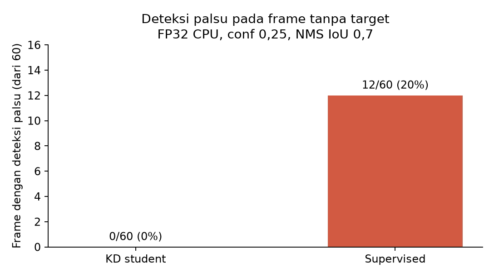

# Peninjauan manual 60 frame tanpa target

Atas permintaan pengguna, peninjau lokal SSH-X dibuka untuk [60 JPEG kandidat negatif](../../../data/op3_camera_eval/sessions/20261021_negative_candidate_01/images/), dengan identitas peninjau `bhre`. Kandidat terdiri dari **52 gambar sesi awal + 8 pengganti**; [manifest kurasi](../../../data/op3_camera_eval/sessions/20261021_negative_candidate_01/curation_manifest.json) mencatat sumber dan SHA-256. Audit sebelum peninjauan menemukan 60 nama gambar unik, 60 file yang sesuai manifest, dan tidak ada hash yang berbeda. Gambar sumber dan yang pernah dikeluarkan dari kandidat tetap disimpan pada sesi asal.

Karena skrip pra-label yang sudah ada mensyaratkan `capture_manifest.json`, folder kandidat diberi [metadata kompatibilitas](../../../data/op3_camera_eval/sessions/20261021_negative_candidate_01/capture_manifest.json) yang menyatakan secara eksplisit bahwa kumpulan 52+8 ini **bukan rekaman kontinu**. Kode package yang sudah ada tidak diubah. Checkpoint student KD `models/weights/kd_student_best.pt` (SHA-256 `2da0c0e58a5c1884358fe814f8992cda19bb7b58f292edc15f53b9081b6129c3`) menghasilkan [60 label otomatis draf](../../../data/op3_camera_eval/sessions/20261021_negative_candidate_01/labels_auto/), semuanya **tanpa kotak** pada `imgsz=640`, `conf=0.25`, `iou=0.45`. Nihil prediksi ini bukan bukti bahwa gambar benar-benar tanpa target.

[Lembar kontak 1–30](../../../data/op3_camera_eval/sessions/20261021_negative_candidate_01/contact_sheet_1.jpg) dan [31–60](../../../data/op3_camera_eval/sessions/20261021_negative_candidate_01/contact_sheet_2.jpg) telah diperiksa sebagai tinjauan awal dan tidak menunjukkan target yang jelas pada ukuran kecil. Peninjau manusia tetap harus melihat **seluruh 60 gambar pada resolusi penuh** di jendela SSH-X. Tekan `S` pada setiap gambar setelah diperiksa, termasuk gambar tanpa kotak; `N`/panah kanan maju, `P`/panah kiri mundur, `Q`/Esc keluar. Panel kanan menunjukkan jumlah yang sudah tersimpan. Jika menemukan bola, gawang, atau robot, tambahkan kotaknya sebagai bukti, simpan, dan catat nomor frame agar kandidat negatif dapat dikurasi ulang; jangan menghapus gambar sumber.

Jendela dibuka dengan perintah berikut. Jika terhenti, jalankan ulang dengan tambahan `--start N`, dengan `N` nomor frame 1–60. Label hasil manusia disimpan di `labels_reviewed/` dan nama peninjau serta waktu di `review_log.jsonl`.

```bash
source .venv-op3-pytorch/bin/activate
PYTHONPATH="$PWD/ros2_packages/op3_label_reviewer" \
python -m op3_label_reviewer \
  --session-dir data/op3_camera_eval/sessions/20261021_negative_candidate_01 \
  --reviewer bhre
```

## Hasil peninjauan dan audit deteksi palsu

Peninjau `bhre` menyimpan **60/60 label** pada 21 Oktober 2026, pukul 18:50:52–18:55:53 WIB. Setiap JPEG memiliki satu file `labels_reviewed/frame_*.txt` kosong dan satu entri log yang sesuai; tidak ada nama hilang, file ekstra, label berisi kotak, atau penyimpanan ulang. Artinya, menurut peninjauan manusia, semua 60 gambar kandidat ini **tanpa tiga objek target**. Catatan sumber, hash, label manusia, dan checkpoint tersedia dalam [manifest input audit](../../../runs/op3_camera_eval/20261021_negative_candidate_01_fp_audit/input_manifest.json).

Inferensi offline diulang pada 60 gambar yang sama dengan input 640, FP32 CPU, confidence ≥0,25, NMS IoU 0,7, tanpa augmentasi. Kedua model diuji dengan parameter yang sama; pengukuran ini terpisah dari log live saat capture. Hasil lengkap per gambar ada di [CSV deteksi palsu](../../../runs/op3_camera_eval/20261021_negative_candidate_01_fp_audit/per_frame.csv) dan [ringkasan JSON](../../../runs/op3_camera_eval/20261021_negative_candidate_01_fp_audit/summary.json).

| Model | Frame dengan deteksi palsu | Jumlah kotak palsu | Kelas kotak palsu |
|---|---:|---:|---|
| Student KD | **0/60 (0%)** | 0 | — |
| Supervised | **12/60 (20%)** | 12 | `robot`: 12 |



Pada [12 contoh deteksi supervised](contoh_fp_supervised_12_frame.jpg), kotak `robot` justru mengelilingi bagian atas kain latar hitam, dengan confidence **0,272–0,466**. Frame terkait: 34, 36, 38–40, 42–44, 46–47, 49, dan 52 dalam urutan kandidat. Ini merupakan kesalahan latar spesifik pada sesi ini; persentase 0% dan 20% adalah **proporsi frame negatif dengan setidaknya satu deteksi palsu**, bukan akurasi, precision, recall, atau mAP. Frame satu sesi juga saling berkorelasi, sehingga hasil ini tidak otomatis berlaku untuk semua lokasi atau pencahayaan.

Sesi ini memakai gambar yang sudah ada; kamera dan motor robot tidak dikendalikan. Gambar, label, dan log tetap lokal sesuai prompt eksperimen.
