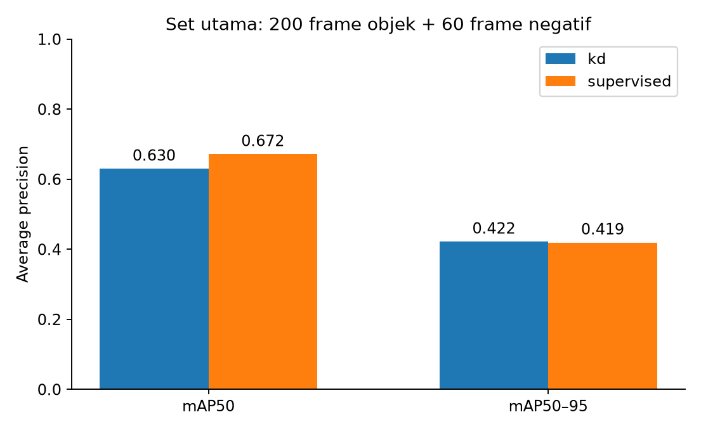
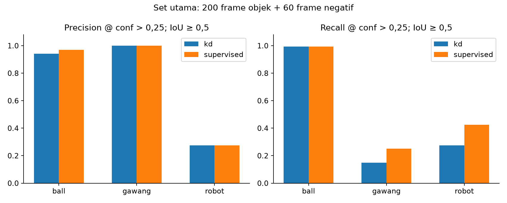
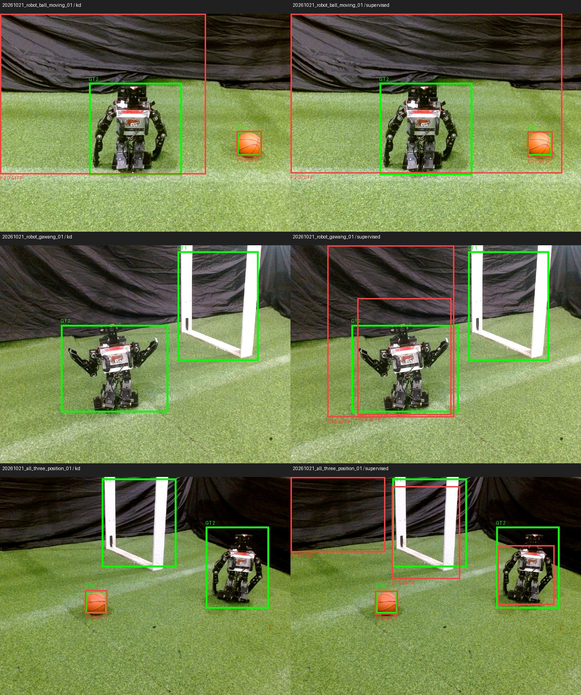

# Percobaan 13 — evaluasi deteksi offline multi-sesi OP3

Evaluasi offline membandingkan checkpoint **student KD** dan **supervised** pada frame kamera OP3 yang sudah ditinjau `bhre`. Tidak ada kamera, ROS, tracking, servo, atau motor yang dijalankan untuk evaluasi ini. Package baru [op3_multi_session_eval](../../../ros2_packages/op3_multi_session_eval/README.md) memakai fungsi baca label, IoU, dan hash dari package evaluator lama sebagai shared code; package lama tidak diubah. Commit repository saat pengambilan data: `0c14591`. Status ini **eksploratif** karena seluruh frame berasal dari lingkungan dan hari pengambilan yang sama.

## Data dan protokol

**Set utama berisi 260 gambar:** 200 gambar dengan objek dan 60 gambar tanpa target. Gambar objek berasal dari `robot_ball_01` (40), `robot_gawang_01` (40), `robot_ball_moving_01` (40), `ball_moving_candidate_01` (40), serta `all_three_position_01` sampai `_04` (4 × 10). Set negatif ialah `negative_candidate_01` (60). Terdapat **400 kotak ground truth** pada set utama: 160 `ball`, 80 `gawang`, 160 `robot`. Satu-satunya set yang memakai gambar pengganti terkurasi adalah `ball_moving_candidate_01`; ini sah untuk deteksi per frame, tetapi tidak digunakan untuk tracking temporal.

**Set gawang parsial dipisahkan:** `gawang_ball_01` (40) dan `all_three_position_05` (10), total 50 gambar dan 110 kotak. Kotak `gawang` pada 40 frame pertama hanya meliputi satu tiang meskipun bagian rangka lain juga terlihat; pada 10 frame tambahan hanya satu tiang berada di bidang pandang. Hasilnya tidak dicampurkan dengan mAP utama yang memakai kotak rangka gawang yang terlihat. Pemisahan ini mengikuti keputusan pengguna untuk melanjutkan tanpa pelabelan ulang. Semua 310 pasangan gambar-label dan log peninjau divalidasi sebelum inferensi; tidak ada gambar duplikat antar-set. Nama gambar pada snapshot dataset diberi awalan ID sesi agar tidak bertabrakan. [Manifest input](../../../runs/op3_multi_session_eval/20261021_primary260_partial50_v1/input_manifest.json) menyimpan path dan SHA-256 setiap gambar, label, log, dan checkpoint.

Kedua model dijalankan dengan **FP32 CPU**, input 640, tanpa augmentasi, NMS IoU 0,7. mAP50 dan mAP50–95 memakai confidence floor 0,001 melalui validasi Ultralytics. Precision, recall, F1, TP/FP/FN dihitung pada **confidence >0,25** dengan pencocokan kelas sama dan IoU ≥0,5. F1 macro ialah rata-rata F1 tiga kelas. Set negatif memberi jumlah frame dengan prediksi palsu; ia tidak diberi precision/recall karena tidak mempunyai objek benar.

## Hasil set utama: 200 objek + 60 negatif

| Model | mAP50 | mAP50–95 | Precision macro @0,25 | Recall macro @0,25 | F1 macro @0,25 | Deteksi palsu pada negatif |
|---|---:|---:|---:|---:|---:|---:|
| Student KD | 0,630 | **0,422** | 0,739 | 0,473 | 0,501 | **0/60 frame** |
| Supervised | **0,672** | 0,419 | **0,748** | **0,556** | **0,572** | 12/60 frame |

| Kelas (jumlah GT) | Model | TP | FP | FN | Precision | Recall | F1 | AP50–95 |
|---|---|---:|---:|---:|---:|---:|---:|---:|
| `ball` (160) | KD | 159 | 10 | 1 | 0,941 | 0,994 | 0,967 | **0,923** |
| `ball` (160) | Supervised | 159 | 5 | 1 | **0,970** | 0,994 | **0,981** | 0,815 |
| `gawang` (80) | KD | 12 | 0 | 68 | 1,000 | 0,150 | 0,261 | 0,116 |
| `gawang` (80) | Supervised | 20 | 0 | 60 | 1,000 | **0,250** | **0,400** | **0,306** |
| `robot` (160) | KD | 44 | 116 | 116 | 0,275 | 0,275 | 0,275 | **0,226** |
| `robot` (160) | Supervised | 68 | 179 | 92 | 0,275 | **0,425** | **0,334** | 0,137 |

Kedua model mendeteksi bola hampir selalu, tetapi **gawang dan robot masih lemah pada ambang 0,25**. Pada 40 gambar `robot_gawang_01`, kedua model memiliki **0/40 TP gawang**. Pada 40 gambar `robot_ball_moving_01`, kedua model memiliki **0/40 TP robot** pada IoU 0,5; sampel memperlihatkan prediksi `robot` mencakup kain latar sehingga gagal cocok dengan kotak robot manusia. [Audit kesalahan 80 frame](../percobaan-14-audit-kesalahan-80-frame/README.md) mengelompokkan seluruh kasus dan menyediakan lembar gambar kedua model. Pada gambar negatif, 12 prediksi palsu model supervised semuanya berkelas `robot` pada kain latar; [audit 60 frame negatif](../percobaan-12-peninjauan-60-frame-negatif/README.md) menyimpan contoh lengkapnya. Precision `gawang` 1,000 di tabel hanya berarti tidak ada prediksi gawang palsu pada ambang tersebut; recall yang rendah tetap menunjukkan banyak gawang terlewat.

Pada gambar contoh, kotak **hijau** ialah ground truth manusia dan **merah** ialah prediksi pada confidence >0,25. Angka kelas: `0=ball`, `1=gawang`, `2=robot`. Sampel ini menjelaskan beberapa kesalahan, bukan audit visual menyeluruh 260 frame.

## Hasil gawang parsial: 50 gambar terpisah

| Model | mAP50 | mAP50–95 | Recall `gawang` @0,25 | Recall `ball` @0,25 | Recall `robot` @0,25 |
|---|---:|---:|---:|---:|---:|
| Student KD | **0,704** | **0,485** | **40/50 (0,800)** | 50/50 | 0/10 |
| Supervised | 0,502 | 0,334 | 0/50 | 50/50 | 0/10 |

Seluruh **40 TP gawang KD** berasal dari `gawang_ball_01`; pada **10 gambar posisi tambahan** kedua model memiliki 0 TP gawang. Dengan demikian angka 40/50 tidak membuktikan ketahanan umum terhadap semua gawang parsial. Nilai AP parsial juga memakai definisi kotak satu tiang, sehingga tidak setara dengan AP gawang pada set utama.

[Hasil lengkap JSON](../../../runs/op3_multi_session_eval/20261021_primary260_partial50_v1/results.json), [tabel CSV](../../../runs/op3_multi_session_eval/20261021_primary260_partial50_v1/summary.csv), dan log prediksi [KD](../../../runs/op3_multi_session_eval/20261021_primary260_partial50_v1/per_frame_kd.jsonl) / [supervised](../../../runs/op3_multi_session_eval/20261021_primary260_partial50_v1/per_frame_supervised.jsonl) tersimpan lokal. Angka mAP50–95 utama berbeda hanya sekitar **0,0023**; hasil ini tidak cukup untuk menyatakan satu model unggul secara umum. Inferensi offline ini bukan uji FPS, latensi, CPU/RAM live, atau tracking. Tidak ada gambar atau log yang diunggah maupun di-push ke GitHub.
