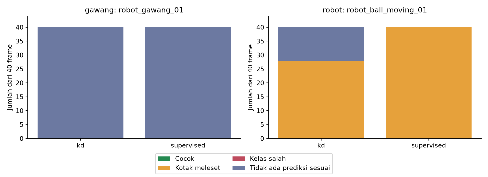
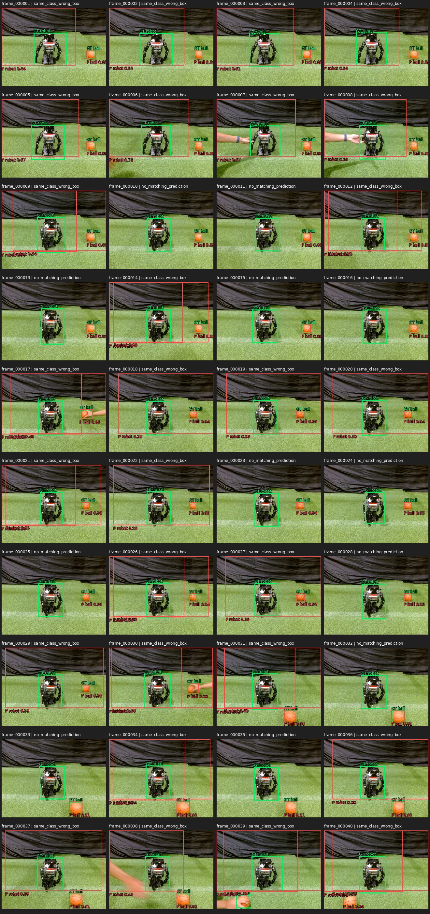
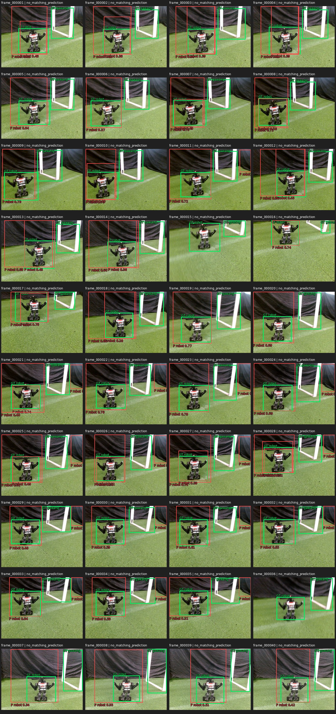

# Percobaan 14 — audit kesalahan 80 frame prioritas

Audit ini menindaklanjuti [evaluasi deteksi multi-sesi](../percobaan-13-evaluasi-deteksi-multi-sesi/README.md) pada dua kelompok dengan kegagalan paling jelas: **40 frame robot + gawang** (`20261021_robot_gawang_01`) dan **40 frame robot + bola berpindah** (`20261021_robot_ball_moving_01`). Seluruh label sumber telah ditinjau oleh `bhre`. Package baru [op3_detection_error_audit](../../../ros2_packages/op3_detection_error_audit/README.md) membaca prediksi KD/supervised yang sudah tersimpan, memverifikasi hash gambar dan label terhadap manifest evaluasi, lalu membandingkan kotak pada confidence >0,25 dan IoU ≥0,5. Tidak ada inferensi, kamera, ROS, tracking, atau gerak robot yang dijalankan. **Tidak ada label manusia yang diubah.**

Setiap kotak ground truth digolongkan sebagai `matched`, `same_class_wrong_box` (kelas benar tetapi IoU <0,5), `wrong_class` (prediksi kelas lain bertumpang tindih ≥0,5), atau `no_matching_prediction`. Ini klasifikasi geometris otomatis; dugaan penyebab visual dicatat terpisah. Semua **320 keputusan** (80 gambar × 2 objek × 2 model) ada di [cases.csv](../../../runs/op3_detection_error_audit/20261021_robot_gawang_robot_ball_moving_v1/cases.csv), dengan hitungan pada [summary.json](../../../runs/op3_detection_error_audit/20261021_robot_gawang_robot_ball_moving_v1/summary.json).

| Kelompok dan objek | Model | Cocok | Kotak meleset | Kelas salah | Tanpa prediksi yang sesuai |
|---|---|---:|---:|---:|---:|
| Robot + gawang: `gawang` (40) | KD | 0 | 0 | 0 | **40** |
| Robot + gawang: `gawang` (40) | Supervised | 0 | 0 | 0 | **40** |
| Robot + bola berpindah: `robot` (40) | KD | 0 | **28** | 0 | 12 |
| Robot + bola berpindah: `robot` (40) | Supervised | 0 | **40** | 0 | 0 |

Pada sesi robot + gawang, **tidak ada satu pun prediksi berkelas `gawang` di atas ambang 0,25** dari kedua model, meskipun gawang terlihat pada lembar gambar. Ini kegagalan deteksi pada ambang operasi, bukan masalah IoU kotak gawang. Pada sesi robot + bola berpindah, kelas `robot` sering diprediksi, tetapi kotaknya terlalu besar dan meliputi kain latar: median IoU prediksi kelas sama terhadap label robot ialah **0,180 (KD; 28 frame memiliki prediksi robot)** dan **0,141 (supervised; 40 frame)**. Median luas kotak prediksi robot sekitar **5,7×** luas kotak manusia pada KD dan **7,0×** pada supervised. Lembar gambar memperlihatkan pola ini secara kronologis.

Pada lembar gambar, **hijau** ialah kotak manusia dan **merah** ialah prediksi model. Empat lembar lengkap, masing-masing 40 frame, tersedia untuk [robot + gawang KD](../../../runs/op3_detection_error_audit/20261021_robot_gawang_robot_ball_moving_v1/lembar_20261021_robot_gawang_01_kd.jpg), [robot + gawang supervised](../../../runs/op3_detection_error_audit/20261021_robot_gawang_robot_ball_moving_v1/lembar_20261021_robot_gawang_01_supervised.jpg), [robot + bola berpindah KD](../../../runs/op3_detection_error_audit/20261021_robot_gawang_robot_ball_moving_v1/lembar_20261021_robot_ball_moving_01_kd.jpg), dan [robot + bola berpindah supervised](../../../runs/op3_detection_error_audit/20261021_robot_gawang_robot_ball_moving_v1/lembar_20261021_robot_ball_moving_01_supervised.jpg).

Di luar objek fokus, pada robot + gawang, KD mencocokkan **3/40 robot** dan supervised **21/40 robot**; pada robot + bola berpindah, kedua model mencocokkan **39/40 bola**. Jadi kelemahan gawang dan robot tidak bisa dijelaskan hanya oleh kegagalan membaca seluruh gambar.

Pemeriksaan ambang menemukan **33 catatan prediksi dekat IoU 0,5 pada 21 gambar unik**, semuanya kelas `robot` dari kelompok robot + gawang. Daftarnya berada di [geometry_recheck.csv](../../../runs/op3_detection_error_audit/20261021_robot_gawang_robot_ball_moving_v1/geometry_recheck.csv). Daftar ini untuk analisis sensitivitas batas IoU; **bukan bukti label manusia salah**. Dari lembar gambar, kotak manusia pada contoh yang diperiksa masuk akal dan pola kesalahan utama tetap jelas. Pengguna **tidak perlu meninjau ulang seluruh 80 frame**. Jika nanti dibutuhkan adjudikasi label yang lebih ketat untuk angka skripsi final, cukup periksa 21 gambar batas tersebut pada resolusi penuh, tanpa mengubah label otomatis.

Audit ini memakai prediksi confidence >0,25 yang telah tersimpan. Ia tidak menjawab apakah model membuat prediksi gawang dengan confidence lebih rendah, dan tidak mengubah metrik mAP dari percobaan 13. Gambar, label, hasil audit, dan log tetap lokal; tidak ada commit, push, atau unggahan data robot.
