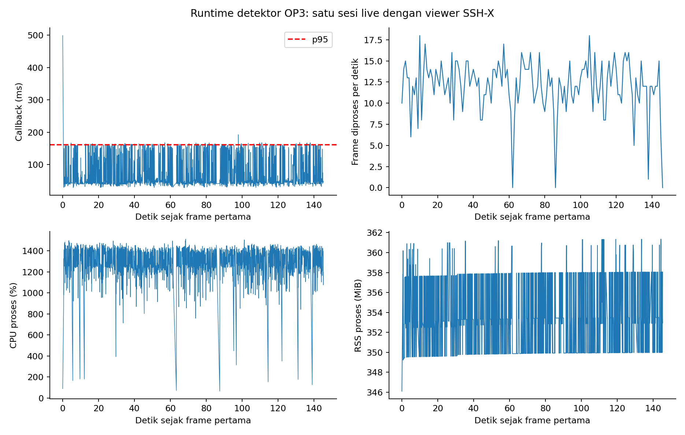
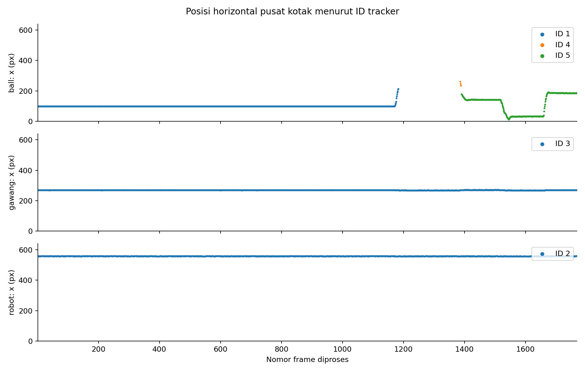
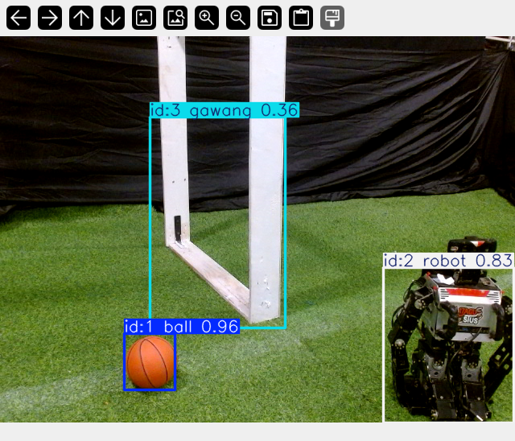

# Percobaan 15 — tracking dan deteksi live kamera OP3

Sesi terukur berlangsung **21 Oktober 2026, 19:28:49–19:31:15 WIB** (146,28 detik). Kamera ROS `/thesis/image_raw` berukuran 640 × 480, model **student KD** `kd_seed42` pada CPU FP32, input model 640, confidence 0,25, NMS IoU 0,45, dan tracker BoT-SORT. Hasil deteksi diterbitkan ke `/vision/detections`, sedangkan tampilan beranotasi dibuka lewat SSH-X. Robot **tidak diberi perintah gerak** dalam percobaan ini; status servo saat sesi terukur tidak diverifikasi sehingga kondisi dicatat `unknown`.

## Hasil runtime

| Parameter | Hasil |
|---|---:|
| Frame berhasil diproses / error | 1.769 / 0 |
| Throughput terukur | **12,09 FPS** |
| Selang antar-frame diproses, median / p95 | 61,10 / 163,28 ms |
| Stempel kamera → awal callback, median / p95 | 40,11 / 70,26 ms |
| Pra-proses, median / p95 | 1,60 / 11,89 ms |
| Inferensi, median / p95 | 28,20 / 136,37 ms |
| Pasca-proses, median / p95 | 0,81 / 0,96 ms |
| Keseluruhan callback, median / p95 / maksimum | **45,42 / 161,54 / 499,01 ms** |
| CPU proses, median / p95 | 1.349,8% / 1.448,1% |
| RAM proses (RSS), median / p95 | 352,87 / 358,05 MiB |

CPU diukur sebagai jumlah pemakaian semua thread proses pada komputer dengan 16 CPU logis; karena itu dapat melampaui 100%. Selisih stempel kamera dan awal callback mengandalkan sinkronisasi jam pada host yang sama. Waktu callback **bukan** latensi kamera-ke-layar, dan throughput bukan FPS sumber kamera. Grafik memperlihatkan fluktuasi dan jeda proses yang tidak tampak dalam angka rata-rata.

## Hasil deteksi dan kontinuitas ID

| Kelas | Frame dengan deteksi | Cakupan frame | Confidence median | ID selama sesi | Rentang pusat kotak |
|---|---:|---:|---:|---|---:|
| Bola | 1.566/1.769 | 88,52% | 0,931 | 1 (1.183 frame), 4 (3), 5 (380) | x 246,89 px; y 141,19 px |
| Gawang | 1.769/1.769 | 100% | 0,411 | 3 sepanjang sesi | x 3,13 px; y 11,98 px |
| Robot | 1.769/1.769 | 100% | 0,790 | 2 sepanjang sesi | x 0,83 px; y 7,48 px |

Deteksi bola memakai **ID 1 sampai frame 1.183**, lalu tidak ada deteksi selama **202 frame** (sekitar 15,6 detik menurut log), muncul lagi sebagai **ID 4 pada frame 1.386–1.388**, hilang satu frame, dan memakai **ID 5 mulai frame 1.390**. Tidak terjadi pergantian ID langsung pada dua frame berturut-turut yang sama-sama mendeteksi bola; ada dua akuisisi ulang setelah jeda. Log tidak merekam anotasi objek yang sebenarnya pada setiap frame, sehingga penyebab jeda (misalnya keluar dari gambar atau gagal dideteksi) tidak dapat dipastikan. ID 3 gawang dan ID 2 robot tidak berubah selama sesi. Perubahan posisi pusat kotak bola pada log menunjukkan target bergerak dalam bidang pandang, tetapi tidak mengukur akurasi posisi kotak.

Gambar tampilan live di atas diambil **sesudah** sesi terukur, ketika preview dibuka kembali, sehingga nomor ID pada gambar memulai sesi tracker baru. Grafik dan tabel memakai log sesi terukur `20261021_tracking_live_01`. Cakupan frame dan confidence model **bukan precision, recall, atau akurasi tracking**. MOTA/IDF1 memerlukan ground truth identitas dan kotak per frame. Hasil akurasi deteksi offline yang memakai label manusia tersedia di [percobaan 13](../percobaan-13-evaluasi-deteksi-multi-sesi/README.md); hasil itu berasal dari dataset berbeda dan tidak boleh dianggap skor akurasi live ini.

## Berkas bukti dan reproduksi

- [Ringkasan metrik JSON](../../../runs/op3_tracking_runtime_report/20261021_tracking_live_01_report/summary.json) menyimpan SHA-256 setiap log input; salinannya ada di [folder ini](summary.json).
- [Metadata run](../../../runs/op3_pytorch/20261021_tracking_live_01.json), [log per frame](../../../runs/op3_pytorch/20261021_tracking_live_01.csv), dan [log deteksi per kotak](../../../runs/op3_pytorch/20261021_tracking_live_01_detections.csv) ialah sumber angka dan grafik.
- [Package laporan baru](../../../ros2_packages/op3_tracking_runtime_report/README.md) membaca log sesi yang sudah berhenti tanpa mengubah package detektor, checkpoint, atau kode robot. Checkpoint SHA-256: `2da0c0e58a5c1884358fe814f8992cda19bb7b58f292edc15f53b9081b6129c3`.

Jendela live SSH-X dikembalikan ke mode preview setelah perekaman, sehingga operator dapat tetap melihat kotak deteksi secara langsung. Preview sesudah run tidak termasuk perhitungan di atas.
