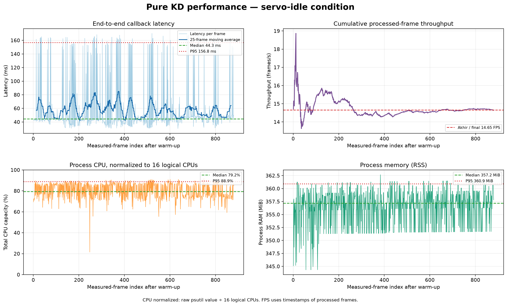

# Experiment 16 — Pure KD benchmark, servo-idle condition

**Main result:** during the approximately 60-second run, the runtime processed **880 measured frames** after a 30-frame warm-up, achieving an effective throughput of **14.65 frames/s** with **zero frame errors**. End-to-end callback latency was **44.30 ms median** and **156.78 ms P95**.

## Configuration and condition

| Parameter | Value |
|---|---|
| Condition | `servo_idle` — operator-supplied condition label |
| Torque state during run | IDs 1–18 on; IDs 19–20 off; no gait or position command was sent |
| Model | Pure KD, `kd_seed42` |
| Checkpoint | `models/weights/kd_student_best.pt` |
| Checkpoint SHA-256 | `2da0c0e58a5c1884358fe814f8992cda19bb7b58f292edc15f53b9081b6129c3` |
| Device | CPU, FP32; Intel Core i5-1240P, 16 logical CPUs |
| PyTorch threads | 12 intra-op, 12 inter-op |
| Camera / topic | C920, 640×480 YUYV, `/thesis/image_raw` (`RELIABLE`) |
| Model input / thresholds | 640; confidence 0.25; NMS IoU 0.45 |
| Tracking / preview | BoT-SORT enabled; preview disabled during measurement |
| Period | October 22, 2026, 14:14:19–14:15:21 WIB |
| Warm-up / measured duration | 30 frames / 60.07 seconds |
| Processed frames | 910 total; 880 measured; 0 errors |

## Performance results

All table statistics use the 880 post-warm-up frames. P95 uses a linear percentile. Callback latency starts when the ROS callback receives a frame and includes image conversion, inference/tracking, and result processing/publication. It **excludes** time spent waiting in a queue before the callback and screen rendering. Throughput is computed from timestamps of successfully processed frames, not as the reciprocal of latency.

| Metric | Median (P50) | P95 | Maximum |
|---|---:|---:|---:|
| End-to-end callback (ms) | **44.30** | **156.78** | 170.27 |
| Preprocessing (ms) | 1.31 | 11.39 | 14.42 |
| Inference (ms) | 26.44 | 134.72 | 147.66 |
| Postprocessing (ms) | 0.80 | 0.89 | 4.01 |
| Process CPU (% of one logical CPU) | 1,267.6% | 1,422.5% | 1,472.9% |
| Process CPU (% of 16 logical CPU capacity) | 79.2% | 88.9% | 92.1% |
| Process RSS memory (MiB) | 357.2 | 360.9 | 362.7 |

Effective throughput over the measured window: **14.65 frames/s**.



Raw CPU follows `psutil` semantics: 100% equals one logical CPU, so values can exceed 100%. The normalized row divides that value by 16 logical CPUs. The graph uses normalized CPU for an easy-to-read 0–100% scale.

## Detection observations

These counts describe model outputs only, not detection correctness. No ground-truth annotations were available for this benchmark run.

| Class | Measured frames with a detection output | Box count | Observed track ID | Median confidence |
|---|---:|---:|---|---:|
| Ball (`ball`) | 880/880 | 880 | 1 | 0.921 |
| Goal (`gawang`) | 879/880 | 879 | 3 | 0.367 |
| Robot (`robot`) | 875/880 | 875 | 2 | 0.647 |

Precision, recall, F1, mAP, and tracking accuracy were **not measured** in this run. Stable IDs in this scene do not establish ID accuracy during motion or occlusion. The result covers one idle session only; there is no walking-condition comparison yet.

## Artifacts and reproduction

- Per-frame performance log: `20261022_kd_pure_servo_idle_01.csv` (lokal: `../../../runs/op3_pytorch/20261022_kd_pure_servo_idle_01.csv`)
- Detection-box log: `20261022_kd_pure_servo_idle_01_detections.csv` (lokal: `../../../runs/op3_pytorch/20261022_kd_pure_servo_idle_01_detections.csv`)
- Session metadata and configuration: `20261022_kd_pure_servo_idle_01.json` (lokal: `../../../runs/op3_pytorch/20261022_kd_pure_servo_idle_01.json`)
- Structured metric summary: [`summary_metrics.json`](summary_metrics.json)
- Versi Bahasa Indonesia: [`README_ID.md`](README_ID.md)
- Grafik Bahasa Indonesia: [`grafik_performa_id.png`](grafik_performa_id.png)

The reproduction command was run from the repository root after sourcing ROS Jazzy, the OP3 overlay, and `.venv-op3-pytorch`:

```bash
python scripts/op3_pytorch_detector.py --ros-args \
  -p input_topic:=/thesis/image_raw -p model_variant:=kd \
  -p run_id:=20261022_kd_pure_servo_idle_01 \
  -p experiment_condition:=servo_idle -p imgsz:=640 \
  -p confidence_threshold:=0.25 -p iou_threshold:=0.45 \
  -p enable_tracking:=true -p tracker_config:=botsort.yaml \
  -p publish_debug_image:=false -p warmup_frames:=30 -p duration_s:=60.0
```
