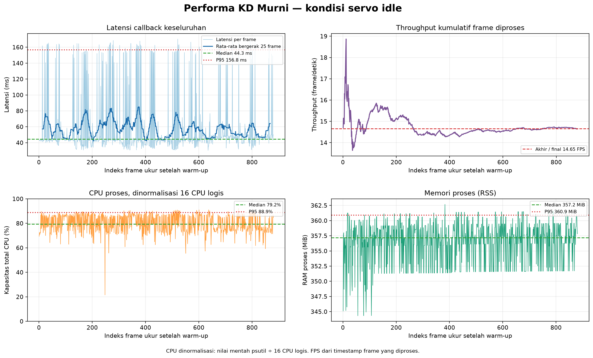

# Percobaan 16 — Benchmark KD Murni, kondisi servo idle

**Hasil utama:** pada sesi sekitar 60 detik, runtime memproses **880 frame ukur** setelah 30 frame warm-up, dengan throughput efektif **14,65 frame/detik** dan **0 error frame**. Latensi callback keseluruhan median **44,30 ms** dan P95 **156,78 ms**.

## Konfigurasi dan kondisi

| Parameter | Nilai |
|---|---|
| Kondisi | `servo_idle` — label kondisi dari operator |
| Status torque selama sesi | ID 1–18 aktif; ID 19–20 mati; tidak ada perintah gait atau posisi yang dikirim |
| Model | KD murni, `kd_seed42` |
| Checkpoint | `models/weights/kd_student_best.pt` |
| SHA-256 checkpoint | `2da0c0e58a5c1884358fe814f8992cda19bb7b58f292edc15f53b9081b6129c3` |
| Perangkat | CPU, FP32; Intel Core i5-1240P, 16 CPU logis |
| Thread PyTorch | 12 intra-op, 12 inter-op |
| Kamera / topic | C920, 640×480 YUYV, `/thesis/image_raw` (`RELIABLE`) |
| Input model / threshold | 640; confidence 0,25; NMS IoU 0,45 |
| Tracking / preview | BoT-SORT aktif; preview mati selama pengukuran |
| Periode | 22 Oktober 2026, 14:14:19–14:15:21 WIB |
| Warm-up / durasi ukur | 30 frame / 60,07 detik |
| Frame diproses | 910 total; 880 frame ukur; 0 error |

## Hasil performa

Semua statistik tabel dihitung dari 880 frame setelah warm-up. P95 menggunakan persentil linear. Latensi callback dimulai saat callback ROS menerima frame dan mencakup konversi citra, inferensi/tracking, serta pemrosesan/publikasi hasil. Nilai ini **tidak** mencakup waktu antre sebelum callback atau tampilan layar. Throughput dihitung dari selisih timestamp frame yang berhasil diproses, bukan dari kebalikan latensi.

| Metrik | Median (P50) | P95 | Maksimum |
|---|---:|---:|---:|
| Callback keseluruhan (ms) | **44,30** | **156,78** | 170,27 |
| Pra-pemrosesan (ms) | 1,31 | 11,39 | 14,42 |
| Inferensi (ms) | 26,44 | 134,72 | 147,66 |
| Pasca-pemrosesan (ms) | 0,80 | 0,89 | 4,01 |
| CPU proses (% satu CPU logis) | 1.267,6% | 1.422,5% | 1.472,9% |
| CPU proses (% kapasitas 16 CPU logis) | 79,2% | 88,9% | 92,1% |
| RAM proses RSS (MiB) | 357,2 | 360,9 | 362,7 |

Throughput efektif selama jendela ukur: **14,65 frame/detik**.



CPU mentah mengikuti definisi `psutil`: 100% setara satu CPU logis sehingga dapat melebihi 100%. Baris normalisasi membagi nilai tersebut dengan 16 CPU logis. Grafik menampilkan CPU ternormalisasi agar skala 0–100% mudah dibaca.

## Observasi deteksi

Hitungan berikut hanya menunjukkan keluaran model, bukan kebenaran deteksi. Tidak ada anotasi ground truth untuk frame benchmark ini.

| Kelas | Frame ukur dengan keluaran deteksi | Jumlah kotak | ID track teramati | Median confidence |
|---|---:|---:|---|---:|
| Bola (`ball`) | 880/880 | 880 | 1 | 0,921 |
| Gawang (`gawang`) | 879/880 | 879 | 3 | 0,367 |
| Robot (`robot`) | 875/880 | 875 | 2 | 0,647 |

Precision, recall, F1, mAP, dan akurasi tracking **tidak diukur** dalam sesi ini. ID yang stabil pada adegan sesi ini tidak membuktikan akurasi ID pada gerak atau oklusi. Hasil hanya berlaku untuk satu sesi dengan kondisi idle; belum ada pembanding walking.

## Artefak dan reproduksi

- Log performa per frame: `20261022_kd_pure_servo_idle_01.csv` (lokal: `../../../runs/op3_pytorch/20261022_kd_pure_servo_idle_01.csv`)
- Log kotak deteksi: `20261022_kd_pure_servo_idle_01_detections.csv` (lokal: `../../../runs/op3_pytorch/20261022_kd_pure_servo_idle_01_detections.csv`)
- Metadata sesi dan konfigurasi: `20261022_kd_pure_servo_idle_01.json` (lokal: `../../../runs/op3_pytorch/20261022_kd_pure_servo_idle_01.json`)
- Ringkasan metrik terstruktur: [`summary_metrics.json`](summary_metrics.json)
- Versi English: [`README_EN.md`](README_EN.md)
- Grafik English: [`performance_graph_en.png`](performance_graph_en.png)

Perintah reproduksi dijalankan dari root repo setelah ROS Jazzy, overlay OP3, dan `.venv-op3-pytorch` diaktifkan:

```bash
python scripts/op3_pytorch_detector.py --ros-args \
  -p input_topic:=/thesis/image_raw -p model_variant:=kd \
  -p run_id:=20261022_kd_pure_servo_idle_01 \
  -p experiment_condition:=servo_idle -p imgsz:=640 \
  -p confidence_threshold:=0.25 -p iou_threshold:=0.45 \
  -p enable_tracking:=true -p tracker_config:=botsort.yaml \
  -p publish_debug_image:=false -p warmup_frames:=30 -p duration_s:=60.0
```
