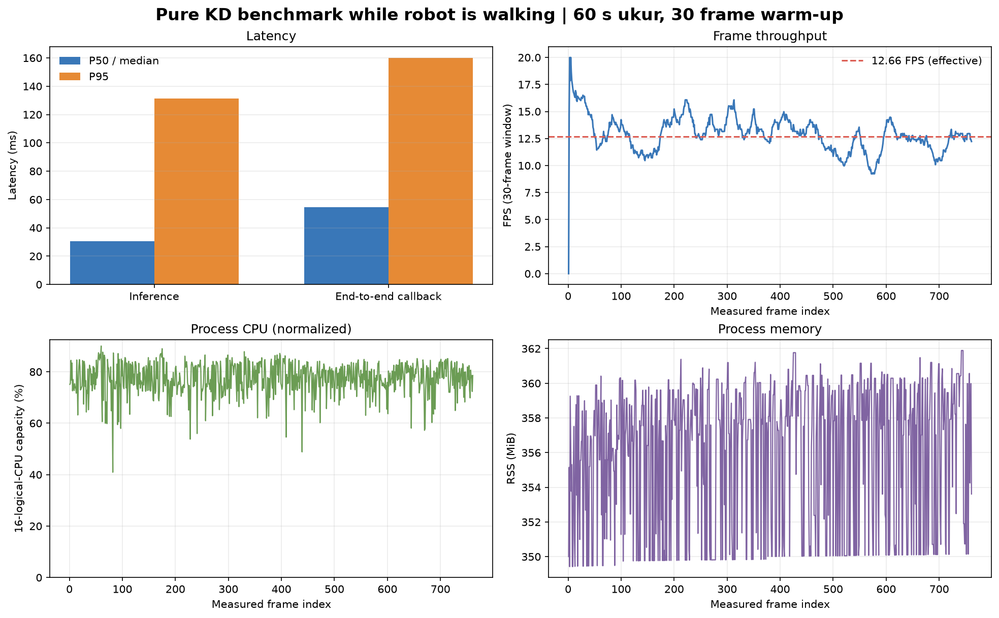

# Experiment 17 — Pure KD benchmark while the robot was commanded to walk

**Main result:** over 60.12 measured seconds after 30 warm-up frames, the detector processed **761 frames** at an effective throughput of **12.66 FPS**, with **zero frame-processing errors**. End-to-end callback latency was **54.67 ms median** and **159.97 ms P95**. A `start` command was sent to `walking_module` before measurement and `stop` was sent immediately after it finished.

## Configuration and condition

| Parameter | Value |
|---|---|
| Condition | `walking` — operator-requested test; metadata is not motion recognition |
| Model | Pure KD, `kd_seed42` |
| Checkpoint | `models/weights/kd_student_best.pt` |
| Checkpoint SHA-256 | `2da0c0e58a5c1884358fe814f8992cda19bb7b58f292edc15f53b9081b6129c3` |
| Device | CPU, FP32; 16 logical CPUs |
| PyTorch threads | 4 intra-op, 2 inter-op |
| Camera / topic | 640×480, YUYV, `/thesis/image_raw` |
| Model input / thresholds | 640; confidence 0.25; NMS IoU 0.45 |
| Tracking / preview | BoT-SORT enabled; live overlay enabled |
| Measured period | October 22, 2026, 15:23:24–15:24:25 WIB |
| Warm-up / measured duration | 30 frames / 60.12 seconds |
| Processed frames | 791 total; 761 measured; 0 errors |

## Performance results

Statistics use the 761 frames after warm-up. P95 uses nearest-rank. Callback latency starts when the ROS callback receives a frame and includes image conversion, inference/tracking, and result processing/publication. Effective throughput uses camera-frame timestamps during the measured window.

| Metric | Median (P50) | P95 | Maximum |
|---|---:|---:|---:|
| End-to-end callback (ms) | **54.67** | **159.97** | 210.63 |
| Preprocessing (ms) | 1.56 | 12.45 | 26.56 |
| Inference (ms) | 30.48 | 131.17 | 146.24 |
| Postprocessing (ms) | 0.80 | 1.24 | 6.75 |
| Process CPU (% of 16 logical CPU capacity) | 77.66% | 85.11% | 90.03% |
| Process RSS memory (MiB) | 357.58 | 360.56 | 361.89 |

Effective throughput: **12.66 FPS**.



## Detection outputs

This table summarizes model outputs on measured frames; it does not establish detection correctness. The benchmark frames have no ground-truth annotations.

| Class | Measured frames with output | Recorded boxes | Observed track ID | Median confidence |
|---|---:|---:|---|---:|
| Ball (`ball`) | 761/761 | 761 | 1 | 0.908 |
| Goal (`gawang`) | 761/761 | 761 | 3 | 0.467 |
| Robot (`robot`) | 711/761 | 711 | 2 | 0.549 |

Precision, recall, F1, mAP, and tracking accuracy cannot be inferred because this run has no ground-truth labels. Track IDs apply only while this node is running and do not establish identity correctness through occlusion or movement.

## Idle comparison limits

The earlier idle run achieved 14.65 FPS, compared with 12.66 FPS in this run. This is **not a controlled comparison**: the idle benchmark used 12 intra-op/inter-op threads with preview disabled, while this walking run used 4 intra-op threads, 2 inter-op threads, and an active overlay to leave CPU capacity for gait and show detections. The FPS decrease cannot be attributed to robot motion alone.

The `walking` label records the requested session condition and the gait command sent. The detector does not read gait telemetry, so its metadata does not independently verify physical motion.

## Artifacts and reproduction

- Per-frame performance log: `20261022_kd_pure_walking_01.csv` (lokal: `../../../runs/op3_pytorch/20261022_kd_pure_walking_01.csv`)
- Detection-box log: `20261022_kd_pure_walking_01_detections.csv` (lokal: `../../../runs/op3_pytorch/20261022_kd_pure_walking_01_detections.csv`)
- Configuration and status metadata: `20261022_kd_pure_walking_01.json` (lokal: `../../../runs/op3_pytorch/20261022_kd_pure_walking_01.json`)
- Metric summary: [`summary_metrics.json`](summary_metrics.json)
- Bahasa Indonesia: [`README_ID.md`](README_ID.md)
- Indonesian graph: [`grafik_performa_id.png`](grafik_performa_id.png)

Run from the repository root after sourcing ROS Jazzy, the OP3 overlay, and `.venv-op3-pytorch`:

```bash
python scripts/op3_pytorch_detector.py --ros-args \
  -p input_topic:=/thesis/image_raw -p model_variant:=kd \
  -p run_id:=20261022_kd_pure_walking_01 \
  -p experiment_condition:=walking -p imgsz:=640 \
  -p confidence_threshold:=0.25 -p iou_threshold:=0.45 \
  -p enable_tracking:=true -p tracker_config:=botsort.yaml \
  -p publish_debug_image:=true -p warmup_frames:=30 -p duration_s:=60.0 \
  -p torch_num_threads:=4 -p torch_interop_threads:=2
```
