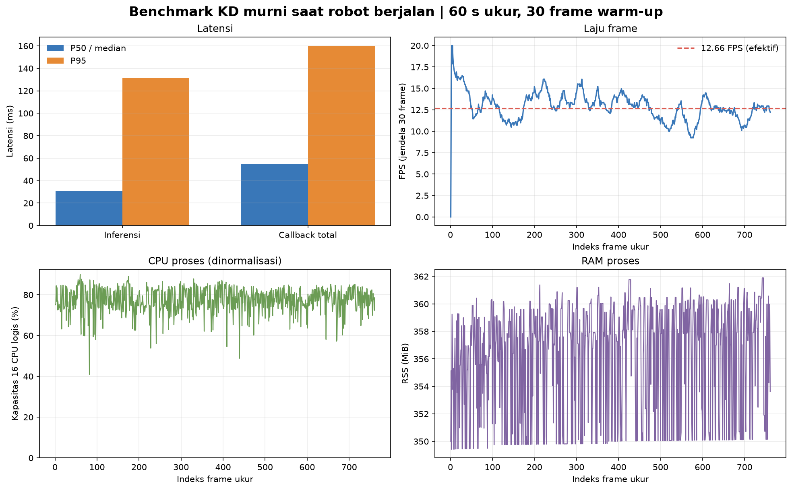

# Percobaan 17 — Benchmark KD murni saat robot berjalan

**Hasil utama:** selama 60,12 detik ukur setelah 30 frame warm-up, detektor memproses **761 frame** dengan throughput efektif **12,66 FPS** dan **0 error pemrosesan frame**. Median latensi callback keseluruhan **54,67 ms** dan P95 **159,97 ms**. Perintah `start` dikirim ke `walking_module` sebelum pengukuran dan perintah `stop` dikirim segera setelah pengukuran selesai.

## Konfigurasi dan kondisi

| Parameter | Nilai |
|---|---|
| Kondisi | `walking` — uji diminta operator; metadata kondisi bukan hasil pengenal gerak |
| Model | KD murni, `kd_seed42` |
| Checkpoint | `models/weights/kd_student_best.pt` |
| SHA-256 checkpoint | `2da0c0e58a5c1884358fe814f8992cda19bb7b58f292edc15f53b9081b6129c3` |
| Perangkat | CPU, FP32; 16 CPU logis |
| Thread PyTorch | 4 intra-op, 2 inter-op |
| Kamera / topic | 640×480, YUYV, `/thesis/image_raw` |
| Input model / threshold | 640; confidence 0,25; NMS IoU 0,45 |
| Tracking / preview | BoT-SORT aktif; overlay live aktif |
| Periode ukur | 22 Oktober 2026, 15:23:24–15:24:25 WIB |
| Warm-up / durasi ukur | 30 frame / 60,12 detik |
| Frame diproses | 791 total; 761 frame ukur; 0 error |

## Hasil performa

Statistik berikut memakai 761 frame setelah warm-up. P95 menggunakan nearest-rank. Latensi callback dihitung sejak callback ROS menerima frame, meliputi konversi citra, inferensi/tracking, serta pemrosesan dan publikasi hasil. Throughput efektif dihitung dari rentang timestamp frame yang diterima selama jendela ukur.

| Metrik | Median (P50) | P95 | Maksimum |
|---|---:|---:|---:|
| Callback keseluruhan (ms) | **54,67** | **159,97** | 210,63 |
| Pra-pemrosesan (ms) | 1,56 | 12,45 | 26,56 |
| Inferensi (ms) | 30,48 | 131,17 | 146,24 |
| Pasca-pemrosesan (ms) | 0,80 | 1,24 | 6,75 |
| CPU proses (% kapasitas 16 CPU logis) | 77,66% | 85,11% | 90,03% |
| RAM proses RSS (MiB) | 357,58 | 360,56 | 361,89 |

Throughput efektif: **12,66 FPS**.



## Keluaran deteksi

Tabel ini merangkum keluaran model pada frame ukur, bukan kebenaran deteksi. Dataset benchmark ini tidak memiliki anotasi ground truth.

| Kelas | Frame ukur dengan keluaran | Kotak tercatat | ID track teramati | Median confidence |
|---|---:|---:|---|---:|
| Bola (`ball`) | 761/761 | 761 | 1 | 0,908 |
| Gawang (`gawang`) | 761/761 | 761 | 3 | 0,467 |
| Robot (`robot`) | 711/761 | 711 | 2 | 0,549 |

Precision, recall, F1, mAP, dan akurasi tracking tidak dapat disimpulkan dari sesi ini karena tidak ada label ground truth. Track ID hanya berlaku selama node berjalan dan tidak membuktikan identitas objek benar saat oklusi atau perpindahan.

## Batas perbandingan dengan kondisi idle

Run idle sebelumnya mencapai 14,65 FPS, sedangkan run ini 12,66 FPS. Angka tersebut **bukan perbandingan terkontrol**: benchmark idle memakai 12 thread intra-op/inter-op dan preview mati, sementara benchmark berjalan memakai 4 thread intra-op, 2 inter-op, dan overlay aktif untuk menyisakan CPU bagi gait serta menampilkan deteksi. Karena itu, penurunan FPS tidak dapat diatribusikan hanya pada gerakan robot.

Label `walking` diberikan berdasarkan tujuan sesi dan perintah gait yang dikirim. Node deteksi tidak membaca telemetry gait; metadata ini tidak memverifikasi gerakan fisik secara independen.

## Artefak dan reproduksi

- Log performa per frame: `20261022_kd_pure_walking_01.csv` (lokal: `../../../runs/op3_pytorch/20261022_kd_pure_walking_01.csv`)
- Log kotak deteksi: `20261022_kd_pure_walking_01_detections.csv` (lokal: `../../../runs/op3_pytorch/20261022_kd_pure_walking_01_detections.csv`)
- Metadata konfigurasi dan status: `20261022_kd_pure_walking_01.json` (lokal: `../../../runs/op3_pytorch/20261022_kd_pure_walking_01.json`)
- Ringkasan metrik: [`summary_metrics.json`](summary_metrics.json)
- Versi English: [`README_EN.md`](README_EN.md)
- Grafik English: [`performance_graph_en.png`](performance_graph_en.png)

Detektor dijalankan dari root repo setelah ROS Jazzy, overlay OP3, dan `.venv-op3-pytorch` diaktifkan:

```bash
python scripts/op3_pytorch_detector.py --ros-args \
  -p input_topic:=/thesis/image_raw -p model_variant:=kd \
  -p run_id:=20261022_kd_pure_walking_01 \
  -p experiment_condition:=walking -p imgsz:=640 \
  -p confidence_threshold:=0.25 -p iou_threshold:=0.45 \
  -p enable_tracking:=true -p tracker_config:=botsort.yaml \
  -p publish_debug_image:=true -p warmup_frames:=30 -p duration_s:=60.0 \
  -p torch_num_threads:=4 -p torch_interop_threads:=2
```
