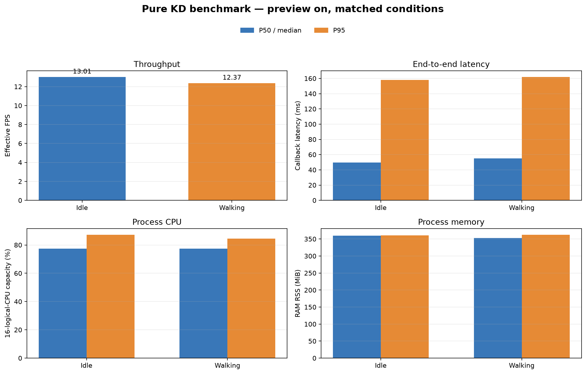

# Experiment 18 — Matched pure KD comparison with preview enabled

**Main result:** I repeated the idle and walking conditions with identical settings, including live preview in both runs. The idle run achieved **13.01 effective FPS** and the walking run **12.37 FPS**. Median end-to-end callback latency was **49.75 ms** and **55.08 ms**, respectively. The descriptive throughput difference was **−4.97%** during the walking session. This is one 60-second run per condition, so it does not establish run-to-run variation or prove gait was the only cause of the difference.

## Matched configuration

| Parameter | Value in both runs |
|---|---|
| Model / checkpoint | Pure KD, `kd_seed42` / `kd_student_best.pt` |
| Checkpoint SHA-256 | `2da0c0e58a5c1884358fe814f8992cda19bb7b58f292edc15f53b9081b6129c3` |
| Device / precision | CPU / FP32 |
| PyTorch threads | 4 intra-op, 2 inter-op |
| Camera / topic | 640×480, `/thesis/image_raw` |
| Model input / thresholds | 640; confidence 0.25; NMS IoU 0.45 |
| Tracking / preview | BoT-SORT enabled; preview enabled in both runs |
| Warm-up / measured duration | 30 frames / about 60 seconds |
| Schedule | Idle 15:30:13–15:31:16 WIB; walking 15:31:42–15:32:44 WIB |

The separate live-monitor inference process was paused to avoid running a second model. The preview window stayed open and received annotated frames directly from the benchmark node. The usual live detector was restarted after both sessions.

## Performance results

| Metric | Idle: median (P95) | Walking: median (P95) | Walking change from idle |
|---|---:|---:|---:|
| Effective throughput (FPS) | **13.01** | **12.37** | −0.65 FPS (−4.97%) |
| End-to-end callback (ms) | 49.75 (157.85) | 55.08 (161.79) | median +5.34 ms; P95 +3.94 ms |
| Inference (ms) | 29.19 (131.75) | 29.98 (132.47) | median +0.80 ms |
| Process CPU (% of 16 logical CPU capacity) | 77.33% (87.17%) | 77.39% (84.59%) | median +0.06 percentage points |
| Process RSS (MiB) | 359.57 (360.86) | 352.43 (362.18) | median −7.14 MiB |
| Measured frames / errors | 780 / 0 | 743 / 0 | — |

P95 uses nearest-rank and the same calculation for both logs. Throughput uses camera-frame timestamps. CPU is normalized to 16 logical CPUs; RSS is detector-process resident memory.

## Detection outputs

These are model outputs, not accuracy results. The benchmark frames have no ground-truth annotations.

| Class | Idle frames with output | Walking frames with output | Median confidence, idle / walking |
|---|---:|---:|---:|
| Ball (`ball`) | 780/780 (100%) | 743/743 (100%) | 0.854 / 0.900 |
| Goal (`gawang`) | 780/780 (100%) | 743/743 (100%) | 0.434 / 0.442 |
| Robot (`robot`) | 771/780 (98.85%) | 606/743 (81.56%) | 0.441 / 0.512 |

The lower robot-output frequency during the walking session merits review on labeled frames, but it is insufficient to conclude that accuracy fell. Precision, recall, F1, mAP, and tracking accuracy were not measured.

## Interpretation limits

Both runs used the same checkpoint, runtime, thread counts, thresholds, tracker, preview, and measured duration. However, this is only one run per condition; object positions or scene changes between runs may affect the result. The `walking` label records the operator-requested gait command; the detector does not read telemetry to independently verify physical motion.

## Artifacts

- Idle run: performance CSV (lokal: `../../../runs/op3_pytorch/20261022_kd_pure_matched_idle_preview_01.csv`), detections CSV (lokal: `../../../runs/op3_pytorch/20261022_kd_pure_matched_idle_preview_01_detections.csv`), metadata (lokal: `../../../runs/op3_pytorch/20261022_kd_pure_matched_idle_preview_01.json`)
- Walking run: performance CSV (lokal: `../../../runs/op3_pytorch/20261022_kd_pure_matched_walking_preview_01.csv`), detections CSV (lokal: `../../../runs/op3_pytorch/20261022_kd_pure_matched_walking_preview_01_detections.csv`), metadata (lokal: `../../../runs/op3_pytorch/20261022_kd_pure_matched_walking_preview_01.json`)
- [Structured metric summary](summary_metrics.json)
- [Grafik Bahasa Indonesia](grafik_perbandingan_id.png)

Both sessions ran `scripts/op3_pytorch_detector.py` with the same ROS parameters except `run_id` and `experiment_condition`; preview was enabled, duration was 60 seconds, warm-up was 30 frames, and PyTorch used 4 intra-op and 2 inter-op threads.
