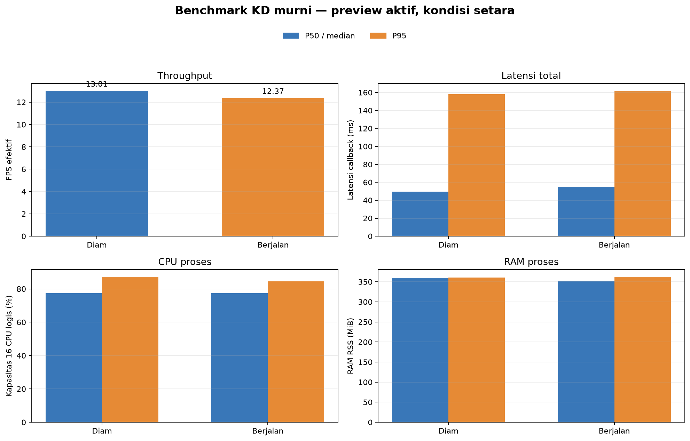

# Percobaan 18 — Perbandingan KD murni setara dengan preview aktif

**Hasil utama:** saya mengulang kondisi diam dan berjalan dengan konfigurasi identik, termasuk preview live yang aktif pada kedua sesi. Kondisi diam memperoleh **13,01 FPS efektif**; kondisi berjalan memperoleh **12,37 FPS**. Latensi callback median masing-masing **49,75 ms** dan **55,08 ms**. Selisih deskriptif throughput adalah **−4,97%** pada sesi berjalan. Ini satu sesi 60 detik per kondisi, jadi hasil belum menunjukkan variasi antar-pengulangan atau membuktikan bahwa gait menjadi satu-satunya penyebab selisih.

## Konfigurasi yang disamakan

| Parameter | Nilai pada kedua sesi |
|---|---|
| Model / checkpoint | KD murni, `kd_seed42` / `kd_student_best.pt` |
| SHA-256 checkpoint | `2da0c0e58a5c1884358fe814f8992cda19bb7b58f292edc15f53b9081b6129c3` |
| Perangkat / presisi | CPU / FP32 |
| Thread PyTorch | 4 intra-op, 2 inter-op |
| Kamera / topic | 640×480, `/thesis/image_raw` |
| Input model / threshold | 640; confidence 0,25; IoU NMS 0,45 |
| Tracking / preview | BoT-SORT aktif; preview aktif di kedua sesi |
| Warm-up / waktu ukur | 30 frame / sekitar 60 detik |
| Jadwal | Diam 15:30:13–15:31:16 WIB; berjalan 15:31:42–15:32:44 WIB |

Live monitor inferensi terpisah dihentikan sementara agar tidak menjalankan model kedua. Jendela preview tetap terbuka dan menerima gambar anotasi langsung dari node benchmark. Setelah kedua sesi selesai, live detection biasa dibuka kembali.

## Hasil performa

| Metrik | Diam: median (P95) | Berjalan: median (P95) | Perubahan berjalan terhadap diam |
|---|---:|---:|---:|
| Throughput efektif (FPS) | **13,01** | **12,37** | −0,65 FPS (−4,97%) |
| Callback total (ms) | 49,75 (157,85) | 55,08 (161,79) | median +5,34 ms; P95 +3,94 ms |
| Inferensi (ms) | 29,19 (131,75) | 29,98 (132,47) | median +0,80 ms |
| CPU proses (% kapasitas 16 CPU logis) | 77,33% (87,17%) | 77,39% (84,59%) | median +0,06 poin persentase |
| RSS proses (MiB) | 359,57 (360,86) | 352,43 (362,18) | median −7,14 MiB |
| Frame ukur / error | 780 / 0 | 743 / 0 | — |

P95 memakai nearest-rank dan dihitung dengan rumus yang sama pada kedua log. Throughput berasal dari timestamp frame kamera. CPU dinormalisasi terhadap 16 CPU logis; RSS adalah memori resident proses detector.

## Keluaran deteksi

Angka di bawah adalah keluaran model, bukan akurasi. Tidak ada anotasi ground truth untuk frame benchmark.

| Kelas | Diam: frame dengan keluaran | Berjalan: frame dengan keluaran | Median confidence diam / berjalan |
|---|---:|---:|---:|
| Bola (`ball`) | 780/780 (100%) | 743/743 (100%) | 0,854 / 0,900 |
| Gawang (`gawang`) | 780/780 (100%) | 743/743 (100%) | 0,434 / 0,442 |
| Robot (`robot`) | 771/780 (98,85%) | 606/743 (81,56%) | 0,441 / 0,512 |

Frekuensi keluaran robot yang lebih rendah pada sesi berjalan layak diperiksa pada frame berlabel, tetapi tidak cukup untuk menyimpulkan penurunan akurasi. Precision, recall, F1, mAP, dan akurasi tracking tidak diukur.

## Batas interpretasi

Kedua sesi menggunakan checkpoint, runtime, jumlah thread, threshold, tracker, preview, dan durasi ukur yang sama. Namun ini hanya satu pengulangan untuk setiap kondisi; posisi objek atau perubahan adegan antar-sesi dapat memengaruhi hasil. Label `walking` berasal dari perintah gait yang dikirim atas permintaan operator; detector tidak membaca telemetry untuk memverifikasi gerakan fisik secara mandiri.

## Artefak

- Log diam: CSV performa (lokal: `../../../runs/op3_pytorch/20261022_kd_pure_matched_idle_preview_01.csv`), CSV deteksi (lokal: `../../../runs/op3_pytorch/20261022_kd_pure_matched_idle_preview_01_detections.csv`), metadata (lokal: `../../../runs/op3_pytorch/20261022_kd_pure_matched_idle_preview_01.json`)
- Log berjalan: CSV performa (lokal: `../../../runs/op3_pytorch/20261022_kd_pure_matched_walking_preview_01.csv`), CSV deteksi (lokal: `../../../runs/op3_pytorch/20261022_kd_pure_matched_walking_preview_01_detections.csv`), metadata (lokal: `../../../runs/op3_pytorch/20261022_kd_pure_matched_walking_preview_01.json`)
- [Ringkasan metrik terstruktur](summary_metrics.json)
- [Grafik English](comparison_graph_en.png)

Kedua sesi menjalankan `scripts/op3_pytorch_detector.py` dengan parameter ROS yang sama, kecuali `run_id` dan `experiment_condition`; preview aktif, durasi 60 detik, 30 warm-up frame, 4 thread intra-op, dan 2 inter-op.
