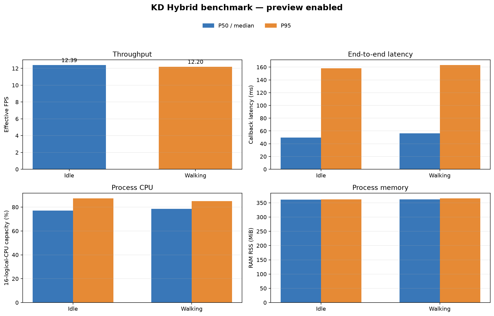

# Experiment 19 — KD Hybrid idle and loaded benchmark

**Main result:** KD Hybrid full `hybrid_full_seed1337` achieved **12.39 FPS** while idle and **12.20 FPS** while the walking command was active. Median end-to-end callback latency was **49.60 ms** and **56.39 ms**, respectively. There were no frame-processing errors. The measurements were repeated after finding that an older preparation detector was still running concurrently; the potentially contaminated initial logs were removed. Only the two clean runs are reported here.

## Configuration

| Parameter | Value in both conditions |
|---|---|
| Model | KD Hybrid full, `hybrid_full_seed1337` |
| Checkpoint | `runs/kd_hybrid/yolo11_tiny_hybrid_full_seed1337/weights/best.pt` |
| SHA-256 | `cd6bcb8bd9316930a14f4f1c5f6ee408e8dd64dddb52fb3c1e8773cde310b363` |
| Runtime | CPU FP32; 16 logical CPUs |
| PyTorch threads | 4 intra-op, 2 inter-op |
| Camera / model input | `/thesis/image_raw`; 640×480 resized to 640 |
| Confidence / NMS IoU | 0.25 / 0.45 |
| Tracking / preview | BoT-SORT; preview enabled in both runs |
| Warm-up / measured duration | 30 frames / about 60 seconds |
| Idle time | October 22, 2026, 15:55:57–15:56:59 WIB |
| Walking time | October 22, 2026, 15:57:34–15:58:37 WIB |

One detector performed inference in each measurement. After the walking run, a `stop` command was sent and live Hybrid tracking was restarted.

## Performance results

P95 uses nearest-rank. Callback latency includes image conversion, inference/tracking, and result processing/publication. Throughput uses camera-frame timestamps. CPU is normalized to 16 logical CPUs; memory is detector-process RSS.

| Metric | Idle: median (P95) | Walking: median (P95) | Walking − idle |
|---|---:|---:|---:|
| Effective throughput (FPS) | **12.39** | **12.20** | −0.19 FPS (−1.56%) |
| End-to-end callback (ms) | 49.60 (158.15) | 56.39 (163.17) | median +6.79 ms; P95 +5.02 ms |
| Inference (ms) | 29.22 (132.45) | 31.74 (134.11) | median +2.52 ms |
| Process CPU (% of 16 logical CPU capacity) | 77.07% (87.28%) | 78.58% (85.04%) | median +1.51 percentage points |
| Process RSS (MiB) | 361.40 (362.40) | 362.43 (365.43) | median +1.03 MiB |
| Measured frames / errors | 744 / 0 | 734 / 0 | — |

## Detection outputs

This table reports how often the model emitted a box on measured frames. It is **not an accuracy measure**. Target visibility was not independently verified throughout the intervals, and these frames have no ground truth.

| Class | Idle frames with output | Walking frames with output | Median confidence, idle / walking |
|---|---:|---:|---:|
| Ball (`ball`) | 744/744 (100%) | 734/734 (100%) | 0.799 / 0.788 |
| Goal (`gawang`) | 0/744 (0%) | 504/734 (68.66%) | — / 0.362 |
| Robot (`robot`) | 743/744 (99.87%) | 646/734 (88.01%) | 0.432 / 0.412 |

For the goal class, the model emitted no boxes in any idle frame. This should be checked against the video or annotations to determine whether the goal was visible during that session. This result alone does not establish whether the model was right or wrong. Precision, recall, F1, mAP, and tracking accuracy were not calculated.

## Descriptive comparison with pure KD

The pure KD benchmark using the same preview and thread protocol recorded 13.01 FPS idle and 12.37 FPS walking. KD Hybrid recorded 12.39 and 12.20 FPS in these runs. This is descriptive only: the measurements came from different sessions and scenes, with one run per condition, so they do not isolate architecture or distillation effects.

| Condition | Pure KD: FPS / median callback | KD Hybrid: FPS / median callback |
|---|---:|---:|
| Idle | 13.01 / 49.75 ms | 12.39 / 49.60 ms |
| Walking | 12.37 / 55.08 ms | 12.20 / 56.39 ms |

See the [matched pure KD benchmark](../percobaan-18-benchmark-kd-murni-setara-preview/README_EN.md).

## Interpretation limits and artifacts

There is one run per condition. The walking label records the operator-requested condition and the gait command sent; the detector does not read telemetry to independently verify physical motion. There is no ground truth, and target visibility was not measured. FPS and latency therefore describe these runs, while box frequency and confidence describe model outputs only.

- Idle: performance CSV (lokal: `../../../runs/op3_pytorch/20261022_kd_hybrid_idle_final_01.csv`), detection CSV (lokal: `../../../runs/op3_pytorch/20261022_kd_hybrid_idle_final_01_detections.csv`), metadata (lokal: `../../../runs/op3_pytorch/20261022_kd_hybrid_idle_final_01.json`)
- Walking: performance CSV (lokal: `../../../runs/op3_pytorch/20261022_kd_hybrid_walking_final_01.csv`), detection CSV (lokal: `../../../runs/op3_pytorch/20261022_kd_hybrid_walking_final_01_detections.csv`), metadata (lokal: `../../../runs/op3_pytorch/20261022_kd_hybrid_walking_final_01.json`)
- [JSON metric summary](summary_metrics.json)
- [Bahasa Indonesia report](README_ID.md) · [Indonesian graph](grafik_performa_id.png)
