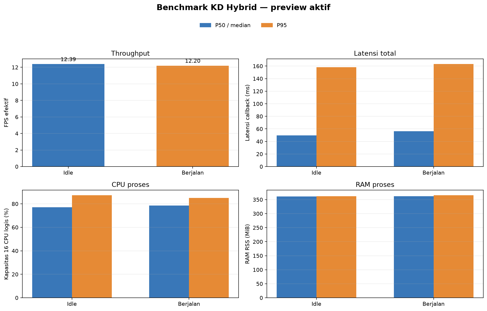

# Percobaan 19 — Benchmark KD Hybrid idle dan terbeban

**Hasil utama:** KD Hybrid full `hybrid_full_seed1337` mencapai **12,39 FPS** pada kondisi idle dan **12,20 FPS** saat perintah walking aktif. Median latensi callback masing-masing **49,60 ms** dan **56,39 ms**. Tidak ada error pemrosesan frame. Pengukuran diulang setelah mendeteksi detector persiapan lama masih berjalan bersamaan; log awal yang berpotensi terkontaminasi dihapus. Hanya dua run bersih yang dilaporkan di sini.

## Konfigurasi

| Parameter | Nilai pada kedua kondisi |
|---|---|
| Model | KD Hybrid full, `hybrid_full_seed1337` |
| Checkpoint | `runs/kd_hybrid/yolo11_tiny_hybrid_full_seed1337/weights/best.pt` |
| SHA-256 | `cd6bcb8bd9316930a14f4f1c5f6ee408e8dd64dddb52fb3c1e8773cde310b363` |
| Runtime | CPU FP32; 16 CPU logis |
| Thread PyTorch | 4 intra-op, 2 inter-op |
| Kamera / input model | `/thesis/image_raw`; 640×480 ke input 640 |
| Confidence / IoU NMS | 0,25 / 0,45 |
| Tracking / preview | BoT-SORT; preview aktif di kedua sesi |
| Warm-up / waktu ukur | 30 frame / sekitar 60 detik |
| Waktu idle | 22 Oktober 2026, 15:55:57–15:56:59 WIB |
| Waktu walking | 22 Oktober 2026, 15:57:34–15:58:37 WIB |

Satu detector menjalankan inferensi pada setiap pengukuran. Setelah pengukuran walking, perintah `stop` dikirim dan live tracking Hybrid dinyalakan kembali.

## Hasil performa

P95 menggunakan nearest-rank. Latensi callback mencakup konversi citra, inferensi/tracking, serta pemrosesan dan publikasi hasil. Throughput memakai timestamp frame kamera. CPU dinormalisasi terhadap kapasitas 16 CPU logis; RAM adalah RSS proses detector.

| Metrik | Idle: median (P95) | Walking: median (P95) | Perubahan walking − idle |
|---|---:|---:|---:|
| Throughput efektif (FPS) | **12,39** | **12,20** | −0,19 FPS (−1,56%) |
| Callback total (ms) | 49,60 (158,15) | 56,39 (163,17) | median +6,79 ms; P95 +5,02 ms |
| Inferensi (ms) | 29,22 (132,45) | 31,74 (134,11) | median +2,52 ms |
| CPU proses (% kapasitas 16 CPU logis) | 77,07% (87,28%) | 78,58% (85,04%) | median +1,51 poin persentase |
| RSS proses (MiB) | 361,40 (362,40) | 362,43 (365,43) | median +1,03 MiB |
| Frame ukur / error | 744 / 0 | 734 / 0 | — |

## Keluaran deteksi

Tabel ini menunjukkan seberapa sering model mengeluarkan kotak pada frame ukur. Ini **bukan ukuran akurasi**. Posisi target pada seluruh interval tidak diverifikasi secara terpisah dan frame tidak mempunyai ground truth.

| Kelas | Idle: frame dengan keluaran | Walking: frame dengan keluaran | Median confidence idle / walking |
|---|---:|---:|---:|
| Bola (`ball`) | 744/744 (100%) | 734/734 (100%) | 0,799 / 0,788 |
| Gawang (`gawang`) | 0/744 (0%) | 504/734 (68,66%) | — / 0,362 |
| Robot (`robot`) | 743/744 (99,87%) | 646/734 (88,01%) | 0,432 / 0,412 |

Khusus kelas gawang, model tidak menghasilkan kotak pada seluruh frame idle. Hal ini perlu diperiksa bersama rekaman atau anotasi untuk memastikan apakah gawang memang terlihat pada sesi tersebut. Hasil ini sendiri tidak membuktikan model salah atau benar. Precision, recall, F1, mAP, dan akurasi tracking tidak dihitung.

## Perbandingan deskriptif dengan KD murni

Pada benchmark KD murni dengan protokol preview dan thread yang sama, throughput tercatat 13,01 FPS idle dan 12,37 FPS walking. KD Hybrid pada run ini mencatat 12,39 dan 12,20 FPS. Perbandingan ini bersifat deskriptif: pengukuran dilakukan pada sesi dan adegan yang berbeda, satu run per kondisi, sehingga belum mengisolasi pengaruh arsitektur atau distilasi.

| Kondisi | KD murni: FPS / median callback | KD Hybrid: FPS / median callback |
|---|---:|---:|
| Idle | 13,01 / 49,75 ms | 12,39 / 49,60 ms |
| Walking | 12,37 / 55,08 ms | 12,20 / 56,39 ms |

Lihat [laporan benchmark KD murni setara](../percobaan-18-benchmark-kd-murni-setara-preview/README_ID.md).

## Batas interpretasi dan artefak

Kondisi idle dan walking masing-masing hanya satu run. Label walking menunjukkan kondisi yang diminta operator dan perintah gait yang dikirim; detector tidak membaca telemetry untuk memverifikasi gerakan fisik secara independen. Tidak ada ground truth, dan visibilitas target tidak diukur. Karena itu, FPS dan latensi merupakan hasil sesi ini, sedangkan frekuensi kotak/confidence hanya keluaran model.

- Idle: CSV performa (lokal: `../../../runs/op3_pytorch/20261022_kd_hybrid_idle_final_01.csv`), CSV deteksi (lokal: `../../../runs/op3_pytorch/20261022_kd_hybrid_idle_final_01_detections.csv`), metadata (lokal: `../../../runs/op3_pytorch/20261022_kd_hybrid_idle_final_01.json`)
- Walking: CSV performa (lokal: `../../../runs/op3_pytorch/20261022_kd_hybrid_walking_final_01.csv`), CSV deteksi (lokal: `../../../runs/op3_pytorch/20261022_kd_hybrid_walking_final_01_detections.csv`), metadata (lokal: `../../../runs/op3_pytorch/20261022_kd_hybrid_walking_final_01.json`)
- [Ringkasan metrik JSON](summary_metrics.json)
- [Laporan English](README_EN.md) · [grafik English](performance_graph_en.png)
