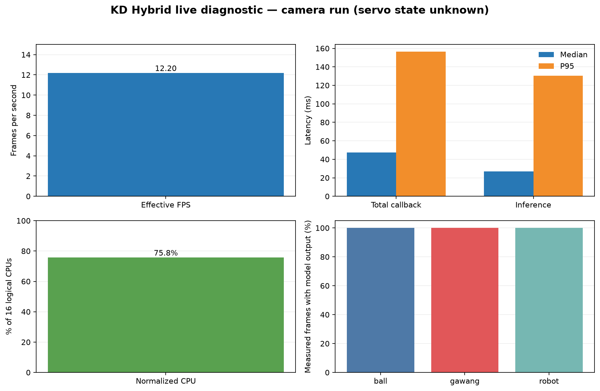

# Experiment 20 — KD Hybrid live diagnostic and goal output

**Result:** in this camera session, KD Hybrid emitted a `gawang` box on **736/736 measured frames (100.0%)**. Ball and robot outputs also appeared on 736/736 and 736/736 frames. These are model outputs visible in the preview, not an accuracy measurement.

## Condition and configuration

The U2D2 device was present, but OpenCR did not answer the controller communication. Servo torque and physical idle state therefore **could not be verified**. The session metadata is `unknown`; this is an approximately 60-second camera diagnostic, not a verified servo-idle benchmark.

Model `hybrid_full_seed1337`, CPU FP32, input size 640, confidence 0.25, IoU 0.45, BoT-SORT, SSH-X preview enabled, 30-frame warm-up, and 4/2 PyTorch threads. After warm-up: **736 frames**, **12.20 FPS**, 0 frame errors. Callback median/P95 47.36/156.37 ms; inference 26.72/130.60 ms; median CPU 75.8% of 16 logical CPUs; median RSS 352.4 MiB.

## Per-class model outputs

| Class | Frames with model output | Median confidence |
|---|---:|---:|
| Ball | 736/736 (100.0%) | 0.850 |
| Goal (`gawang`) | 736/736 (100.0%) | 0.433 |
| Robot | 736/736 (100.0%) | 0.436 |

These values report detector-output frequency. No independently verified ground truth was available, so they are not accuracy, precision, or recall.

## Evidence

- Performance CSV (lokal: `../../../runs/op3_pytorch/20261022_kd_hybrid_opencr_recovery_idle_diag_01.csv`)
- Detection boxes and confidence CSV (lokal: `../../../runs/op3_pytorch/20261022_kd_hybrid_opencr_recovery_idle_diag_01_detections.csv`)
- Raw run metadata (lokal: `../../../runs/op3_pytorch/20261022_kd_hybrid_opencr_recovery_idle_diag_01.json`)
- [Metrics summary](summary_metrics.json)
- [Indonesian chart](grafik_performa_id.png)
