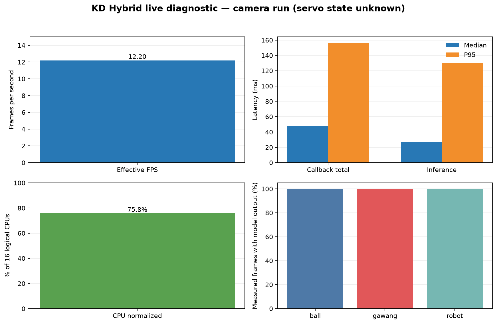

# Percobaan 20 — Diagnostik live KD Hybrid dan keluaran gawang

**Hasil:** pada sesi kamera ini, KD Hybrid mengeluarkan kotak kelas gawang pada **736/736 frame ukur (100.0%)**. Bola dan robot juga muncul pada 736/736 dan 736/736 frame. Ini merupakan keluaran model yang terlihat pada preview, bukan pengukuran akurasi.

## Kondisi dan konfigurasi

OpenCR terdeteksi sebagai perangkat U2D2, tetapi tidak menjawab komunikasi controller. Karena itu, torque servo dan kondisi fisik idle **tidak dapat diverifikasi**. Metadata sesi disimpan sebagai `unknown`; hasil ini adalah diagnostik kamera selama kira-kira 60 detik, bukan benchmark idle servo.

Model `hybrid_full_seed1337`, CPU FP32, input 640, confidence 0,25, IoU 0,45, BoT-SORT, preview SSH-X aktif, warm-up 30 frame, dan 4/2 thread PyTorch. Setelah warm-up: **736 frame**, **12.20 FPS**, error frame 0. Median/P95 callback 47.36/156.37 ms; inferensi 26.72/130.60 ms; CPU median 75.8% kapasitas 16 CPU logis; RAM RSS median 352.4 MiB.

## Keluaran per kelas

| Kelas | Frame dengan keluaran model | Median confidence |
|---|---:|---:|
| Bola | 736/736 (100.0%) | 0.850 |
| Gawang | 736/736 (100.0%) | 0.433 |
| Robot | 736/736 (100.0%) | 0.436 |

Angka di atas menyatakan frekuensi keluaran detektor. Tidak ada ground truth yang diverifikasi secara independen, sehingga angka tersebut bukan akurasi, precision, atau recall.

## Bukti

- CSV performa (lokal: `../../../runs/op3_pytorch/20261022_kd_hybrid_opencr_recovery_idle_diag_01.csv`)
- CSV kotak deteksi dan confidence (lokal: `../../../runs/op3_pytorch/20261022_kd_hybrid_opencr_recovery_idle_diag_01_detections.csv`)
- Metadata run mentah (lokal: `../../../runs/op3_pytorch/20261022_kd_hybrid_opencr_recovery_idle_diag_01.json`)
- [Ringkasan metrik](summary_metrics.json)
- [Grafik English](performance_graph_en.png)
