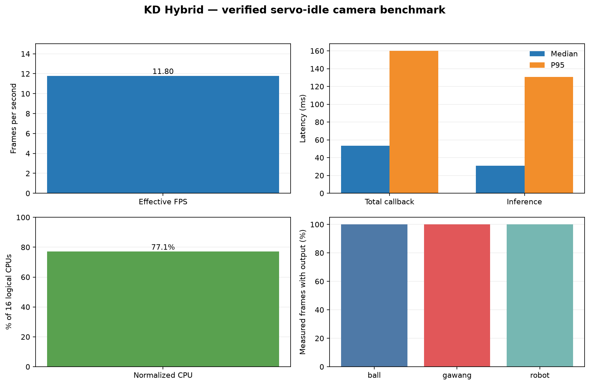

# Experiment 21 — KD Hybrid servo-idle after OpenCR recovery

**Main result:** after OpenCR communications recovered, KD Hybrid detected the goal class on **708/708 measured frames (100%)**. Ball and robot outputs also appeared on every measured frame. This addresses the previous session's missing goal boxes; these are model outputs, not an accuracy measurement.

## Robot state and method

OpenCR communicated again over U2D2. The controller published 20-joint telemetry and IMU. Pre/post checks reported zero joint velocity; the controller restored its torque configuration during initialization. No gait or init-pose command was sent. SSH-X preview remained active during the run.

Model: `hybrid_full_seed1337`, CPU FP32, input size 640, confidence 0.25, IoU 0.45, BoT-SORT, 30-frame warm-up followed by 60.08 seconds of measurement. Results: **708 frames**, **11.80 FPS**, 0 errors. Callback total median/P95 **53.22/159.87 ms**, inference **31.07/130.64 ms**, median CPU **77.1%** of 16 logical CPUs, median RSS **357.3 MiB**.

## Detection outputs

| Class | Frames with model output | Median confidence |
|---|---:|---:|
| Ball | 708/708 (100%) | 0.842 |
| Goal (`gawang`) | 708/708 (100%) | 0.409 |
| Robot | 708/708 (100%) | 0.533 |

Without independently verified ground truth, box frequency and confidence must not be interpreted as accuracy, precision, or recall.

## Artifacts

- Performance CSV (lokal: `../../../runs/op3_pytorch/20261022_kd_hybrid_servo_idle_after_opencr_recovery_01.csv`)
- Detection boxes CSV (lokal: `../../../runs/op3_pytorch/20261022_kd_hybrid_servo_idle_after_opencr_recovery_01_detections.csv`)
- Run metadata (lokal: `../../../runs/op3_pytorch/20261022_kd_hybrid_servo_idle_after_opencr_recovery_01.json`)
- [Metrics summary](summary_metrics.json)
- [Indonesian report](README_ID.md) · [Indonesian chart](grafik_performa_id.png)
