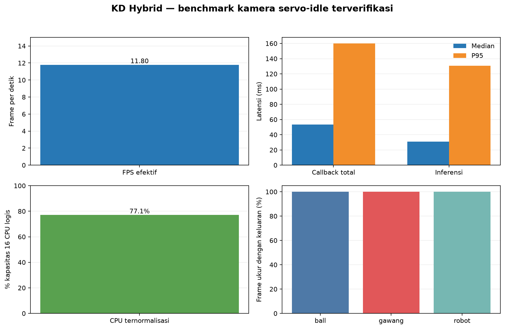

# Percobaan 21 — KD Hybrid pada kondisi servo-idle setelah OpenCR pulih

**Hasil utama:** setelah OpenCR kembali merespons, KD Hybrid mendeteksi kelas gawang pada **708/708 frame ukur (100%)**. Bola dan robot juga muncul pada setiap frame ukur. Ini menjawab pengamatan sesi sebelumnya yang tidak menghasilkan kotak gawang; hasil tersebut masih merupakan keluaran model, bukan ukuran akurasi.

## Status robot dan metode

OpenCR kembali berkomunikasi melalui U2D2. Controller menerbitkan telemetry 20 joint dan IMU. Pemeriksaan posisi sebelum/sesudah pengukuran menunjukkan kecepatan joint nol; controller memulihkan konfigurasi torque saat inisialisasi. Tidak ada perintah gait atau pose awal. Preview SSH-X aktif selama run.

Model: `hybrid_full_seed1337`, CPU FP32, input 640, confidence 0,25, IoU 0,45, BoT-SORT, warm-up 30 frame, lalu 60.08 detik ukur. Hasilnya **708 frame**, **11.80 FPS**, 0 error. Median/P95 callback total **53.22/159.87 ms**, inferensi **31.07/130.64 ms**, CPU median **77.1%** dari kapasitas 16 CPU logis, RSS median **357.3 MiB**.

## Keluaran deteksi

| Kelas | Frame dengan keluaran model | Median confidence |
|---|---:|---:|
| Bola | 708/708 (100%) | 0.842 |
| Gawang | 708/708 (100%) | 0.409 |
| Robot | 708/708 (100%) | 0.533 |

Tanpa ground truth yang diverifikasi independen, frekuensi kotak dan confidence tidak dapat ditafsirkan sebagai akurasi, precision, atau recall.

## Artefak

- CSV performa (lokal: `../../../runs/op3_pytorch/20261022_kd_hybrid_servo_idle_after_opencr_recovery_01.csv`)
- CSV hasil kotak deteksi (lokal: `../../../runs/op3_pytorch/20261022_kd_hybrid_servo_idle_after_opencr_recovery_01_detections.csv`)
- Metadata run (lokal: `../../../runs/op3_pytorch/20261022_kd_hybrid_servo_idle_after_opencr_recovery_01.json`)
- [Ringkasan metrik](summary_metrics.json)
- [Laporan English](README_EN.md) · [grafik English](performance_graph_en.png)
