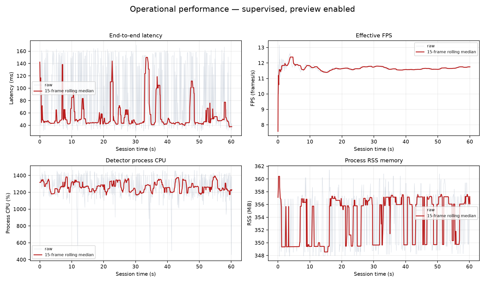
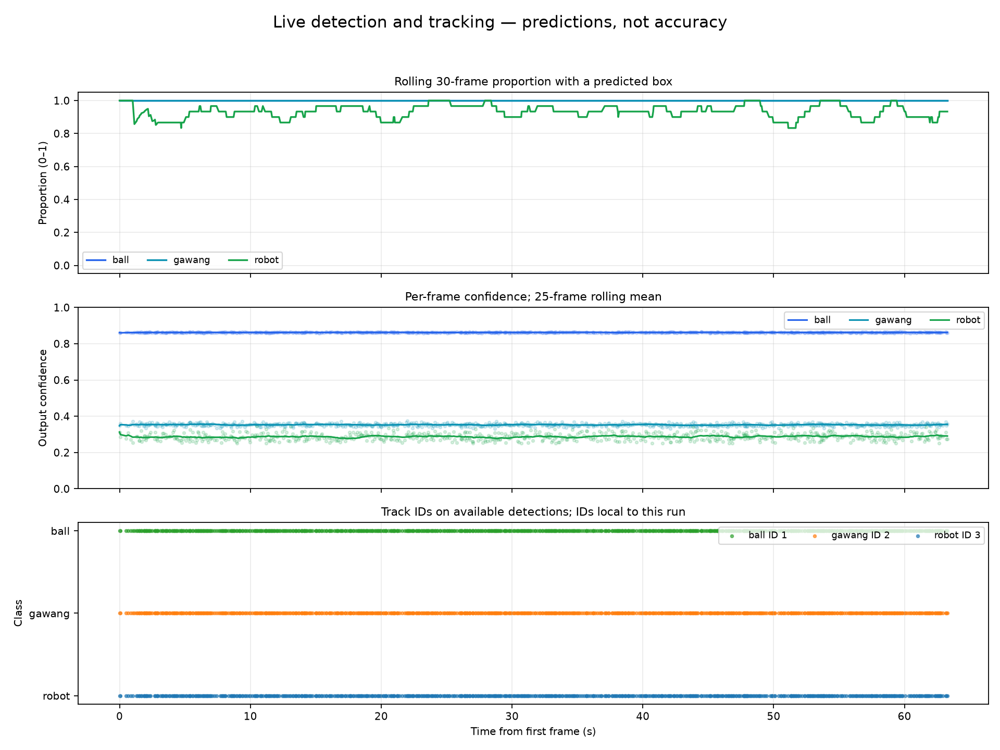

# Experiment 22 — supervised live function and tracking check

**Date and time:** 22 October 2026, 21:52:32–21:53:35 WIB (UTC+7)

**Run ID:** 20261022_external_supervised_function_unknown_02

**Repository commit:** d748def3d764cb84c9c776b551a848f59443163e. The working tree already contained local changes before this session.

## Condition and configuration

The operator confirmed object placement. Physical robot condition remains **unknown** because servo or motion state was not verified. No actuator commands were issued.

The model was **supervised seed 1337**. Checkpoint SHA-256: d41046c384c9795b7724db726a99abbbd26217ffa53c77412d5cfcf34a16e041. CPU FP32 inference; imgsz 640; confidence 0.25; NMS IoU 0.45; BoT-SORT; 4 PyTorch threads and 2 interop threads. SSH-X preview was enabled.

The ROS camera source was /thesis/image_raw (sensor_msgs/msg/Image, 640×480, publisher QoS RELIABLE). The detector subscribed with BEST_EFFORT depth 1 and published /vision/detections and /vision/debug_image. Runtime: Ubuntu 24.04.5 LTS, ROS Jazzy, Python 3.12.3, PyTorch 2.4.1+cpu, Ultralytics 8.4.130, OpenCV 4.11.0; Intel Core i5-1240P, 16 logical CPUs, 7.3 GiB RAM, powersave governor.

## Detection and tracking results

| Predicted class | Frames with box / total | Mean confidence (range) | Track ID | ID switches |
|---|---:|---:|---:|---:|
| ball | 738/738 (100.0%) | 0.862 (0.857–0.867) | 1 | 0 |
| gawang | 738/738 (100.0%) | 0.353 (0.332–0.374) | 2 | 0 |
| robot | 689/738 (93.4%) | 0.287 (0.250–0.348) | 3 | 0 |

The detector processed **738 frames**, including 30 warm-up frames. **708 frames** contributed to the operational summary over 60.23 seconds. Observed IDs remained ball:1, gawang:2, and robot:3, with no ID switches logged in this session.

## Session performance

| Measure | Result |
|---|---:|
| Effective post-warm-up FPS | 11.75 frames/s |
| Median / p95 end-to-end latency | 45.21 / 158.93 ms |
| Median / p95 process CPU | 1262.3% / 1432.8% |
| Median / peak RSS | 355.8 / 361.4 MiB |
| Frame errors | 0 |

## Visual evidence, tables, and graphs

- Annotated video: live_detection_tracking.mp4 (lokal: `live_detection_tracking.mp4`), 668 frames at 640×480, about 62.58 seconds. The initial capture is also retained: live_detection_tracking_capture_12fps.mp4 (lokal: `live_detection_tracking_capture_12fps.mp4`).
- Screenshots: beginning (lokal: `ss_deteksi_awal.png`), middle (lokal: `ss_deteksi_tengah.png`), ending (lokal: `ss_deteksi_akhir.png`).
- Tables: [summary](summary_table_EN.csv), [per-class results](per_class_summary_EN.csv).
- Full logs: [per-frame metrics](log_framewise.csv), [detections and track IDs](log_detections_tracking.csv), [runtime metadata](metadata_runtime.json), [session and file-hash manifest](result_manifest.json).

The video contains 668 frames, while the detector log contains 738 processed frames. The video recorder was a separate BEST_EFFORT subscriber, so it is illustrative and does not contain every detector-log frame. The detector CSV is the authoritative per-frame source. The video and screenshots come from the annotated /vision/debug_image topic, not a desktop recording or raw camera video.

## Interpretation limits

Frame presence and confidence are **model outputs**, not precision, recall, mAP, or accuracy. This session has no ground truth. It was an exploratory check with preview enabled, not a clean benchmark. CPU is a per-process psutil reading and can exceed 100% for a multithreaded process.

In the screenshots, the goal box appears to cover one post or part of the visible structure, rather than the complete structure. The robot box touches the right and lower image edges; a robot prediction is absent in 49 of 738 frames. The evidence does not determine the cause. No planned or documented object-motion sequence was recorded, so tracking on moving objects was not tested. CPU temperature and the actual camera rate during this session were not measured.

## Next step

To test tracking during motion, run a separate session with planned and documented object movement, without moving the robot. Accuracy claims require new frames with human-reviewed ground truth and offline evaluation under the locked protocol. All session artifacts remain local; no commit or push was made.
