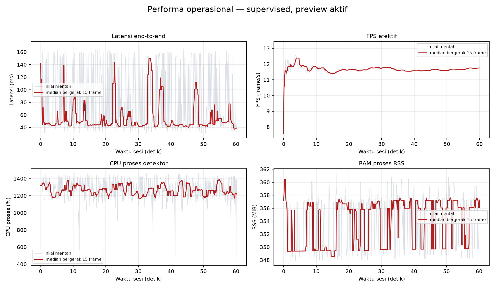
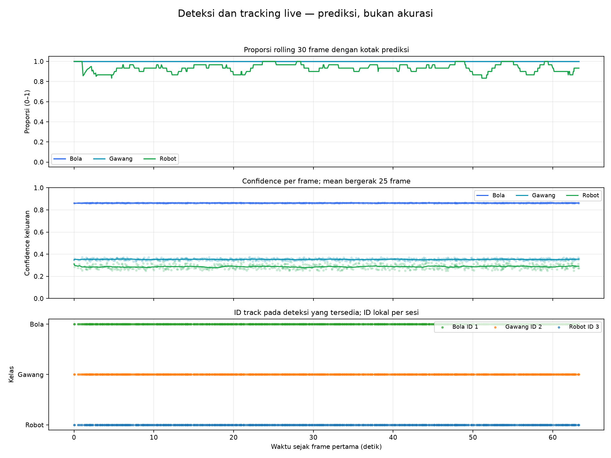

# Percobaan 22 — pemeriksaan fungsi live supervised dan tracking

**Tanggal dan waktu:** 22 Oktober 2026, 21:52:32–21:53:35 WIB (UTC+7)

**Run ID:** 20261022_external_supervised_function_unknown_02

**Commit repo:** d748def3d764cb84c9c776b551a848f59443163e. Working tree sudah berisi perubahan lokal sebelum sesi ini.

## Kondisi dan konfigurasi

Operator mengonfirmasi bahwa objek sudah diposisikan. Kondisi fisik robot tetap dicatat sebagai **unknown**, karena keadaan servo atau gerak tidak diverifikasi. Tidak ada perintah aktuator.

Model yang dipakai adalah **supervised seed 1337**. Checkpoint SHA-256: d41046c384c9795b7724db726a99abbbd26217ffa53c77412d5cfcf34a16e041. Inferensi CPU FP32; imgsz 640; confidence 0,25; NMS IoU 0,45; BoT-SORT; 4 thread PyTorch dan 2 thread interop. Preview SSH-X aktif.

Kamera ROS menggunakan /thesis/image_raw (sensor_msgs/msg/Image, 640×480, publisher QoS RELIABLE). Detektor menerima frame dengan BEST_EFFORT depth 1 dan menerbitkan /vision/detections serta /vision/debug_image. Runtime: Ubuntu 24.04.5 LTS, ROS Jazzy, Python 3.12.3, PyTorch 2.4.1+cpu, Ultralytics 8.4.130, OpenCV 4.11.0; Intel Core i5-1240P, 16 logical CPU, RAM 7,3 GiB, governor powersave.

## Hasil deteksi dan tracking

| Kelas keluaran | Frame dengan kotak / total | Confidence rata-rata (rentang) | ID track | Pergantian ID |
|---|---:|---:|---:|---:|
| Bola | 738/738 (100.0%) | 0.862 (0.857–0.867) | 1 | 0 |
| Gawang | 738/738 (100.0%) | 0.353 (0.332–0.374) | 2 | 0 |
| Robot | 689/738 (93.4%) | 0.287 (0.250–0.348) | 3 | 0 |

Detektor memproses **738 frame**, termasuk 30 frame warm-up. Sebanyak **708 frame** dipakai untuk ringkasan operasional dalam 60.23 detik. ID yang teramati tetap ball:1, gawang:2, dan robot:3; tidak ada pergantian ID pada log sesi ini.

## Performa operasional sesi ini

| Ukuran | Hasil |
|---|---:|
| FPS efektif sesudah warm-up | 11.75 frame/s |
| Latensi end-to-end median / p95 | 45.21 / 158.93 ms |
| CPU proses median / p95 | 1262.3% / 1432.8% |
| RSS median / puncak | 355.8 / 361.4 MiB |
| Error frame | 0 |

## Bukti visual, tabel, dan grafik

- Video anotasi: live_detection_tracking.mp4 (lokal: `live_detection_tracking.mp4`), 668 frame pada 640×480, sekitar 62.58 detik. Berkas capture awal juga disimpan: live_detection_tracking_capture_12fps.mp4 (lokal: `live_detection_tracking_capture_12fps.mp4`).
- Screenshot: awal (lokal: `ss_deteksi_awal.png`), tengah (lokal: `ss_deteksi_tengah.png`), akhir (lokal: `ss_deteksi_akhir.png`).
- Tabel: [ringkasan](tabel_ringkasan_ID.csv), [hasil per kelas](tabel_per_kelas_ID.csv).
- Log lengkap: [metrik per frame](log_framewise.csv), [deteksi dan ID track](log_detections_tracking.csv), [metadata runtime](metadata_runtime.json), [manifest sesi dan hash file](result_manifest.json).

Video berisi 668 frame, sedangkan log detektor berisi 738 frame yang diproses. Perekam video merupakan subscriber BEST_EFFORT terpisah, sehingga video hanya bukti visual ilustratif dan tidak mencakup setiap frame log. CSV detektor adalah sumber utama analisis per frame. Video dan screenshot berasal dari topik anotasi /vision/debug_image, bukan rekaman desktop atau video kamera mentah.

## Batas interpretasi

Persentase frame dengan kotak dan nilai confidence merupakan **keluaran model**, bukan precision, recall, mAP, atau akurasi. Tidak ada ground truth untuk sesi ini. Uji ini bersifat eksploratif dengan preview aktif, bukan benchmark bersih. Angka CPU adalah pemakaian proses menurut psutil dan dapat melebihi 100% pada proses multithread.

Pada screenshot, kotak gawang tampak mencakup satu tiang atau bagian rangka, bukan seluruh struktur yang terlihat. Kotak robot menyentuh tepi kanan dan bawah gambar; prediksi robot tidak muncul pada 49 dari 738 frame. Data ini belum memastikan penyebabnya. Tidak ada rangkaian gerak objek yang direncanakan atau dicatat, sehingga kontinuitas tracking objek bergerak belum teruji. Suhu CPU dan laju kamera aktual selama sesi tidak diukur.

## Langkah berikutnya

Untuk menguji tracking ketika objek bergerak, lakukan sesi terpisah dengan perpindahan objek yang direncanakan dan dicatat, tanpa menggerakkan robot. Klaim akurasi memerlukan frame baru dengan ground truth yang ditinjau manusia dan evaluasi offline sesuai protokol terkunci. Artefak sesi ini tetap lokal; tidak ada commit atau push.
