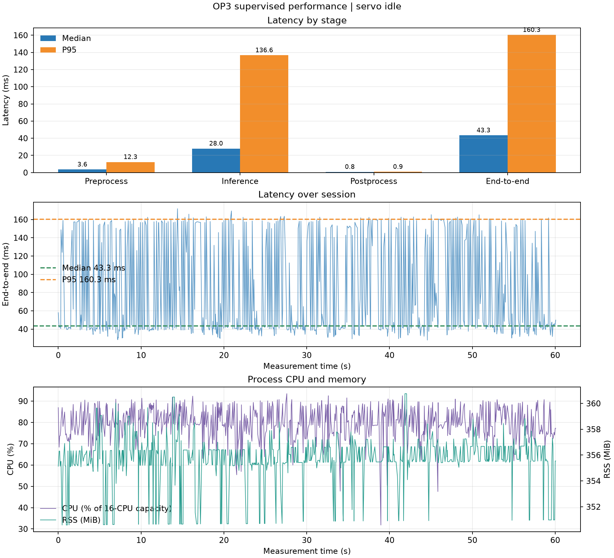
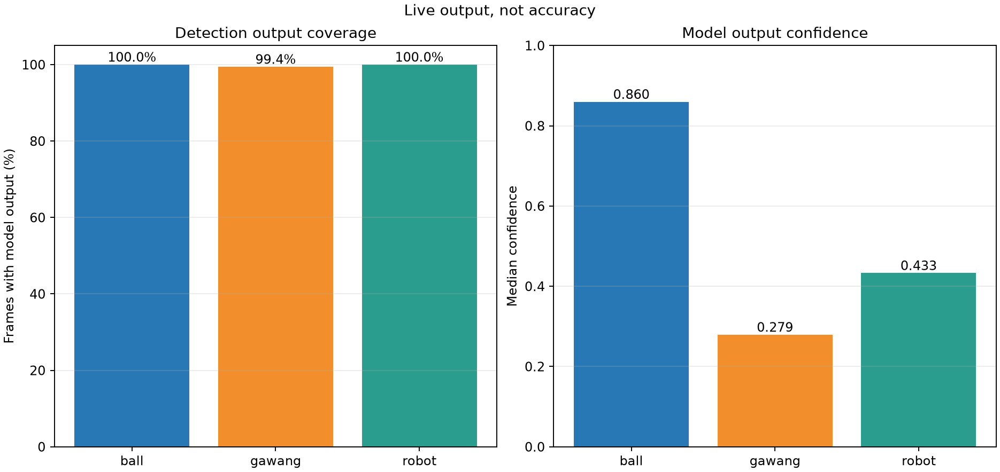

# Supervised OP3 test — servo idle

## Session result

Run 20261022_supervised_servo_idle_preview_01: **703 measured frames**, **60.12 s**, 30 warm-up frames, **11.69 effective FPS**, 0 frame errors. Time: 2026-10-22 22:40:29 WIB to 2026-10-22 22:41:32 WIB. SSH-X preview remained active during measurement.

Supervised seed 1337, CPU FP32, input size 640, confidence 0.25, NMS IoU 0.45, BoT-SORT. Checkpoint SHA-256: d41046c384c9795b7724db726a99abbbd26217ffa53c77412d5cfcf34a16e041.

Condition was recorded as **servo_idle** per operator direction. Read-only pre/post snapshots show torque IDs 1–18 enabled and IDs 19/20 disabled; maximum position change was 2 counts. These are two snapshots, not continuous velocity telemetry.

## Performance

| Stage | Median (ms) | P95 (ms) | Mean (ms) |
| --- | ---: | ---: | ---: |
| Preprocess | 3.56 | 12.29 | 5.86 |
| Inference | 27.96 | 136.64 | 58.18 |
| Postprocess | 0.79 | 0.87 | 0.74 |
| End-to-end | 43.34 | 160.34 | 76.13 |

Process CPU median/P95: 1269.3% / 1436.2% (100% equals one logical CPU; host has 16 logical CPUs). RSS median/P95: 355.6 / 357.9 MiB.

## Detection and tracker output

| Class | Frames with model output | Median confidence | Observed IDs | Adjacent-frame ID changes |
| --- | ---: | ---: | --- | ---: |
| ball | 703/703 (100.0%) | 0.860 | 1 | 0 |
| gawang | 699/703 (99.4%) | 0.279 | 3 | 0 |
| robot | 703/703 (100.0%) | 0.433 | 2 | 0 |

Frame coverage, confidence, and tracker IDs are model outputs, **not** precision, recall, mAP, or accuracy. An idle scene does not test tracker continuity for moving objects; a separate tracking session will follow.

Live preview screenshot (lokal: `ss_live_detection.png`)

## Interpretation limits and evidence

Preview can affect runtime; these values are not a preview-off benchmark. Camera ground truth was unavailable, so accuracy metrics cannot be calculated. This folder contains raw logs, tables, graphs, screenshot, metadata, and servo snapshots.
