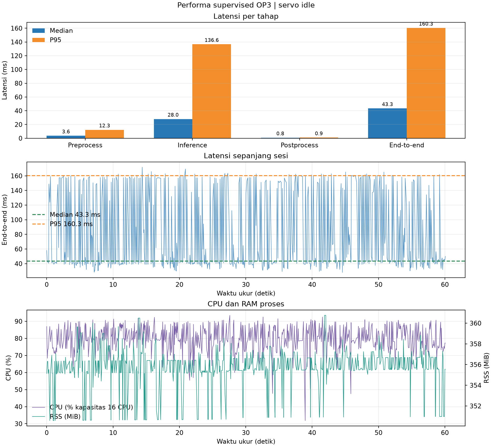
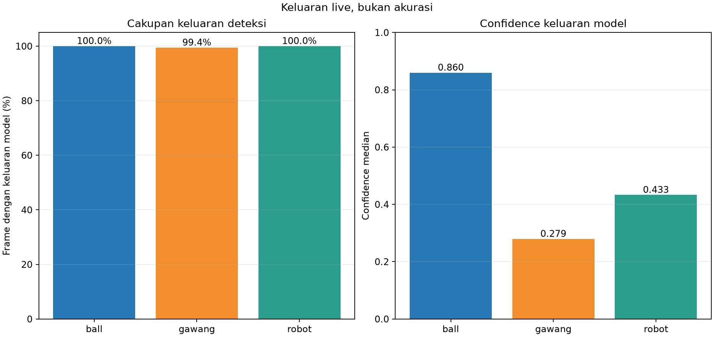

# Uji supervised OP3 — servo idle

## Hasil sesi

Run 20261022_supervised_servo_idle_preview_01: **703 frame ukur**, **60.12 detik**, 30 frame warm-up, **11.69 FPS efektif**, 0 error frame. Waktu: 2026-10-22 22:40:29 WIB sampai 2026-10-22 22:41:32 WIB. Preview SSH-X aktif selama pengukuran.

Model supervised seed 1337, CPU FP32, input 640, confidence 0,25, NMS IoU 0,45, BoT-SORT. SHA-256 checkpoint: d41046c384c9795b7724db726a99abbbd26217ffa53c77412d5cfcf34a16e041.

Kondisi dicatat sebagai **servo_idle** sesuai arahan operator. Snapshot baca-saja sebelum dan sesudah menunjukkan torque ID 1–18 aktif dan ID 19/20 mati; perubahan posisi maksimum 2 count. Snapshot hanya pada dua waktu, bukan telemetry kecepatan kontinu.

## Performa

| Tahap | Median (ms) | P95 (ms) | Rata-rata (ms) |
| --- | ---: | ---: | ---: |
| Preprocess | 3.56 | 12.29 | 5.86 |
| Inference | 27.96 | 136.64 | 58.18 |
| Postprocess | 0.79 | 0.87 | 0.74 |
| End-to-end | 43.34 | 160.34 | 76.13 |

CPU proses median/P95: 1269.3% / 1436.2% (100% setara satu logical CPU; host memiliki 16 CPU logis). RSS median/P95: 355.6 / 357.9 MiB.

## Deteksi dan tracker

| Kelas | Frame dengan keluaran model | Confidence median | ID terlihat | Pergantian ID frame berurutan |
| --- | ---: | ---: | --- | ---: |
| ball | 703/703 (100.0%) | 0.860 | 1 | 0 |
| gawang | 699/703 (99.4%) | 0.279 | 3 | 0 |
| robot | 703/703 (100.0%) | 0.433 | 2 | 0 |

Cakupan frame, confidence, dan ID tracker adalah keluaran model, **bukan** precision, recall, mAP, atau akurasi. Scene idle tidak menguji kontinuitas tracker saat objek bergerak; sesi tracking terpisah menyusul.

Screenshot preview live (lokal: `ss_live_detection.png`)

## Batas interpretasi dan bukti

Preview aktif dapat memengaruhi runtime; angka ini bukan benchmark preview-off. Tidak ada ground truth kamera untuk menghitung akurasi. Folder ini berisi log mentah, tabel, grafik, screenshot, metadata, dan snapshot servo.
