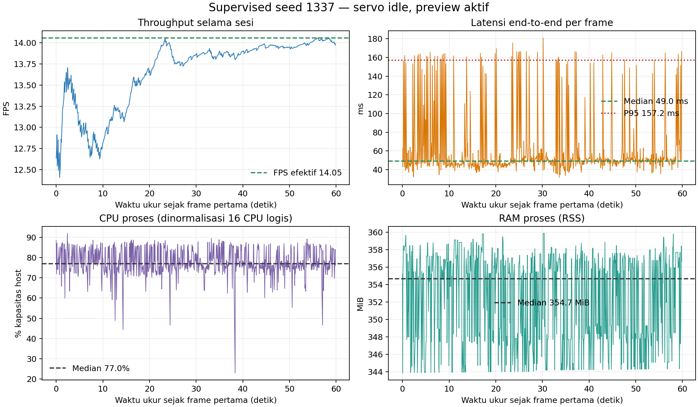
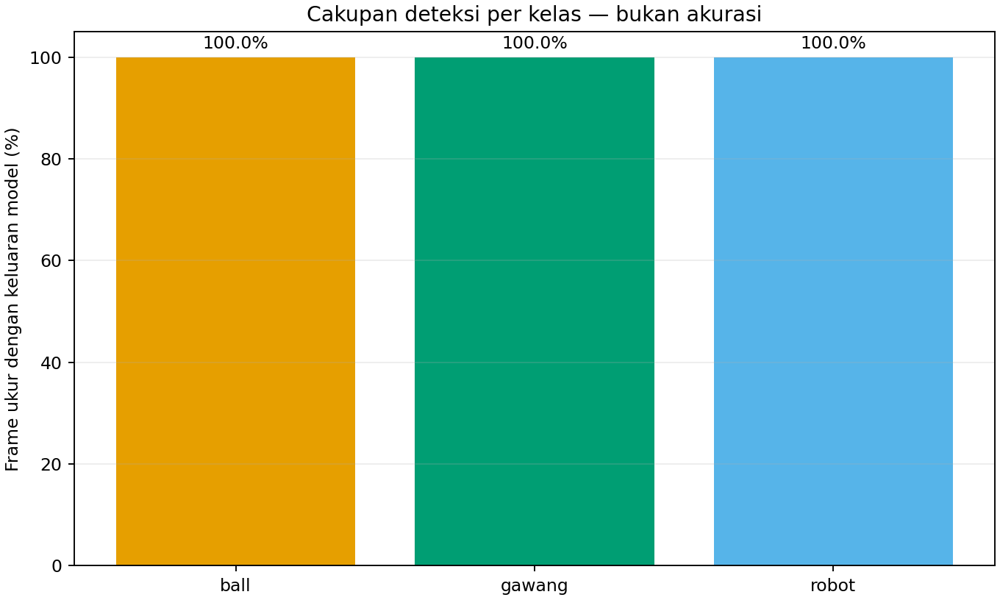

# Uji supervised — kondisi servo idle

## Hasil

Detektor supervised seed 1337 memproses **842 frame ukur** setelah 30 frame warm-up selama **60,01 detik**. Throughput efektif tercatat **14,05 FPS**, dengan **0 error frame**. Preview SSH-X tetap aktif sepanjang pengukuran.

| Metrik | Median | P95 | Satuan |
|---|---:|---:|---|
| Pra-pemrosesan | 1,49 | 11,63 | ms |
| Inferensi | 28,39 | 130,67 | ms |
| Pascapemrosesan | 0,83 | 0,93 | ms |
| End-to-end | 49,03 | 157,24 | ms |
| CPU proses | 1.232,3 | 1.393,4 | % satu CPU logis |
| CPU dinormalisasi terhadap 16 CPU logis | 77,02 | 87,09 | % kapasitas host |
| RAM proses (RSS) | 354,69 | 358,68 | MiB |

## Keluaran deteksi dan tracking

| Kelas | Frame dengan kotak / frame ukur | Cakupan keluaran | Median confidence | ID terlihat |
|---|---:|---:|---:|---:|
| Bola (`ball`) | 842/842 | 100% | 0,847 | 1 |
| Gawang (`gawang`) | 842/842 | 100% | 0,370 | 3 |
| Robot (`robot`) | 842/842 | 100% | 0,643 | 2 |

Cakupan kotak, confidence, dan ID di atas adalah **keluaran model, bukan akurasi**. Adegan ini tidak memakai ground truth. Karena kondisi objek tidak digerakkan secara terencana, sesi idle juga tidak mengukur kestabilan ID ketika objek bergerak.

## Kondisi servo dan konfigurasi

| Item | Nilai |
|---|---|
| Run ID | `20261022_supervised_retest_servo_idle_01` |
| Model/checkpoint | `supervised_seed1337` |
| SHA-256 | `d41046c384c9795b7724db726a99abbbd26217ffa53c77412d5cfcf34a16e041` |
| Runtime | CPU FP32, PyTorch 2.4.1, Ultralytics 8.4.130 |
| Input dan threshold | 640; confidence 0,25; IoU NMS 0,45 |
| Tracker | BoT-SORT |
| Thread PyTorch | 4 intra-op, 2 inter-op |
| Kamera | C920 `/dev/video0`, 640×480, topic `/thesis/image_raw` |
| Preview | Aktif selama sesi |
| Kondisi | `servo_idle`, label operator; tidak dideteksi otomatis |

Preflight baca-saja pada 23:23:28 dan 23:26:30 WIB menunjukkan ID 1–18 torque-on dan ID 19/20 torque-off pada kedua pemeriksaan. Goal position ID 19/20 tidak berubah. Present position masing-masing terbaca bergeser +1 count antara snapshot; sesi deteksi tidak menulis register servo. Rincian seluruh ID ada pada [tabel status servo](tabel_status_servo.csv) dan snapshot pre/post di bawah.

Sesi deteksi berjalan 23:23:51–23:24:53 WIB. Screenshot X11 tidak tersimpan karena server X11 menolak capture desktop; jendela preview sendiri aktif saat run. Karena itu bukti sesi ini berupa log, tabel, dan grafik.

## Artefak sumber

- [Metrik terstruktur](summary_metrics.json)
- [Tabel performa](tabel_performa.csv) · [tabel deteksi per kelas](tabel_deteksi_per_kelas.csv)
- Log frame mentah (lokal: `../../../../runs/op3_pytorch/20261022_supervised_retest_servo_idle_01.csv`)
- Log deteksi dan ID (lokal: `../../../../runs/op3_pytorch/20261022_supervised_retest_servo_idle_01_detections.csv`)
- Metadata run (lokal: `../../../../runs/op3_pytorch/20261022_supervised_retest_servo_idle_01.json`)
- Snapshot servo sebelum (lokal: `../../../../runs/op3_servo_torque_control/20261022T162328Z.json`) · sesudah (lokal: `../../../../runs/op3_servo_torque_control/20261022T162630Z.json`)
