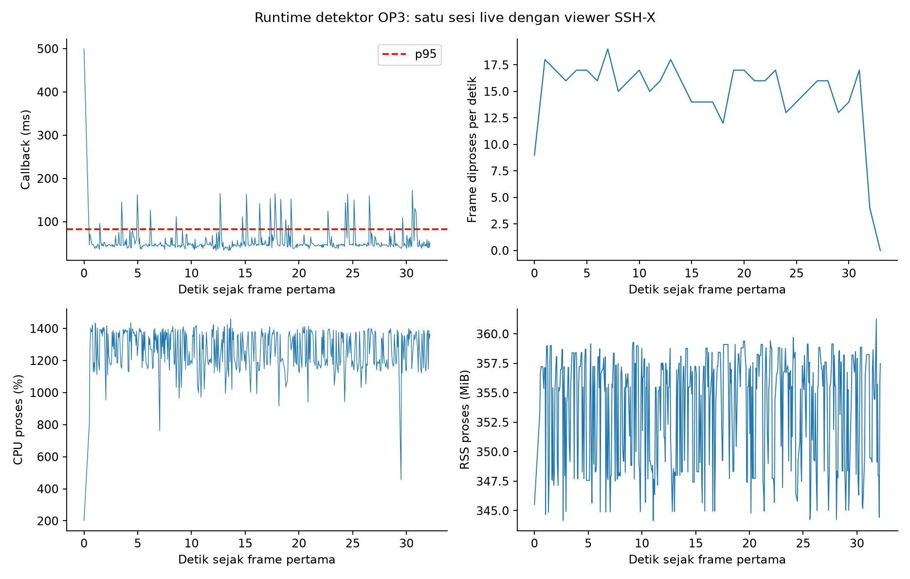
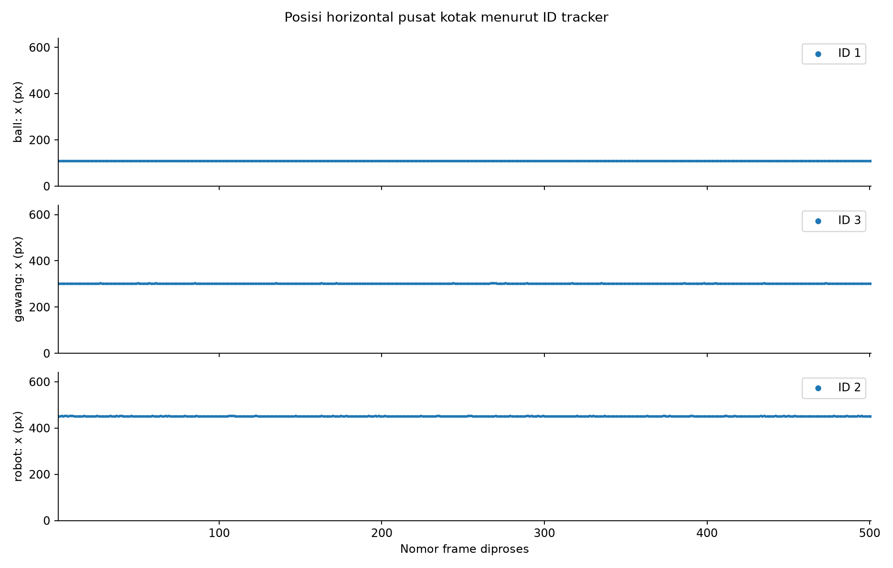

# Tracking live Supervised — sesi 1

## Status dan kesimpulan

Preview deteksi SSH-X berjalan selama pengukuran. Model menghasilkan kotak dan ID tracker untuk bola, gawang, dan robot pada 501/501 frame tanpa error. ID tetap konsisten pada sesi ini. Namun, bola hampir tidak berpindah: rentang pusat kotak horizontalnya hanya **0,51 piksel**. Karena gerak target tidak terlihat di log, sesi ini membuktikan keluaran live dan kestabilan ID pada adegan statis, **bukan tracking bola bergerak**.

Frame deteksi live dengan bola, gawang, dan robot (lokal: `frame_deteksi.png`)

## Performa runtime

| Metrik | Median | P95 | Satuan |
|---|---:|---:|---|
| Pra-pemrosesan | 1,38 | 11,46 | ms/frame |
| Inferensi | 27,04 | 54,65 | ms/frame |
| Pascapemrosesan | 0,79 | 0,84 | ms/frame |
| Callback end-to-end | 45,90 | 82,73 | ms/frame |
| Usia frame kamera saat callback | 33,11 | 62,02 | ms |
| CPU proses | 1.280,9 | 1.404,0 | % satu CPU logis |
| CPU / kapasitas 16 CPU logis | 80,06 | 87,75 | % host |
| RAM proses RSS | 355,55 | 359,01 | MiB |

Total log berisi 501 frame selama 32,30 detik; 30 frame pertama menjadi warm-up. Pengukuran setelah warm-up berlangsung 30,03 detik, mencakup 471 frame, dengan FPS efektif **15,68**. FPS pemrosesan seluruh log, termasuk warm-up, **15,51**. Perbedaan definisi ini dipertahankan agar angka tidak tertukar.

## Keluaran tracker

| Kelas | Frame dengan deteksi | ID | Cakupan ID | Rentang pusat X | Rentang pusat Y | Median confidence |
|---|---:|---:|---:|---:|---:|---:|
| Bola (`ball`) | 501/501 | 1 | 100% | 0,51 px | 0,75 px | 0,849 |
| Gawang (`gawang`) | 501/501 | 3 | 100% | 1,46 px | 1,11 px | 0,348 |
| Robot (`robot`) | 501/501 | 2 | 100% | 0,89 px | 2,83 px | 0,599 |

Cakupan kotak, confidence, dan ID merupakan keluaran model; tanpa label ground truth per frame, angka tersebut **bukan akurasi**, MOTA, atau IDF1. Lintasan yang hampir datar sesuai dengan kamera dan objek yang tampak diam. Uji gerak perlu diulang ketika bola benar-benar digerakkan melintasi bidang kamera.

## Kondisi servo dan konfigurasi

| Item | Nilai |
|---|---|
| Run ID | `20261022_supervised_retest_tracking_01` |
| Waktu sesi | 22 Oktober 2026, 23:34:39–23:35:11 WIB (16:34:39–16:35:11 UTC) |
| Model | `supervised_seed1337` |
| SHA-256 checkpoint | `d41046c384c9795b7724db726a99abbbd26217ffa53c77412d5cfcf34a16e041` |
| Runtime | CPU FP32; PyTorch 2.4.1; Ultralytics 8.4.130; OpenCV 4.11.0 |
| Input kamera | `/thesis/image_raw`, 640×480 |
| Parameter | imgsz 640; confidence 0,25; IoU 0,45; BoT-SORT |
| Thread | 4 intra-op; 2 inter-op |
| Preview | SSH-X aktif; overlay dipublikasikan ke `/vision/debug_image` |
| Frame error | 0 |

Snapshot baca-saja menunjukkan:

| Servo | Torque sebelum → sesudah | Goal sebelum → sesudah | Present sebelum → sesudah |
|---|---|---:|---:|
| ID 19 | mati → mati | 2228 → 2228 | 2228 → 2228 |
| ID 20 | mati → mati | 1725 → 1725 | 1725 → 1726 |

Detektor tidak menulis register servo. Goal kedua servo tidak berubah; pembacaan posisi aktual ID20 bergeser 1 count saat torque mati. Snapshot sebelum dan sesudah: 16:33:05 UTC (lokal: `../../../../runs/op3_servo_torque_control/20261022T163305Z.json`) dan 16:35:30 UTC (lokal: `../../../../runs/op3_servo_torque_control/20261022T163530Z.json`).

## Artefak

- Frame deteksi (lokal: `frame_deteksi.png`) dan [metadata frame](frame_deteksi.json)
- [Tabel performa CSV](tabel_performa.csv) · [tabel tracker CSV](tabel_tracking.csv) · [tabel servo CSV](tabel_servo.csv)
- [Ringkasan runtime dan tracking JSON](summary_runtime.json)
- CSV frame mentah (lokal: `../../../../runs/op3_pytorch/20261022_supervised_retest_tracking_01.csv`)
- CSV deteksi/ID (lokal: `../../../../runs/op3_pytorch/20261022_supervised_retest_tracking_01_detections.csv`)
- Metadata run (lokal: `../../../../runs/op3_pytorch/20261022_supervised_retest_tracking_01.json`)
- Laporan grafik sumber: `runs/op3_tracking_runtime_report/20261022_supervised_retest_tracking_01/` (lokal: `../../../../runs/op3_tracking_runtime_report/20261022_supervised_retest_tracking_01/`)

Video mentah tidak direkam pada sesi ini. Bukti visual terdiri dari satu frame beranotasi; data kontinu tersedia sebagai CSV frame dan deteksi.
