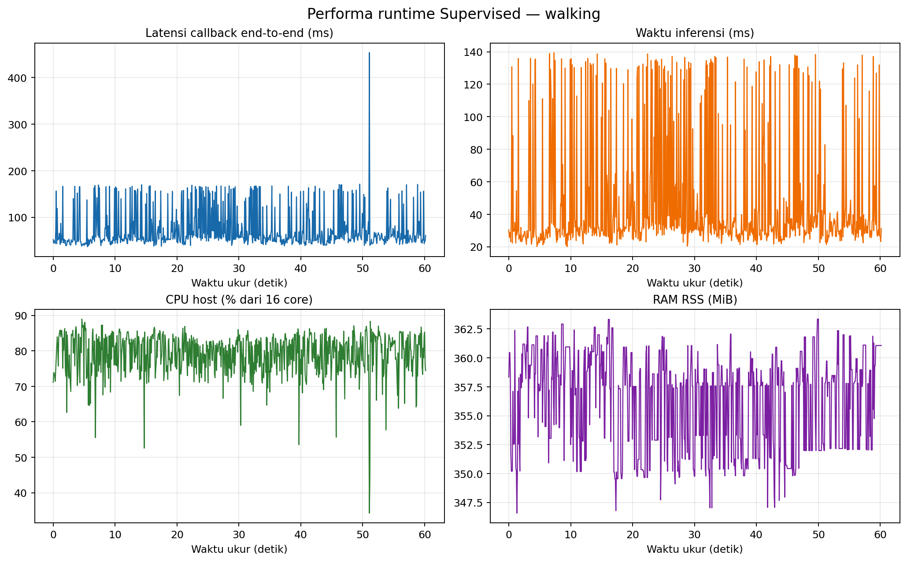
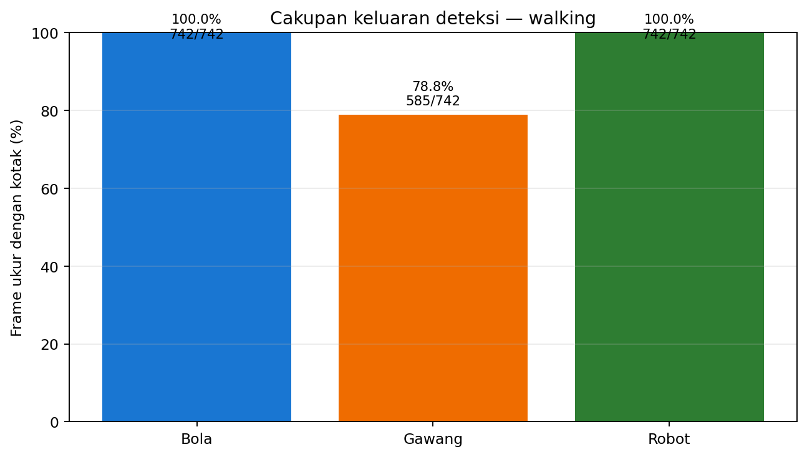

# Uji Supervised — robot berjalan

Run 20261022_supervised_retest_head_held_walking_01 merekam 742 frame ukur selama 60.24 detik setelah 30 frame warm-up. Throughput efektif 12.31 FPS; error frame 0. Preview SSH-X aktif.

Contoh deteksi langsung (lokal: `frame_deteksi.png`)

## Performa runtime

| Metrik | Median | P95 | Satuan |
|---|---:|---:|---|
| Pra-pemrosesan | 4.99 | 12.69 | ms/frame |
| Inferensi | 31.35 | 133.85 | ms/frame |
| Pascapemrosesan | 0.79 | 1.12 | ms/frame |
| Callback end-to-end | 55.60 | 165.14 | ms/frame |
| CPU proses | 1277.70 | 1371.57 | % satu CPU logis |
| CPU host (16 CPU logis) | 79.86 | 85.72 | % kapasitas host |
| RAM RSS | 357.61 | 361.91 | MiB |

## Keluaran deteksi

| Kelas | Frame terdeteksi | Cakupan | Median confidence | ID tracker |
|---|---:|---:|---:|---|
| Bola | 742/742 | 100.0% | 0.849 | 1 |
| Gawang | 585/742 | 78.8% | 0.305 | 3 |
| Robot | 742/742 | 100.0% | 0.609 | 2, 4 |

Cakupan dan confidence adalah keluaran model, bukan akurasi. Tidak tersedia ground truth frame untuk menghitung precision, recall, F1, atau mAP.

## Servo kepala

Torque ID19/20 aktif dan Goal/Present register cocok pada preflight sebelum manager. Manager dijalankan dengan auto_start_init_pose=false; tidak ada perintah Goal_Position atau pose kepala sepanjang sesi. Feedback ROS selama sesi berada dekat pembacaan awal. Rinciannya ada pada [telemetry kepala](../head_pose_telemetry.json) dan [tabel status kepala](../tabel_status_kepala.csv).

## Konfigurasi dan sumber

- Kondisi: Berjalan; waktu: 23:52:13 WIB–23:53:16 WIB.
- Model: supervised_seed1337; CPU FP32; PyTorch 2.4.1+cpu; Ultralytics 8.4.130.
- Kamera 640×480 dari /thesis/image_raw; imgsz 640; confidence 0,25; IoU 0,45; BoT-SORT; 4 intra-op dan 2 inter-op.
- [Ringkasan JSON](summary_metrics.json) · [tabel runtime](tabel_performa.csv) · [tabel deteksi](tabel_deteksi_per_kelas.csv).
- CSV frame mentah (lokal: `../../../../runs/op3_pytorch/20261022_supervised_retest_head_held_walking_01.csv`) · CSV deteksi/ID (lokal: `../../../../runs/op3_pytorch/20261022_supervised_retest_head_held_walking_01_detections.csv`) · metadata run (lokal: `../../../../runs/op3_pytorch/20261022_supervised_retest_head_held_walking_01.json`).
- Video tidak direkam; bukti visual berupa frame anotasi dan data kontinu pada CSV.
