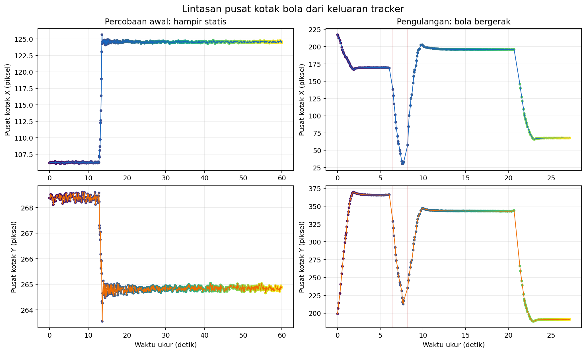

# Uji tracking bola Supervised

Dua sesi disimpan terpisah. Percobaan awal 60 detik hampir statis; pengulangan 30 detik memperlihatkan gerak bola yang jelas. Hasil tracking gerak mengacu pada pengulangan.

## Hasil tracking gerak

Contoh frame live (lokal: `retest-01/frame_deteksi.png`)

Pada pengulangan 20261022_supervised_retest_head_held_tracking_moving_ball_retry01, bola terdeteksi pada 314/361 frame ukur (87.0%). Pusat kotak bergerak 187.0 px horizontal (29.2% lebar gambar) dan 181.2 px vertikal. Tracker menghasilkan ID 12, 3, 5, 8 dengan 3 pergantian ID antar-frame terdeteksi. Ini menunjukkan lokasi bola bergerak, tetapi identitas tracker belum konsisten sepanjang lintasan.

| Sesi | Frame ukur | Cakupan deteksi bola | Rentang X | Rentang Y | ID | Pergantian ID | FPS efektif |
|---|---:|---:|---:|---:|---|---:|---:|
| Awal, bola hampir statis (60 dtk) | 779 | 100.0% | 19.6 px | 5.1 px | 1 | 0 | 12.97 |
| Pengulangan, bola bergerak (30 dtk) | 361 | 87.0% | 187.0 px | 181.2 px | 12, 3, 5, 8 | 3 | 11.99 |

Cakupan dan confidence adalah keluaran model, bukan akurasi. Tanpa anotasi ground truth per frame, precision/recall tracking, MOTA, dan IDF1 tidak dihitung. Pergantian ID perlu ditinjau pada lintasan berlabel.

## Performa pengulangan

| Metrik | Median | P95 | Satuan |
|---|---:|---:|---|
| Pra-pemrosesan | 3.74 | 12.77 | ms/frame |
| Inferensi | 29.87 | 135.59 | ms/frame |
| Pascapemrosesan | 0.79 | 1.03 | ms/frame |
| Callback end-to-end | 51.96 | 163.44 | ms/frame |
| CPU proses | 1254.40 | 1392.70 | % satu CPU logis |
| CPU host (16 CPU logis) | 78.40 | 87.04 | % kapasitas host |
| RAM RSS | 360.18 | 362.54 | MiB |

## Artefak

- Frame anotasi pengulangan (lokal: `retest-01/frame_deteksi.png`) · [metadata frame](retest-01/frame_deteksi.json).
- [Tabel performa retry](retest-01/tabel_performa.csv) · [tabel deteksi retry](retest-01/tabel_deteksi_per_kelas.csv) · [tabel lintasan/ID](tabel_tracking.csv).
- Percobaan awal: CSV frame (lokal: `../../../../runs/op3_pytorch/20261022_supervised_retest_head_held_tracking_moving_ball_01.csv`), CSV deteksi (lokal: `../../../../runs/op3_pytorch/20261022_supervised_retest_head_held_tracking_moving_ball_01_detections.csv`), metadata (lokal: `../../../../runs/op3_pytorch/20261022_supervised_retest_head_held_tracking_moving_ball_01.json`), [ringkasan](summary_metrics.json).
- Pengulangan bergerak: CSV frame (lokal: `../../../../runs/op3_pytorch/20261022_supervised_retest_head_held_tracking_moving_ball_retry01.csv`), CSV deteksi (lokal: `../../../../runs/op3_pytorch/20261022_supervised_retest_head_held_tracking_moving_ball_retry01_detections.csv`), metadata (lokal: `../../../../runs/op3_pytorch/20261022_supervised_retest_head_held_tracking_moving_ball_retry01.json`), [ringkasan](retest-01/summary_metrics.json).
- Video tidak direkam; gambar contoh dan log CSV menjadi bukti visual/temporal.
