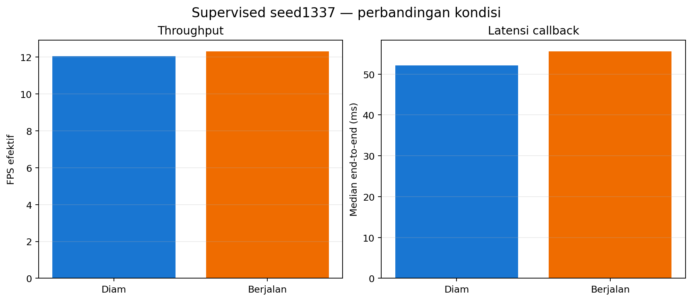

# Percobaan 25 — uji ulang Supervised dengan posisi kepala dipertahankan

## Hasil utama

Pengukuran live menggunakan Supervised seed 1337 dengan preview SSH-X. Uji robot diam dan berjalan masing-masing berlangsung sekitar 60 detik dengan parameter sama; model memproses 724 dan 742 frame ukur tanpa error. Throughput 12.06 dan 12.31 FPS. Gait dikonfirmasi melalui perubahan siklik posisi joint kaki pada telemetry ROS.

Uji tracking pertama hampir statis. Pengulangan 30 detik menunjukkan pusat kotak bola bergerak 187.0 px horizontal dan 181.2 px vertikal. Bola terlihat pada 87.0% frame, tetapi ID tracker berganti 3 kali.

## Perbandingan runtime

| Metrik | Robot diam | Robot berjalan | Satuan |
|---|---:|---:|---|
| FPS efektif | 12.06 | 12.31 | frame/detik |
| Latensi end-to-end median | 52.13 | 55.60 | ms |
| CPU host median | 78.34 | 79.86 | % kapasitas host |
| RAM RSS median | 363.0 | 357.6 | MiB |
| Error frame | 0 | 0 | frame |

## Posisi kamera dan servo kepala

Preflight langsung sebelum manager (22 Oktober 2026, 23:47 WIB) membaca ID19 torque=1, Goal/Present=2228/2228 dan ID20 torque=1, Goal/Present=1725/1725. Manager hardware dijalankan dengan auto_start_init_pose=false. Tidak ada perintah pose atau Goal_Position untuk ID19/20 selama sesi.

Feedback joint ROS saat idle, gait, dan setelah gait menunjukkan perubahan pan maksimal 0,00153 rad (sekitar satu count) dan tilt maksimal 0,00307 rad (sekitar dua count) dari sampel awal. Ini variasi pembacaan kecil, bukan target kamera yang diganti. Preflight register setelah manager tidak dijalankan karena manager memakai bus serial yang sama.

## Metode dan batas interpretasi

- Checkpoint supervised_seed1337; CPU FP32; PyTorch 2.4.1; Ultralytics 8.4.130; OpenCV 4.11.0.
- Kamera 640×480 dari /thesis/image_raw; imgsz 640; confidence 0,25; NMS IoU 0,45; BoT-SORT; 4 intra-op dan 2 inter-op.
- Preview SSH-X aktif. Setiap sesi memisahkan 30 frame warm-up dari metrik ukur.
- Kondisi walking direkam sebagai label operator dan dikonfirmasi oleh perubahan telemetry joint kaki.
- Frekuensi deteksi dan confidence bukan akurasi. Tanpa ground truth, precision, recall, F1, dan mAP tidak dihitung.
- Video tidak direkam; dokumentasi visual menggunakan frame anotasi dan CSV frame/deteksi kontinu.

## Rincian dan bukti

- [Robot diam, gait off](01-servo-idle/README_ID.md)
- [Robot berjalan](02-berjalan/README_ID.md)
- [Tracking bola](03-tracking/README_ID.md)
- [Tabel status servo kepala](tabel_status_kepala.csv) · [telemetry posisi kepala](head_pose_telemetry.json) · [tabel perbandingan](tabel_perbandingan.csv)

Log mentah berada di runs/op3_pytorch; setiap laporan kondisi menautkan CSV performa, CSV deteksi, metadata, gambar, tabel, dan grafik.
