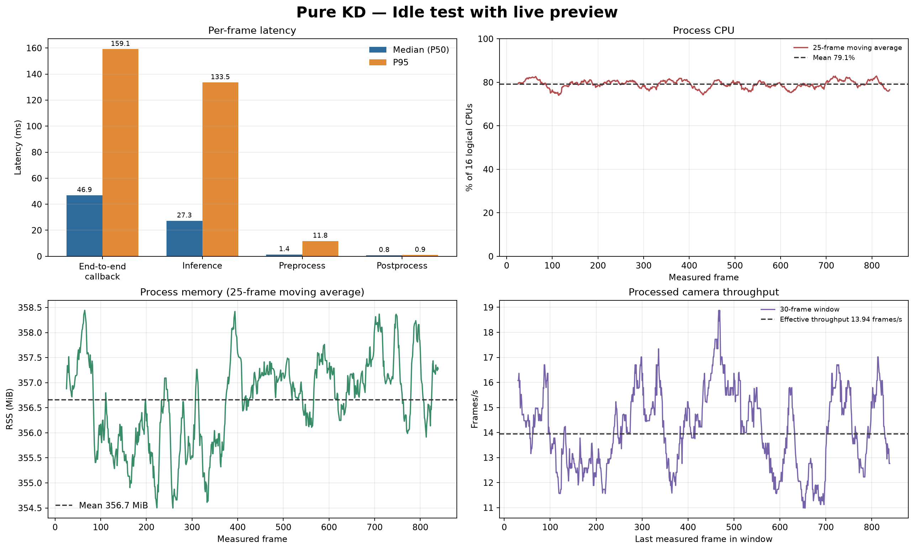

# Experiment 26.1 — Pure KD, Idle Condition

**Result:** the 60.27-second measurement processed **839 measured frames** after 30 warm-up frames. Effective throughput was **13.94 frames/s**, end-to-end callback latency was **46.87 ms median** (**159.14 ms P95**), with **0 frame errors**. SSH-X preview was enabled.

## Conditions and configuration

| Parameter | Value |
|---|---|
| Condition | `servo_idle`, operator-supplied label; motion is not inferred from telemetry |
| Torque | ID 1–20 active in pre-test readback; no gait/position command during the run |
| Manager OP3 | Not running; EEPROM indirect-address initialization failed with torque enabled. Manager/gait load is excluded |
| Model | Pure KD `kd_seed42`; `models/weights/kd_student_best.pt` |
| SHA-256 | `2da0c0e58a5c1884358fe814f8992cda19bb7b58f292edc15f53b9081b6129c3` |
| Compute | CPU FP32; Intel Core i5-1240P, 16 logical CPUs; PyTorch 2.4.1+cpu |
| PyTorch threads | 4 intra-op / 2 inter-op |
| Camera | `/thesis/image_raw`, 640×480; preview `/vision/debug_image` enabled |
| Detection/tracking | imgsz 640; confidence 0.25; IoU 0.45; BoT-SORT |
| Time | 23 Oct 2026 00:21:42–00:22:45 WIB |
| Warm-up / measurement | 30 frames / 60.27 seconds |
| Frames | 869 total; 839 measured frames; 0 errors |

## Runtime performance

Statistics use post-warm-up frames; P95 uses linear interpolation. End-to-end callback includes image conversion, inference/tracking, result creation and publication, and preview publication. Throughput uses processed camera-frame timestamps.

| Metric | Median (P50) | P95 | Maximum |
|---|---:|---:|---:|
| End-to-end callback (ms) | 46.87 | 159.14 | 171.92 |
| Preprocess (ms) | 1.44 | 11.76 | 17.76 |
| Inference (ms) | 27.28 | 133.52 | 141.04 |
| Postprocess (ms) | 0.80 | 0.93 | 3.27 |
| Process CPU (% of 16 logical CPUs) | 79.0% | 87.0% | 90.4% |
| Process RSS (MiB) | 357.4 | 360.0 | 361.5 |

## Detection outputs

| Class | Measured frames with output | Boxes | Median confidence | Track IDs |
|---|---:|---:|---:|---|
| ball | 839/839 (100.0%) | 839 | 0.908 | 1 |
| gawang | 839/839 (100.0%) | 839 | 0.669 | 3 |
| robot | 839/839 (100.0%) | 839 | 0.750 | 2 |

Per-frame class output and confidence describe model behavior in this scene, not accuracy. No frame-aligned ground truth was available, so precision, recall, F1, mAP, and tracking accuracy were not calculated.

SSH-X preview screenshot with bounding boxes and tracking IDs. (lokal: `pratinjau_live_idle_kd_murni.png`)

## Limitations and evidence

The preview was active and `op3_manager` was unavailable, so CPU/RAM excludes manager load. Do not directly compare with the earlier run, which had different preview and thread settings. No gait or servo position command was sent. No continuous video was recorded; evidence consists of the screenshot and per-frame logs. Pre-test servo snapshot: `20261022T172001Z_pretest_all_torque_snapshot.json` (lokal: `../../../../runs/op3_servo_torque_control/20261022T172001Z_pretest_all_torque_snapshot.json`).

- [Indonesian chart](grafik_performa_id.png) · [JSON summary](summary_metrics.json) · [Runtime table](tabel_performa.csv) · [Detection output table](tabel_keluaran_deteksi.csv)
- Raw runtime log (lokal: `../../../../runs/op3_pytorch/20261023_kd_pure_idle_retest_01.csv`) · Detection/tracking log (lokal: `../../../../runs/op3_pytorch/20261023_kd_pure_idle_retest_01_detections.csv`) · Metadata (lokal: `../../../../runs/op3_pytorch/20261023_kd_pure_idle_retest_01.json`)
