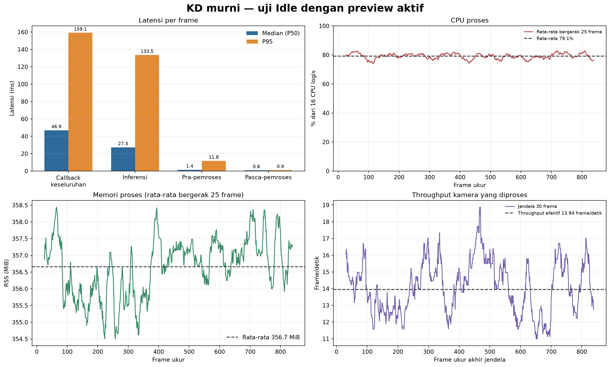

# Percobaan 26.1 — KD murni, kondisi Idle

**Hasil:** sesi ukur 60.27 detik memproses **839 frame ukur** setelah 30 frame warm-up. Throughput efektif **13.94 frame/detik**, callback keseluruhan median **46.87 ms** (P95 **159.14 ms**), dengan **0 error frame**. Preview SSH-X aktif.

## Kondisi dan konfigurasi

| Parameter | Nilai |
|---|---|
| Kondisi | `servo_idle`, label operator; gerak tidak disimpulkan dari telemetri |
| Torque | ID 1–20 aktif pada pemeriksaan pra-uji; tidak ada perintah gait/posisi selama sesi |
| Manager OP3 | Tidak berjalan; inisialisasi EEPROM indirect-address gagal saat torque aktif. Beban manager/gait tidak termasuk |
| Model | KD murni `kd_seed42`; `models/weights/kd_student_best.pt` |
| SHA-256 | `2da0c0e58a5c1884358fe814f8992cda19bb7b58f292edc15f53b9081b6129c3` |
| Komputasi | CPU FP32; Intel Core i5-1240P, 16 CPU logis; PyTorch 2.4.1+cpu |
| Thread PyTorch | 4 intra-op / 2 inter-op |
| Kamera | `/thesis/image_raw`, 640×480; preview `/vision/debug_image` aktif |
| Deteksi/tracking | imgsz 640; confidence 0,25; IoU 0,45; BoT-SORT |
| Waktu | 23 Oct 2026 00:21:42–00:22:45 WIB |
| Warm-up / ukur | 30 frame / 60.27 detik |
| Frame | 869 total; 839 frame ukur; 0 error |

## Performa

Statistik memakai frame setelah warm-up; P95 menggunakan interpolasi linear. Callback keseluruhan mencakup konversi citra, inferensi/tracking, pembuatan dan publikasi hasil, serta preview. Throughput berasal dari timestamp frame kamera yang diproses.

| Metrik | Median (P50) | P95 | Maksimum |
|---|---:|---:|---:|
| Callback keseluruhan (ms) | 46.87 | 159.14 | 171.92 |
| Pra-pemrosesan (ms) | 1.44 | 11.76 | 17.76 |
| Inferensi (ms) | 27.28 | 133.52 | 141.04 |
| Pasca-pemrosesan (ms) | 0.80 | 0.93 | 3.27 |
| CPU proses (% kapasitas 16 CPU logis) | 79.0% | 87.0% | 90.4% |
| RSS proses (MiB) | 357.4 | 360.0 | 361.5 |

## Keluaran deteksi

| Kelas | Frame ukur dengan keluaran | Jumlah kotak | Median confidence | ID track |
|---|---:|---:|---:|---|
| ball | 839/839 (100.0%) | 839 | 0.908 | 1 |
| gawang | 839/839 (100.0%) | 839 | 0.669 | 3 |
| robot | 839/839 (100.0%) | 839 | 0.750 | 2 |

Keluaran kelas pada setiap frame dan confidence menunjukkan perilaku model pada adegan ini, bukan akurasi. Tidak tersedia ground truth selaras frame, sehingga precision, recall, F1, mAP, dan akurasi tracking tidak dihitung.

Screenshot preview SSH-X dengan bounding box dan ID tracking. (lokal: `pratinjau_live_idle_kd_murni.png`)

## Batasan dan bukti

Preview aktif dan `op3_manager` tidak berjalan, sehingga CPU/RAM tidak mencakup beban manager. Jangan bandingkan langsung dengan uji sebelumnya yang memakai status preview dan thread berbeda. Tidak ada gait atau perintah posisi servo. Video kontinu tidak direkam; bukti berupa screenshot dan log per-frame. Snapshot pra-uji: `20261022T172001Z_pretest_all_torque_snapshot.json` (lokal: `../../../../runs/op3_servo_torque_control/20261022T172001Z_pretest_all_torque_snapshot.json`).

- [Grafik English](performance_graph_en.png) · [Ringkasan JSON](summary_metrics.json) · [Tabel performa](tabel_performa.csv) · [Tabel keluaran deteksi](tabel_keluaran_deteksi.csv)
- Log performa mentah (lokal: `../../../../runs/op3_pytorch/20261023_kd_pure_idle_retest_01.csv`) · Log kotak dan tracking (lokal: `../../../../runs/op3_pytorch/20261023_kd_pure_idle_retest_01_detections.csv`) · Metadata (lokal: `../../../../runs/op3_pytorch/20261023_kd_pure_idle_retest_01.json`)
