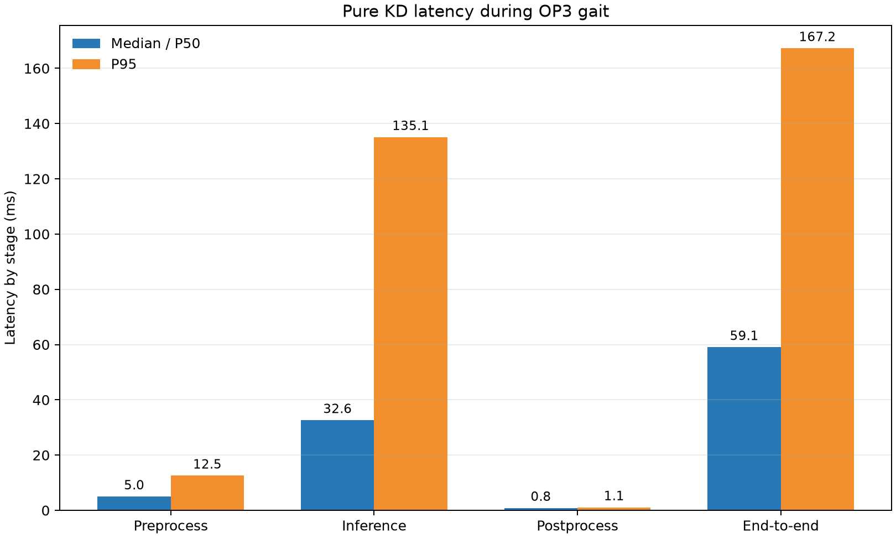
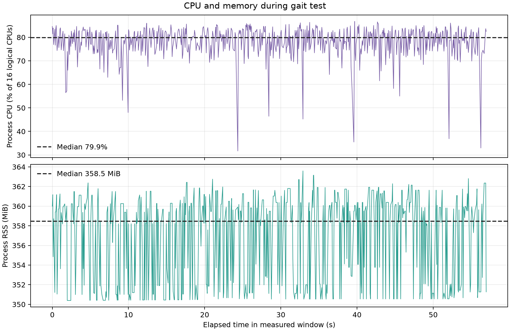
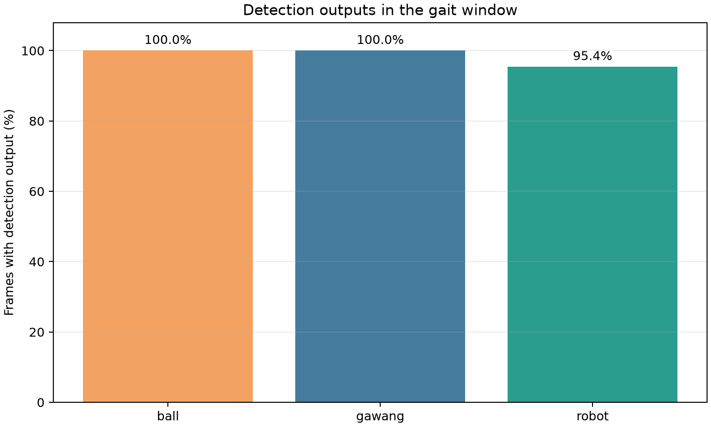

# Experiment 26.2 — Pure KD during OP3 walking

**Result:** in a **57-second verified walking window**, the pure KD model processed **675 frames** at **11.84 effective FPS**. End-to-end callback latency was **59.05 ms median** and **167.24 ms P95**. No frame-processing errors occurred.

## Protocol and configuration

| Parameter | Value |
|---|---|
| Condition | Standard OP3 gait active; operator confirmed walk-ready posture and clear area |
| Run | `20261023_kd_pure_walking_retest_02`; the first attempt is excluded because joint-controller mappings were `none` |
| Analysis window | 23 Oct 2026 00:45:50–00:46:47 WIB (57 s, conservatively selected from the approximately 60 s gait interval) |
| Model | Pure KD `kd_seed42`, `models/weights/kd_student_best.pt` |
| Checkpoint SHA-256 | `2da0c0e58a5c1884358fe814f8992cda19bb7b58f292edc15f53b9081b6129c3` |
| Runtime | CPU FP32; PyTorch 2.4.1+cpu; Ultralytics 8.4.130; 640×640 input |
| Threads | 4 intra-op / 2 inter-op; 16 logical CPUs |
| Threshold / tracker | confidence 0.25; IoU 0.45; BoT-SORT |
| Camera / preview | `/thesis/image_raw` 640×480; SSH-X overlay `/vision/debug_image` active |
| Warm-up | 30 frames; excluded from the 675 measured frames below |
| Robot modules | IDs 1–18 `walking_module`; IDs 19–20 `head_control_module`; no head setpoint sent |

The walking module initially did not control any joints. After applying the standard OP3 module mapping, telemetry confirmed the leg joints were assigned to `walking_module`; the first run remains preserved but is **excluded from walking results**. During the valid session, sampled leg positions changed during gait and stabilized after the normal `stop` command.

## Runtime performance

| Metric | Median/P50 | P95 |
|---|---:|---:|
| Preprocess (ms) | 4.98 | 12.53 |
| Inference (ms) | 32.61 | 135.07 |
| Postprocess (ms) | 0.85 | 1.06 |
| End-to-end callback (ms) | 59.05 | 167.24 |
| Process CPU | 1278.8% of one logical CPU (79.9% of 16 CPUs) | 1357.5% of one logical CPU |
| Process RSS | 358.5 MiB | 361.8 MiB |
| Effective throughput | 11.84 frames/s | — |

## Detection outputs and tracking IDs

| Class | Frames with output | Median confidence | Track ID |
|---|---:|---:|---|
| ball | 675/675 (100.0%) | 0.920 | 1 |
| gawang | 675/675 (100.0%) | 0.629 | 2 |
| robot | 644/675 (95.4%) | 0.747 | 3 |

These percentages describe **model outputs in this scene, not accuracy**. No frame-aligned ground truth was available, so precision, recall, F1, mAP, and tracking accuracy were not calculated. Stable IDs here describe one observed session, not general tracking accuracy.

## Evidence and limitations

Pure KD live overlay while OP3 was walking (lokal: `live_overlay_walking.png`)

No head position target was sent. Pan readback was 0.128917 rad before gait and 0.127383 rad during/after gait (about one encoder count, 0.088°); tilt stayed at −0.403437 rad. The camera therefore remained pointed in essentially the same direction, with a small pan readback change. Mid-run and post-stop telemetry: `telemetry_mid_capture.txt` (lokal: `telemetry_mid_capture.txt`), `telemetry_after_gait_stop.txt` (lokal: `telemetry_after_gait_stop.txt`).

The full run includes data before and after gait; this report uses only the 57-second window stated above. This is one repetition with preview and the OP3 manager active. The earlier idle measurement was captured without the manager, so idle-versus-walking differences are not a controlled comparison.

- [Runtime table CSV](performance_table.csv) · [Detection/tracking table CSV](detection_tracking_table.csv) · [JSON summary](summary_metrics.json)
- [Filtered runtime log](jendela_gait_runtime.csv) · [Filtered detections/tracks](jendela_gait_detections.csv)
- Raw run log (lokal: `../../../../runs/op3_pytorch/20261023_kd_pure_walking_retest_02.csv`) · Run metadata (lokal: `../../../../runs/op3_pytorch/20261023_kd_pure_walking_retest_02.json`)
- Screenshot metadata: [`live_overlay_walking.json`](live_overlay_walking.json)
