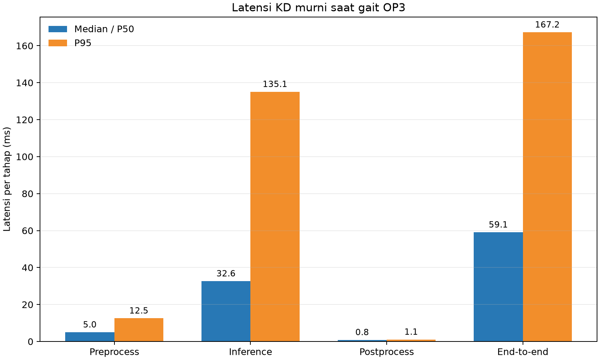
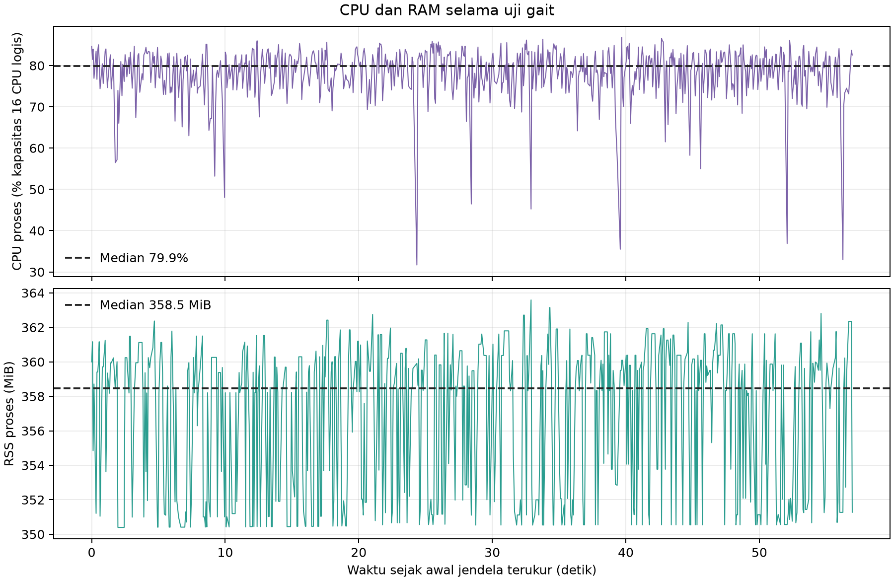
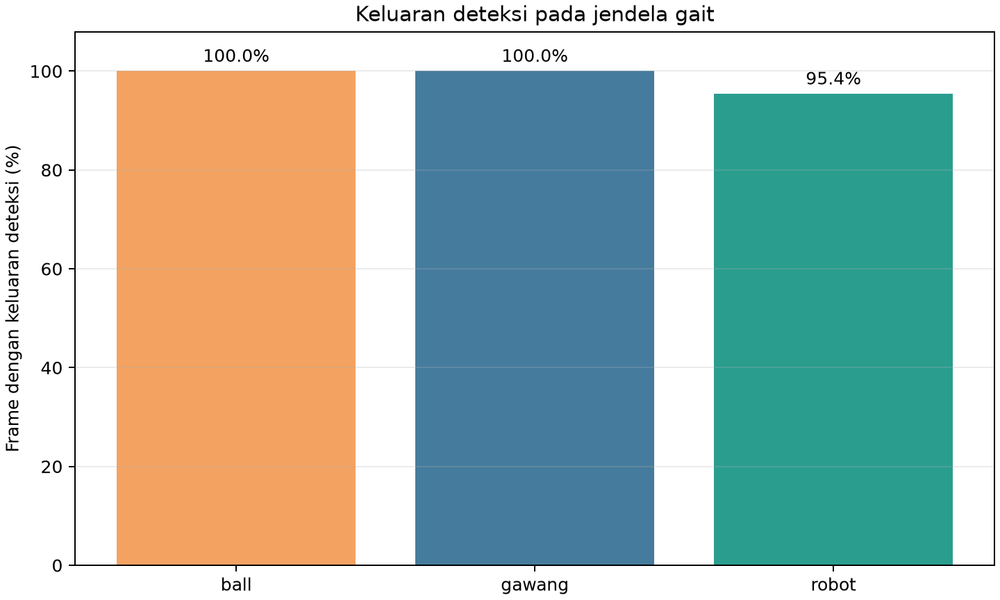

# Percobaan 26.2 — KD murni saat robot berjalan

**Hasil:** pada jendela walking terverifikasi selama **57 detik**, KD murni memproses **675 frame** dengan **11.84 FPS efektif**. Latensi end-to-end median **59.05 ms** dan P95 **167.24 ms**. Tidak ada error pemrosesan frame.

## Protokol dan konfigurasi

| Parameter | Nilai |
|---|---|
| Kondisi | Gait standar OP3 aktif; operator memastikan robot walk-ready dan area kosong |
| Run | `20261023_kd_pure_walking_retest_02`; run percobaan pertama dikecualikan karena mapping kontrol sendi masih `none` |
| Jendela analisis | 23 Okt 2026 00:45:50–00:46:47 WIB (57 detik, dipilih konservatif dari interval gait sekitar 60 detik) |
| Model | KD murni `kd_seed42`, `models/weights/kd_student_best.pt` |
| SHA-256 checkpoint | `2da0c0e58a5c1884358fe814f8992cda19bb7b58f292edc15f53b9081b6129c3` |
| Runtime | CPU FP32; PyTorch 2.4.1+cpu; Ultralytics 8.4.130; input 640×640 |
| Thread | 4 intra-op / 2 inter-op; 16 CPU logis |
| Threshold / tracker | confidence 0,25; IoU 0,45; BoT-SORT |
| Kamera / preview | `/thesis/image_raw` 640×480; overlay SSH-X `/vision/debug_image` aktif |
| Warm-up | 30 frame; tidak masuk hitungan 675 frame di bawah |
| Modul robot | ID 1–18 `walking_module`; ID 19–20 `head_control_module`; tidak ada perintah setpoint kepala |

Modul walking sempat tidak mengendalikan sendi pada percobaan pertama. Setelah pemetaan modul resmi OP3 diterapkan, telemetry mengonfirmasi kaki berada di `walking_module`; run pertama tetap disimpan sebagai bukti tetapi **tidak dipakai sebagai hasil walking**. Pada sesi valid, sampel posisi kaki berubah selama gait dan kembali stabil setelah perintah `stop`.

## Performa runtime

| Metrik | Median/P50 | P95 |
|---|---:|---:|
| Pra-pemrosesan (ms) | 4.98 | 12.53 |
| Inferensi (ms) | 32.61 | 135.07 |
| Pasca-pemrosesan (ms) | 0.85 | 1.06 |
| End-to-end callback (ms) | 59.05 | 167.24 |
| CPU proses | 1278.8% dari 1 CPU logis (79.9% dari 16 CPU) | 1357.5% dari 1 CPU logis |
| RSS proses | 358.5 MiB | 361.8 MiB |
| FPS efektif | 11.84 frame/detik | — |

## Keluaran deteksi dan tracking

| Kelas | Frame dengan keluaran | Median confidence | ID track |
|---|---:|---:|---|
| ball | 675/675 (100.0%) | 0.920 | 1 |
| gawang | 675/675 (100.0%) | 0.629 | 2 |
| robot | 644/675 (95.4%) | 0.747 | 3 |

Persentase ini adalah **keluaran model pada adegan tersebut, bukan akurasi**. Tidak ada ground truth selaras frame, jadi precision, recall, F1, mAP, dan akurasi tracking tidak dihitung. ID yang tetap sama pada log ini menunjukkan konsistensi ID yang diamati selama satu sesi, bukan ukuran akurasi tracking umum.

## Bukti dan keterbatasan

Screenshot overlay live KD murni selama robot berjalan (lokal: `live_overlay_walking.png`)

Kepala tidak menerima target posisi. Pan terbaca 0,128917 rad sebelum gait dan 0,127383 rad pada sampel selama/setelah gait (selisih sekitar satu count, 0,088°); tilt terbaca tetap −0,403437 rad. Karena itu kamera praktis tetap menghadap arah yang sama, dengan variasi readback kecil pada pan. Telemetry tengah dan akhir tersedia di `telemetry_mid_capture.txt` (lokal: `telemetry_mid_capture.txt`) dan `telemetry_after_gait_stop.txt` (lokal: `telemetry_after_gait_stop.txt`).

Run lengkap memuat data sebelum dan sesudah gait; angka laporan hanya memakai jendela 57 detik yang ditentukan di atas. Ini satu ulangan, preview aktif, dan manager robot aktif. Hasil idle sebelumnya dibuat tanpa manager, jadi selisih performa idle-vs-walking belum merupakan perbandingan terkontrol.

- [Tabel performa CSV](tabel_performa.csv) · [Tabel deteksi/tracking CSV](tabel_deteksi_tracking.csv) · [Ringkasan JSON](summary_metrics.json)
- [Log runtime terfilter](jendela_gait_runtime.csv) · [Log bbox/tracking terfilter](jendela_gait_detections.csv)
- Log run mentah (lokal: `../../../../runs/op3_pytorch/20261023_kd_pure_walking_retest_02.csv`) · Metadata run (lokal: `../../../../runs/op3_pytorch/20261023_kd_pure_walking_retest_02.json`)
- Screenshot metadata: [`live_overlay_walking.json`](live_overlay_walking.json)
