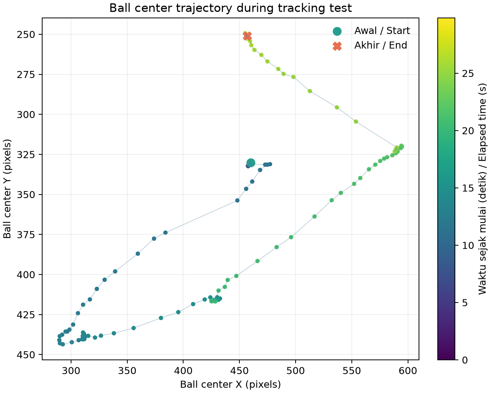
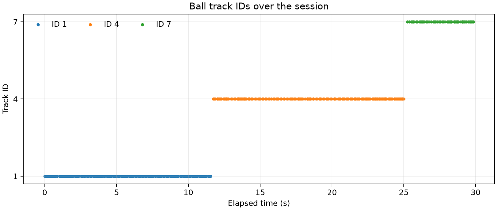
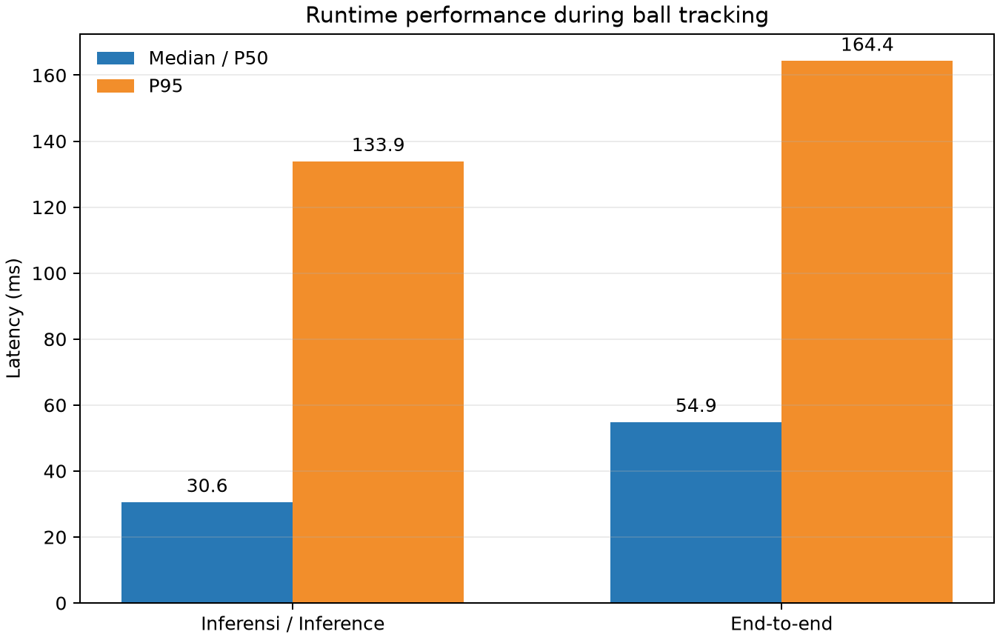

# Experiment 26.3 — Pure KD ball tracking

**Result:** during the **29.84-second** operator-driven ball movement window, the model processed **357 frames** at **11.93 FPS**. The ball was detected in **353/357 frames (98.9%)**. The detected ball-center span was **305.1 px** horizontally and **194.2 px** vertically. The tracker emitted **3 ball IDs**, with **2 ID transitions** between consecutive detections.

## Conditions and configuration

| Parameter | Value |
|---|---|
| Run ID | `20261023_kd_pure_tracking_moving_ball_01` |
| Robot condition | `unknown` (gait was stopped; physical state was not independently verified for this session) |
| Target movement | Operator moved the ball for about 30 s; no servo or gait command was sent |
| Analysis window | 23 Oct 2026 00:50:20–00:50:50 WIB; 357 frames, 29.84 s actual |
| Model | Pure KD `kd_seed42`; SHA-256 `2da0c0e58a5c1884358fe814f8992cda19bb7b58f292edc15f53b9081b6129c3` |
| Runtime | CPU FP32; PyTorch 2.4.1+cpu; Ultralytics 8.4.130; 4 intra-op / 2 inter-op threads |
| Camera and preview | `/thesis/image_raw` 640×480; SSH-X preview `/vision/debug_image` active |
| Tracker | BoT-SORT; confidence 0.25; IoU 0.45; imgsz 640 |
| Frame errors | 0 |

## Ball motion and ID continuity

Detected centers ranged from X=289.6–594.7 px and Y=249.4–443.6 px. Track IDs: 1 (137 frames), 4 (162 frames), 7 (54 frames). Two ID transitions occurred while the ball remained detected in nearly all frames. The tracker followed the ball’s changing position, but one ID did not persist throughout the session.

## Object outputs and runtime performance

| Class | Frames with output | Median confidence | Track IDs |
|---|---:|---:|---|
| ball | 353/357 (98.9%) | 0.915 | 1, 4, 7 |
| gawang | 357/357 (100.0%) | 0.592 | 3 |
| robot | 342/357 (95.8%) | 0.609 | 2 |

| Runtime metric | Median/P50 | P95 |
|---|---:|---:|
| Inference (ms) | 30.59 | 133.93 |
| End-to-end callback (ms) | 54.90 | 164.35 |
| Process CPU | 1264.7% of one logical CPU (79.0% of 16 CPU capacity) | 1374.3% of one logical CPU |
| Process RSS | 356.2 MiB | 361.5 MiB |

Live overlay screenshot while the ball was moving (lokal: `live_overlay_tracking.png`)

## Interpretation and limits

Detection outputs, confidence, coverage, and ID changes are descriptive results from one session, not accuracy. No frame-aligned ground-truth positions or identities were available, so tracking accuracy, precision, recall, F1, and mAP were not computed. The raw run continued for about 15 seconds after the operator’s 30-second movement window; this report’s tables and plots use only the 30-second movement interval.

- [Tracking table CSV](tracking_table.csv) · [Class-output table CSV](tracking_table.csv) · [Metrics JSON](summary_metrics.json)
- [Filtered runtime log](jendela_tracking_runtime.csv) · [Filtered boxes and IDs](jendela_tracking_detections.csv)
- Raw run (lokal: `../../../../runs/op3_pytorch/20261023_kd_pure_tracking_moving_ball_01.csv`) · Raw detections (lokal: `../../../../runs/op3_pytorch/20261023_kd_pure_tracking_moving_ball_01_detections.csv`) · Metadata (lokal: `../../../../runs/op3_pytorch/20261023_kd_pure_tracking_moving_ball_01.json`)
- Screenshot metadata: [`live_overlay_tracking.json`](live_overlay_tracking.json)
