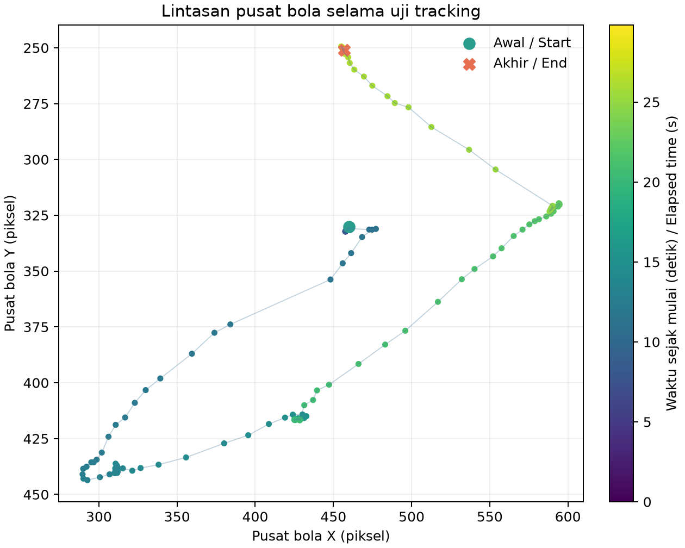
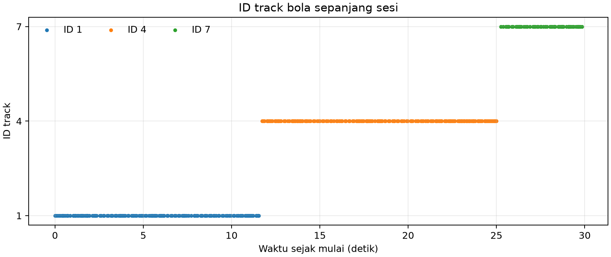
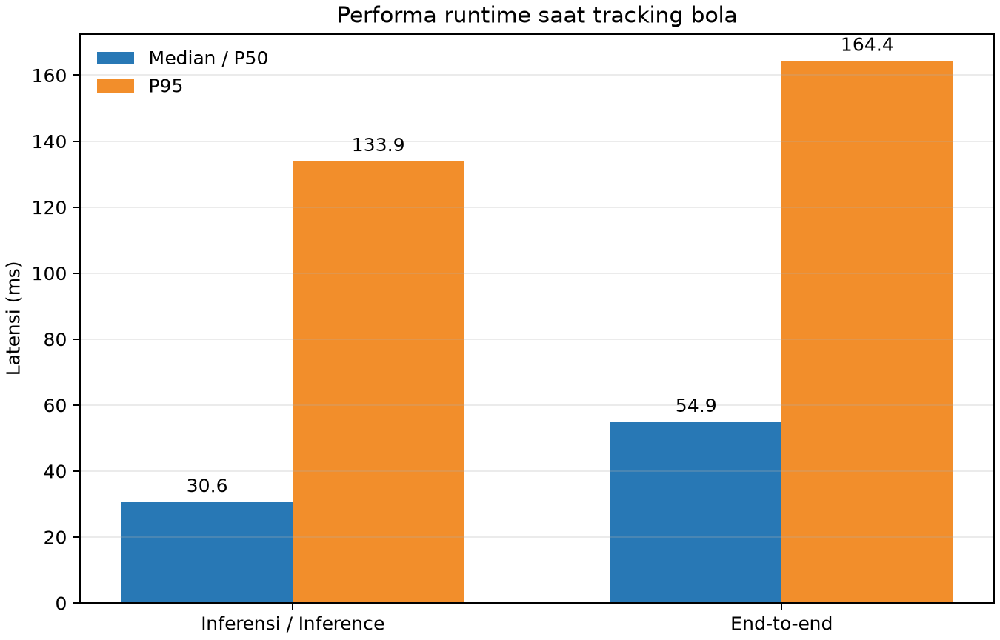

# Percobaan 26.3 — Tracking bola KD murni

**Hasil:** dalam jendela **29.84 detik** saat operator menggerakkan bola, model memproses **357 frame** pada **11.93 FPS**. Bola terdeteksi pada **353/357 frame (98.9%)**. Pusat kotak bola menjangkau rentang **305.1 px** pada sumbu X dan **194.2 px** pada sumbu Y. Tracker mengeluarkan **3 ID bola** dengan **2 peralihan ID** di antara deteksi berurutan.

## Kondisi dan konfigurasi

| Parameter | Nilai |
|---|---|
| Run ID | `20261023_kd_pure_tracking_moving_ball_01` |
| Kondisi robot | `unknown` (gait dihentikan; kondisi fisik tidak diverifikasi independen untuk sesi ini) |
| Gerak target | Operator menggerakkan bola sekitar 30 detik; tidak ada perintah servo atau gait |
| Jendela analisis | 23 Okt 2026 00:50:20–00:50:50 WIB; 357 frame, 29,84 detik aktual |
| Model | KD murni `kd_seed42`; SHA-256 `2da0c0e58a5c1884358fe814f8992cda19bb7b58f292edc15f53b9081b6129c3` |
| Runtime | CPU FP32; PyTorch 2.4.1+cpu; Ultralytics 8.4.130; 4 intra-op / 2 inter-op thread |
| Kamera dan preview | `/thesis/image_raw` 640×480; preview SSH-X `/vision/debug_image` aktif |
| Tracking | BoT-SORT; confidence 0,25; IoU 0,45; imgsz 640 |
| Error frame | 0 |

## Gerak bola dan kesinambungan ID

Pusat bola terdeteksi dari X=289.6–594.7 px dan Y=249.4–443.6 px. ID yang tercatat: 1 (137 frame), 4 (162 frame), 7 (54 frame). Dua peralihan ID terlihat walau deteksi bola hadir di hampir seluruh jendela. Ini menunjukkan tracker mengikuti posisi bola, tetapi ID tidak bertahan sebagai satu identitas sepanjang sesi.

## Keluaran objek dan performa

| Kelas | Frame dengan keluaran | Median confidence | ID track |
|---|---:|---:|---|
| ball | 353/357 (98.9%) | 0.915 | 1, 4, 7 |
| gawang | 357/357 (100.0%) | 0.592 | 3 |
| robot | 342/357 (95.8%) | 0.609 | 2 |

| Metrik runtime | Median/P50 | P95 |
|---|---:|---:|
| Inferensi (ms) | 30.59 | 133.93 |
| End-to-end callback (ms) | 54.90 | 164.35 |
| CPU proses | 1264.7% satu CPU logis (79.0% kapasitas 16 CPU) | 1374.3% satu CPU logis |
| RSS proses | 356.2 MiB | 361.5 MiB |

Screenshot overlay live saat bola bergerak (lokal: `live_overlay_tracking.png`)

## Interpretasi dan batasan

Keluaran, confidence, cakupan deteksi, dan perubahan ID adalah statistik satu sesi, bukan akurasi. Tidak ada ground truth posisi atau ID objek per frame, sehingga akurasi tracking, precision, recall, F1, dan mAP tidak dihitung. Run mentah berlanjut sekitar 15 detik setelah jendela operator 30 detik; tabel dan grafik di laporan ini hanya memakai 30 detik gerak bola.

- [Tabel tracking CSV](tabel_tracking.csv) · [Tabel kelas CSV](tracking_table.csv) · [JSON metrik](summary_metrics.json)
- [Log runtime terfilter](jendela_tracking_runtime.csv) · [Log kotak dan ID terfilter](jendela_tracking_detections.csv)
- Run mentah (lokal: `../../../../runs/op3_pytorch/20261023_kd_pure_tracking_moving_ball_01.csv`) · Deteksi mentah (lokal: `../../../../runs/op3_pytorch/20261023_kd_pure_tracking_moving_ball_01_detections.csv`) · Metadata (lokal: `../../../../runs/op3_pytorch/20261023_kd_pure_tracking_moving_ball_01.json`)
- Metadata screenshot: [`live_overlay_tracking.json`](live_overlay_tracking.json)
